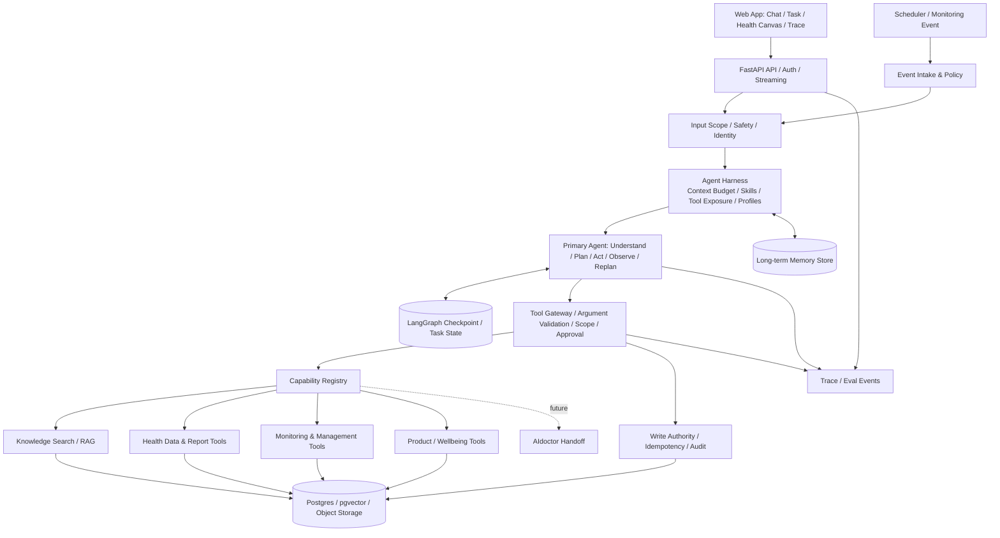
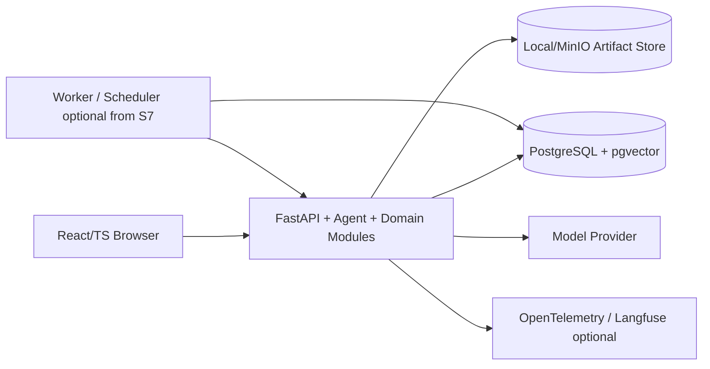
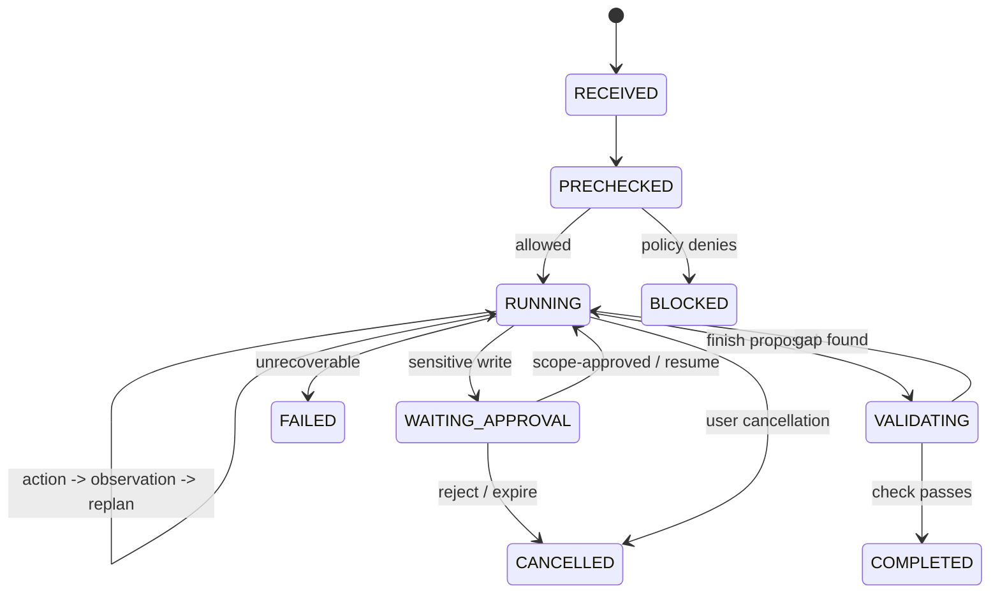
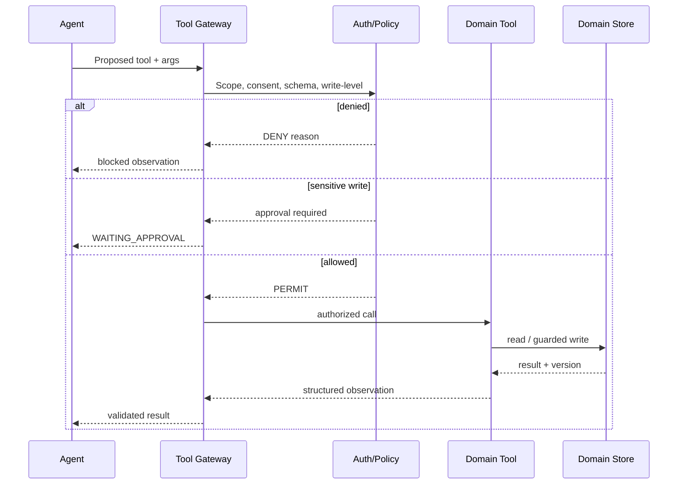
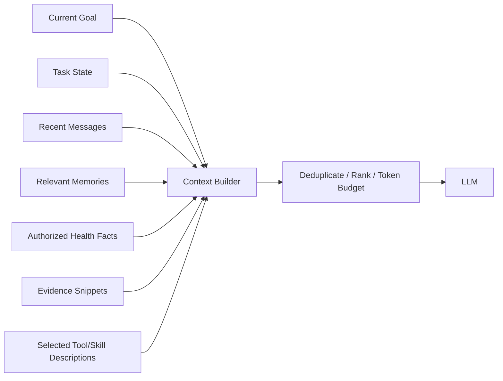
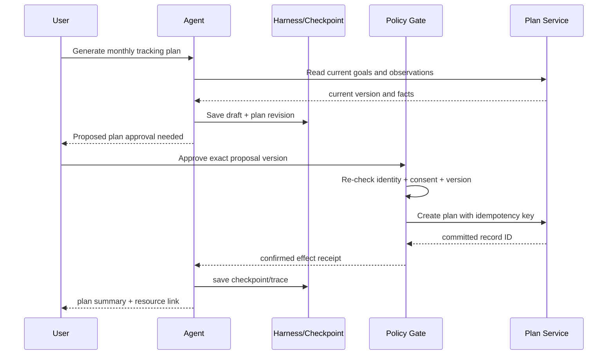

# HealthAgent — 03 系统总体架构（详细设计 V4.0）

## V4.2 命名与追踪说明

统一使用语义名称标识组件、领域、实验和八大智能；开发阶段使用 S0–S8；正式测试案例使用 T-001 格式。规范见 `../README.md` 和 `../traceability.json`。

## 0. 架构设计结论（供开发时快速复核）

1. **Agent-first、模块化单体、渐进领域化**：第一版是能完成非医疗任务的通用 Agent；健康能力以后通过独立工具/知识/领域服务加入，不反向侵入 Agent Core。
2. **一个 Primary Agent + 可选委派**：只有经 Benchmark 证明能降低复杂度或提高效果时才加入 Subagent；不用“一个业务功能一个 Agent”的模式。
3. **框架提供 Runtime，项目重点在 Harness 与业务策略**：以 LangGraph 的执行图、持久化、暂停恢复为基础；自己实现可测试的上下文装配、能力选择、记忆策略、规划反馈及评测，不重造事务调度器。
4. **LLM 不拥有事实与副作用写入权威**：健康事实由数据服务维护；计划/提醒/订单由业务服务维护；模型只能提出动作，经过身份、参数、策略和必要审批后执行。
5. **可复现性优先**：最初即具备合成用户、固定任务集、工具模拟器、运行 Trace；“功能可用”和“Agent 技术有效”分别验收。
6. **医疗是场景而非 Core 耦合**：知识回答、健康数据、报告解读、导购、慢病工具、研究性预测与情感支持按阶段增加，问诊系统作为后期受控外部能力。

### 0.1 目标、范围及约束

| 维度 | 架构目标 | 边界/限制 |
|---|---|---|
| 自主执行 | 在工具可用情况下完成多步目标、观察、重规划 | 不承诺任意目标都能自主执行 |
| 可扩展 | 新增领域能力不修改 Agent 的核心决策循环 | 需要注册工具、权限、知识及测试 |
| 连续性 | 对话、任务与长记忆分别治理 | 不允许将历史聊天直接当作临床事实 |
| 安全 | 工具调用、写操作、通知都有确定性门禁 | 不实现自主诊断、处方或真实购药交易 |
| 可解释 | 能复盘“选了什么工具、根据什么结果继续” | 不暴露模型隐含推理过程；展示可审计行动证据 |
| 个人可运行 | Docker Compose 本地一键启动核心系统 | 不预建设 K8s/消息集群/分布式多租户 |
| 求职展示 | 可运行 Demo、评测数据、调参和消融报告 | 禁止以模拟数据宣称临床有效性 |

### 0.2 架构假设和待证伪点

- 默认单人或少量测试账号、合成健康资料、非生产医疗场景；不假设有医院业务授权。
- 至少有一个能稳定调用 Tool Calling 的模型；供应商和模型版本通过配置替换。
- 无强需求则 PostgreSQL 一库承担业务数据、Checkpoints、长期记忆和 pgvector 检索；不同 Schema / Table 隔离语义。
- 浏览器可视化可先用 SVG 人体模型，在用户价值确认后再升级为 3D。
- “优于固定工作流”“动态 Skills 有收益”等都是**实验假设**，不是当前已有事实。

## 1. 架构原则与关键决策 ADR

### ADR-01：单 Primary Agent 而不是七个并列业务 Agent

**选择**：模型驱动主 Agent；子任务优先通过 Tool/Skill 完成。  
**原因**：多 Agent 会增加上下文传递、协调延迟、费用、测试复杂度；初期并无多代理必要性证据。  
**替代方案**：Router + 各专业 Agent，暂不采用。  
**重新评估触发**：独立研究子任务很长、互不共享上下文、可并行且 A/B 测试证明收益。

### ADR-02：LangGraph 作为执行基础，不重写 Runtime

**选择**：使用成熟框架提供状态运行、checkpoint、中断/恢复基础；Agent 行动策略封装在业务层。  
**原因**：过去投入于自研 Runtime 的成本较高，本项目主目标是展示 Agent 智能执行与效果。  
**风险**：框架升级、API 迁移；通过版本锁定、适配器和契约测试应对。

### ADR-03：Harness 独立于 Agent Loop 的“能力组合层”

**选择**：Harness 提供 context budget、task workspace、skills disclosure、memory policy、tool exposure、approval policy、tracing hooks 等；底层 Runtime 负责执行/持久化。  
**区别**：Agent = 做什么、下一动作如何选；Harness = 以怎样的上下文、工具和控制环境支持 Agent；Runtime = 状态运行及恢复。  
**限制**：初期不自行开发通用虚拟文件系统和沙箱执行平台，只做场景必需的可替换适配。

### ADR-04：业务数据源权威与 Agent 认知分离

健康数据、商品目录、管理任务拥有各自确定性 Source of Truth。Agent 消息、对话摘要、长期记忆可引用这些数据，但不能冒充它们；每一项健康事实要有主体、来源、有效时间、记录时间与更正机制。

### ADR-05：内部工具优先 Python，跨进程工具才优先 MCP

将本地纯计算函数全部封装为 MCP 会加重维护。先使用统一 Tool 契约，按需提供 `PythonToolAdapter`、`MCPToolAdapter`、`HTTPToolAdapter`；权限策略在适配器之外集中执行。

### ADR-06：评测与事件追踪从首版落地

每次运行记录输入版本、模型配置、可用工具、决策动作、工具结果、耗时、成本与状态变化；最终业务正确性由独立断言判断，不以模型“说完成了”为准。

## 2. 系统上下文与参与者

### 2.1 参与者

| 角色/系统 | 向本系统输入 | 从系统获得 | 信任关系 |
|---|---|---|---|
| 普通用户 | 目标、问题、文件、授权、修改 | 响应、任务与数据视图 | 登录后隔离本人数据 |
| 开发/演示者 | 合成种子、评测配置 | Trace、指标、调试面板 | 仅开发环境管理权限 |
| LLM Provider | 模型推断 API | 有预算与权限的上下文 | 第三方服务；脱敏与发送边界 |
| 医学知识来源 | 文档/元信息 | 被检索的证据文本 | 低信任内容，不是系统指令 |
| 工具/外部服务 | 结构化输出、故障信息 | 受控调用参数 | 验证返回内容与数据主体 |
| AIdoctor（后期） | 受控问诊接口与结果 | 经授权的上下文摘要 | 独立医疗安全责任域 |
| Scheduler/Worker | 到期事件、监测规则触发 | 调用结果与任务状态 | 机器身份受限 |

### 2.2 信任边界

- **T0 本地确定性应用代码**：身份认证、资源所有权、业务提交、授权、审计。
- **T1 LLM 生成结果**：规划、参数、总结、记忆候选，均需结构化验证。
- **T2 外部/用户内容**：用户上传文档、网页、检索片段、MCP Tool 返回信息；禁止作为高级系统指令执行。
- **T3 外部服务执行**：HTTP/MCP/数据库等存在超时、错误和不一致风险。
- **T4 研究性医学模型**：产生概率/风险估计但不能自动转化为诊疗决定。

## 3. 总体逻辑架构



> `Harness` 与 `Agent` 逻辑分离，不意味着引入两个独立服务；V1 在同一个 Python 进程内模块化实现。`Checkpoint` 只保证框架状态持久化，不自动保证外部副作用 Exactly-once。

### 3.1 物理部署（起步版本）



**最小运行单元**：`web`, `api`, `postgres`。文档/报告文件起步可放本地持久卷并保存文件引用，规模增加后迁移到对象存储。Trace 初期可使用本地事件表 + JSON，后再对接 Langfuse；不让外部 SaaS 成为本地 Demo 的硬依赖。

### 3.2 逻辑职责与调用权

| 组件 | 主要职责 | 可以做 | 不可以做 |
|---|---|---|---|
| API/BFF | 登录、会话/任务 API、事件流 | 校验用户身份、分派任务 | 自行推断医疗结论 |
| Agent Core | 根据目标决定下一步 | 调用获准工具、澄清、重规划 | 直接提交关键业务状态 |
| Harness | 准备能力与执行环境 | 预算、Context、可见工具、Skills | 绕开 Tool Gateway |
| Tool Gateway | 验证并执行动作 | 鉴权、Schema、审批、幂等、审计 | 让模型自行判断写权限 |
| Domain Services | 提供确定性领域能力 | 计算、读写拥有的业务资源 | 自行改写 Agent 的会话状态 |
| Data & Memory | 持久化来源明确的数据 | 版本化、纠正、删除 | 把推测强制升级为事实 |
| Eval/Trace | 记录行动证据与指标 | 重放测试、诊断、聚合 | 修改线上任务结果 |

## 4. 主 Agent 运行机制与控制平面

### 4.1 通用任务生命期

`RECEIVED → PRECHECKED → RUNNING ↔ WAITING_APPROVAL → VALIDATING → COMPLETED`；异常/终止包含 `FAILED`、`CANCELLED`、`BLOCKED`。恢复后的 `RUNNING` 必须重新验证当前权限、工具版本及数据有效性。



### 4.2 Loop 的最小语义

1. **Intake**：生成独立 `conversation_id`、`task_id`、`trace_id`，绑定主体及权限；消息需区分普通聊天、任务请求和事件触发。
2. **Precheck**：处理高风险输入、非法操作和缺失授权；必要时立即停止普通规划。
3. **Context Assembly**：选取本轮相关消息、任务目标、已验证事实、记忆摘要、工具说明和约束，按 token 预算排序。
4. **Decide**：模型提出 `answer | clarify | call_tool | request_approval | revise_plan | delegate(可选)`；输出校验失败时走受控纠错，不直接执行。
5. **Policy & Execute**：根据身份、对象、工具模式、读写级别校验，调用工具并记录观察结果；不可逆操作经过审批。
6. **Observe & Replan**：识别已完成/局部失败/目标变更/数据矛盾；保留已验证结果，必要时更新计划版本。
7. **Validate & Respond**：检查任务目标和最终业务状态；输出引用来源、缺失信息及明确限制。
8. **Persist**：Checkpoint、Trace 和符合记忆策略的候选内容分别保存。

**终止保护**：全局最大步数、累计工具调用、Token/成本预算、墙钟时长以及同一失败动作重复阈值。超额返回可解释的部分结果和下一步选择，不隐藏失败。

### 4.3 模型职责和确定性代码边界

| 决策 | 模型是否参与 | 最终权威 |
|---|---|---|
| 用户意图、下一工具、回复草案 | 是 | Agent 策略 + 模型 |
| 工具参数草案 | 是 | Tool Schema 校验 |
| 某主体是否有读取权限 | 否 | 身份/资源策略服务 |
| 是否超过预设医学阈值 | 否（可解释结果） | 验证过的领域规则/算法 |
| 新事实是否正式写入健康档案 | 可提出候选 | 数据归属服务 + 确认/证据 |
| 是否应向第三方发通知 | 可建议 | 用户明确授权 + 通知策略 |
| 任务是否完成 | 可以提议 | 结果验证器/业务状态断言 |

## 5. Harness 结构与研究位置

### 5.1 结构

`Agent Harness = Model Profile + Context Builder + Task Workspace + Skill Resolver + Tool Exposure + Budgets + Policy Hooks + Observation Hooks + Optional Delegation`。

- **Model Profile**：模型路由、温度、最大输出、Tool Calling 兼容级别、重试限制。
- **Context Builder**：精简消息历史、读取 Task State、检索相关 Memory、引用领域数据摘要，控制去重与预算。
- **Task Workspace**：当前目标、计划步骤、已证实观察、产物引用、待解决约束；可用数据库映射，不必先建虚拟文件系统。
- **Skill Resolver**：根据任务检索合适的 Skill 指令与可用工具目录；Skill 不具有高于系统策略的权限。
- **Tool Exposure**：最小权限原则，模型只看到当前主体和任务允许的工具。
- **Budget/Policy Hooks**：任务耗时、token、工具次数、风险操作约束。
- **Observation Hooks**：动作、参数摘要、版本、结果和状态变化进入 Trace。
- **Optional Delegation**：只有多 Agent 实验成立时才开启。

### 5.2 演进模式

| 模式 | 组成 | 用途 |
|---|---|---|
| H0 Bare Agent | 模型 + 少量工具 + 简单状态 | 求出 Baseline |
| planning-strategy Task-aware | 增加可见计划/完成条件 | 多步规划实验 |
| context-strategy Context-aware | 增加预算、记忆过滤、结果裁剪 | 长会话/长期任务 |
| skill-loading Capability-aware | Skills 检索、动态 Tool Exposure | 工具规模扩大时 |
| recovery-strategy Reliable Execution | Checkpoint、审批、幂等、副作用审计 | 长期任务与写操作 |
| subagent-comparison Delegation (optional) | 受限子 Agent | 仅有测试收益时 |

这些是设计内部的渐进实验配置，不意味着要并行建设六套产品。专题实验与对照细节交由文档 07。

## 6. Capability / Tool / Skill / MCP 架构

### 6.1 核心实体

| 实体 | 最少元数据 | 运行意义 |
|---|---|---|
| Capability | id、domain、version、description、required_scopes | 业务能力的逻辑标识 |
| Tool | name、input_schema、output_schema、side_effect_level、timeout、idempotency | 一次具体调用 |
| Skill | name、intent_examples、instructions_ref、tool_allowlist、version | 复杂任务方法或领域策略 |
| Knowledge Collection | corpus_id、license、source、version、language、validity | 检索范围与证据来源 |
| Policy | id、version、condition、effect、reason | 明确的禁止/审批/准入决策 |

**Skill** 是可按需加载的指导信息和工具组合，不是一个任意提升权限的 Prompt；**Tool** 是可执行接口；**MCP** 是跨进程/进程外能力的连接协议；三者不是一回事。

### 6.2 Tool 调用合同（架构级示意）

```json
{
  "call_id": "uuid",
  "task_id": "uuid",
  "actor_scope": {"user_id": "u_1", "patient_id": "p_1"},
  "tool_name": "health.get_observations",
  "tool_version": "1.0",
  "arguments": {"codes": ["body_weight"], "date_from": "2026-01-01"},
  "idempotency_key": null,
  "deadline_ms": 10000
}
```

```json
{
  "call_id": "uuid",
  "status": "SUCCEEDED",
  "data": {"count": 3, "records_ref": "artifact://task/123/observations"},
  "evidence_refs": ["record:observation-1"],
  "source_version": "2026-10-16",
  "warnings": [],
  "effect": {"type": "NONE", "resource_ref": null}
}
```

这是**语义示例而非冻结的 Pydantic 定义**。错误状态最少区分 `INVALID_INPUT / PERMISSION_DENIED / APPROVAL_REQUIRED / TIMEOUT / UNAVAILABLE / RETRYABLE_FAILURE / UNKNOWN_EFFECT / SUCCEEDED`；对 `UNKNOWN_EFFECT` 必须先核对执行事实，禁止直接重试写操作。

### 6.3 调用边界流程



### 6.4 MCP 接入准则

- 首先使用本地函数抽象，再抽出第三方/跨进程 MCP server；对 MCP Server 施行固定服务器白名单、来源信任、凭据隔离。
- 使用官方 MCP SDK，遵守所选协议版本的能力协商与授权要求；不自造协议层细节。
- 工具返回是**低信任数据**：禁止将结果文本提升为系统指令；长度裁剪和敏感信息处理均在 Gateway 完成。
- 仅展示用户获准使用的工具；高风险/写操作需要明确确认，保留可追溯 Tool Call。

## 7. 数据、状态与记忆架构

### 7.1 四种完全不同的状态

| 类别 | 示例 | 所有权 | 更新机制 | 保留策略 |
|---|---|---|---|---|
| Conversation | 用户消息、可见助手回答 | Conversation Service | 追加/软删除 | 用户可删除 |
| Task / Checkpoint | 目标、步骤、plan_revision、graph state | Agent Execution / Checkpointer | 框架检查点、任务变更 | TTL/任务归档 |
| Memory | 沟通偏好、约定、长期目标 | Memory Service | 候选→授权/筛选→版本更新 | 查看、纠正、删除 |
| Domain Facts/State | 健康数值、报告、计划、提醒 | 各领域服务 | 证据/确认、版本、审计 | 按来源许可与保留政策 |

**禁止**：`messages[-1]` 代表用户健康状态；从用户一句话直接写 `ClinicalFact`；把任务 Trace 存入长期记忆并无期限注入所有会话。

### 7.2 状态标识与隔离

每次请求绑定 `tenant_id`（个人演示可固定值）、`user_id`、`subject_id/patient_id`、`conversation_id`、`task_id`、`trace_id`；记录中至少按拥有者约束查询。`subject_id` 不一定等于当前用户本人（例如父母的设备导购），必须有明确主体归属与授权，不从自然语言推断即可访问他人档案。

### 7.3 事实时间与来源

健康观测建议包含：`subject_id / code / value / unit / reference_range / effective_at / recorded_at / source_type / source_ref / verification_state / supersedes_id`。

- **effective_at**：事实适用或测量发生时间；**recorded_at**：系统获知时间；二者不必相同。
- **source_type**：合成 FHIR、用户输入、报告解析、外部设备等，不得伪装权威。
- **verification_state**：已验证、用户自述、待核实、无效等；模型推测另存分析结果。
- **supersedes_id**：更正后关联旧记录，不应简单覆盖丢失历史。

### 7.4 长期记忆生命周期

`CANDIDATE → (REJECTED | ACCEPTED) → ACTIVE → (SUPERSEDED | EXPIRED | DELETED)`。

记忆应包含类别、来源、同意与作用域、有效时间、置信依据、最近确认时间；实际是否应该影响回答取决于当前任务和时效评估。不同医疗/情感敏感信息采用默认不自动写入的保守策略。

### 7.5 Context Assembly 和数据投影



避免全量拼接：优先当前任务与明确规则，再放已验证事实、相关历史、检索证据和工具说明。超额时压缩低价值的工具结果；带来源与关键数值的证据不能被无损性不明的摘要悄悄替换。

## 8. Knowledge & RAG 总体架构

### 8.1 知识流水线

`Authorized Source → Ingestion → Parse → Dedup → Chunk → Metadata/License → Embedding → Hybrid Index → Rerank → Evidence Pack → Answer`。

元数据至少含来源 URL/文献 ID、许可状态、发布时间/更新日期、领域、语言、内容版本与切片定位。公开可读不意味着可以任意复制全文并重新分发。

### 8.2 检索模式

- **Direct Answer**：无知识依赖的基础问题可直接回答（并标记知识不确定性）。
- **Evidence-seeking**：用户需要医学知识时优先召回可信来源，并保留每项结论到片段的引用。
- **Agentic Retrieval**：多跳问题通过重写查询、分步检索、证据比较完成，但要限制调用预算。
- **Personal Data Query**：个人体检/历史数据只能走 Health Data Tool，不能将私有事实混入共享 RAG 索引。

### 8.3 检索质量门槛

检索层测 Recall@k、MRR/nDCG（若有标注）；生成层测 supported-claim ratio、citation correctness、unsupported claims、拒答/不确定性表达。第一版应有“答不上来”的测试，避免无证据硬答。

## 9. 领域能力隔离及演进

| 领域 | 首次接入 | 技术承载 | 主要状态 | 风险门禁 |
|---|---|---|---|---|
| 健康科普 | S3 | RAG/Knowledge Tool | 来源与版本 | 医学信息不替代诊疗 |
| 健康中心 | S4 | Health Data API + SVG/3D | HealthFact/Observation | 主体授权、无数据区分 |
| 报告解读 | S5 | Parser/OCR fallback + Validation | Artifact/ExtractedObservation | 单位/参考范围复核 |
| 健康导购 | S6 | Catalog Search/Compare | 用户条件、候选商品 | 健康商品与 OTC 分级 |
| 监测/预测 | S7 | Rule/Time-series/Research Model Tools | MonitoringTask/Event | 数据适用性、风险模型界限 |
| 慢病/健康老龄化 | S7 | Plan & Progress Service | ManagementPlan | 不自主修改临床治疗 |
| 情感支持 | S2 起渐进 | Interaction Strategy + Memory + Scheduler | 偏好、用户授权的约定 | 危机/通知/依赖保护 |
| AIdoctor | S8 | HTTP/MCP Handoff Adapter | Handoff Record | 独立系统安全边界 |

### 9.1 保持 Core 与领域分离的判据

加入新领域时，修改范围应主要位于 `domains/`、注册表、权限/知识配置和测试，不需要更改 Core 的循环状态机。若新增一项领域能力需要修改通用 Agent 每一步的逻辑，视为可扩展性回归，要求复审。

### 9.2 情感支持特殊定位

情绪理解属于输入解释与响应策略；个人长期偏好由用户授权记忆承载；主动问候由 Scheduler + Consent/Quiet Hours 约束。不存在独立于安全边界的“陪伴优先”执行权限。面临严重自伤等风险表达时，中断普通任务并提供适当的现实支持与求助路径；不通过模型自行判断是否向家属泄露信息。

## 10. 端到端数据流及失败分支

### F1 通用非医疗多工具任务（S2）

`User Goal → Context + Tool Disclosure → Plan/Choose → Call Tool A → Observation → Call Tool B → Validate → Answer + Trace`。

验收：工具选择依据可以通过实际调用日志验证；工具 A 失败时会澄清或选合法替代，不凭空生成结果。

### F2 健康科普有证据回答（S3）

`Question → RAG Tool → Hybrid Retrieval → Rerank → Evidence IDs → Answer with Citations`。

失败：证据相互冲突时显式说明；没有足够证据时承认限制；检索到恶意提示指令时不能按其执行工具。

### F3 多期体检与人体可视化（S4–S5）

`Report Uploaded → Artifact Store → Parse → Normalize → Confirm Ambiguity → Health Data Service → Trend Tool → Visualization + Agent Explanation`。

失败：报告姓名/主体不一致、指标单位含糊、扫描质量不达标，标为待核实并禁止自动当成可靠健康事实。

### F4 计划审批与恢复（S7）



失败：批准期间草案版本变化、超时出现未知写入结果、重复点击提交，必须先读取资源和幂等记录确认状态；不得盲目重复创建。

### F5 监测事件触发（S7）

`New Synthetic Observation → Deterministic Rule Check → Event Registry → Consent Gate → Agent Context → Explanation / Action Proposal → Approved Reminder`。

高风险异常由明确政策直接处理，不能等待自由规划循环才判断是否需要采取安全提示。

### F6 AIdoctor Handoff（S8）

仅通过最小必要的已授权摘要和结构化交接参数调用独立服务；返回结构化状态与局限。上层 Agent 不改写 AIdoctor 的临床风险结论，不把问诊内部规则复制到本项目。

## 11. 安全、审批与操作可靠性

### 11.1 操作分级

| 等级 | 举例 | 默认策略 |
|---|---|---|
| R0 只读公开 | 医学知识、商品公开参数 | 可以执行，记录工具与来源 |
| R1 只读个人 | 个人报告、健康数据、记忆 | 登录 + 资源主体授权 |
| R2 可撤销写入 | 创建健康目标草案、个人提醒 | 最小权限；必要时用户确认 |
| R3 敏感/外部影响 | 通知他人、涉及用药或高风险输出 | 专门审批/限制或不可用 |
| R4 禁止自主执行 | 开处方、擅自诊断、越权患者操作 | 硬拒绝、不给工具执行入口 |

### 11.2 幂等与恢复约束

- 对所有写操作使用稳定 `operation_id` 和业务幂等键，写侧记录执行回执。
- `Tool timeout ≠ tool never executed`：超时后状态是 `UNKNOWN_EFFECT`，先检查外部结果再决定是否可重试。
- Graph Checkpoint 与领域数据提交不是一个原子事务；需要业务层事实核对/补偿策略。
- 任务恢复时重新鉴权、检查草案版本、输入有效性与原先批准的作用域。
- 取消任务不可悄悄撤销已经发生的外部副作用；应明确已执行/未执行清单。

### 11.3 Prompt Injection 与数据污染

- 检索文本、报告内容、商品描述、MCP 返回结果一律标记为 untrusted content。
- 禁止低信任文本修改工具白名单、身份、系统消息、审批或安全规则。
- 对工具调用参数执行 Pydantic/schema 验证，对工具返回执行长度/类型/敏感信息过滤。
- Memory Write Policy 不应将外部文档的指令类文本当成用户长期偏好。

## 12. API 与事件边界（草案，不冻结接口）

| API | 用途 | 关键要求 |
|---|---|---|
| `POST /api/v1/chat/stream` | 发送对话/目标，SSE 流输出 | user / conversation / task identity |
| `GET /api/v1/tasks/{id}` | 查询任务和进度 | 只允许拥有者 |
| `POST /api/v1/tasks/{id}/approve` | 批准某一精确操作 | 指定 proposal_id/version、有效期 |
| `POST /api/v1/tasks/{id}/resume` | 继续任务 | 重新验证作用域、Checkpoint |
| `POST /api/v1/tasks/{id}/cancel` | 停止继续执行 | 返回已完成副作用情况 |
| `GET /api/v1/tasks/{id}/events` | 任务可见轨迹 | 脱敏、过滤内部机密 |
| `GET /api/v1/memories` 等 | 记忆查/改/删 | 用户控制、软硬删除策略 |
| `GET /api/v1/health/observations` | 健康中心数据 | 主体/时间/来源过滤 |
| `POST /api/v1/reports` | 上传报告并异步解析 | 文件白名单、大小、隔离 |

SSE 事件可以约定 `message.delta`, `task.updated`, `tool.started`, `tool.completed`, `approval.required`, `evidence.added`, `task.completed`, `task.failed`。前端不可把 SSE 当业务事实唯一来源，刷新后须能从 API 还原当前 Task State。

### 12.1 错误处理规范

API 层返回机器可读 `error_code`、人类可读 `message`、`trace_id`、是否允许重试；不要直接暴露模型原始异常、数据库连接信息或私有路径。

## 13. 数据库及文件持久化部署边界

建议在 PostgreSQL 内按逻辑命名空间拆分：

```text
identity/       users, subjects, subject_access
conversation/   conversations, messages
agent/          tasks, task_events, approvals, tool_calls
checkpoint/     framework-managed checkpoints
memory/         memory_records, memory_versions, memory_decisions
health/         observations, reports, facts, management_plans
knowledge/      sources, documents, chunks, embeddings
catalog/        products, product_sources, product_constraints
observability/  eval_runs, eval_cases, trace_index
```

这只是领域逻辑分区，不强制按照以上名称建立 PostgreSQL Schema。正式 DDL 由模块实现阶段明确，避免整体架构过早锁定数据库结构。

文件大对象与 PostgreSQL 元数据分离，保存内容哈希、用户所有者、上传来源、解析状态、版本与删除标记。禁止将未经脱敏的文件原文直接写入公共日志或评测报告。

## 14. 评测与可观测性架构

### 14.1 三种证据

1. **行为轨迹证据**：模型选了什么工具、工具返回什么、是否发生重规划、耗时与费用。
2. **状态正确性证据**：最终数据库记录、任务审批、跨会话状态是否符合预期。
3. **对照实验依据**：固定模型与任务集，只改变 Harness/Memory/Planning 策略，多次运行并记录差异。

### 14.2 分层评测

| 层 | 关键指标 | 典型测试 |
|---|---|---|
| Tool | args validity / permission denial / timeout | Tool Contract / Fault Injection |
| RAG | Recall@k / Citation accuracy | 黄金问答与来源定位 |
| Agent | task success / unnecessary tool calls / steps | 多工具任务及未知措辞 |
| Context/Memory | retrieval relevance / stale-memory error | 更正与跨会话测试 |
| Runtime Integration | resume correctness / duplicate effects | Crash/Resume / retries |
| Safety | unauthorized side effects / injection success | 红队与安全回归 |
| UX | 任务状态可见、纠错成本 | 人工 Demo 走查 |

### 14.3 Trace 约束

每次 Trace 包含 `trace_id/task_id/span_id/model_id/model_settings/tool_version/policy_version/prompt_version/dataset_version`；个人健康数据和情绪敏感内容只做最小脱敏结构化摘要。评测记录保留原任务预期状态的 hash 和测试代码版本，便于复现。

### 14.4 评测设计禁忌

- 不以 LLM Judge 的主观评分代替数据库状态和工具调用正确性。
- 不用开发调试所见的同一小批任务反复调参后宣称泛化成功；保留 held-out 测试。
- 不将模型供应商随版本变动的结果当成不同 Harness 配置带来的收益；固定模型/配置/预算。
- 指标提升需报告样本规模、置信区间或多次运行波动，并披露失败案例。

## 15. 非功能指标与容量假设

这些是**工程目标/初始预算**，不是已经达成的性能承诺。

| 属性 | 初始目标/约束 | 验证方式 |
|---|---|---|
| 本地运行 | `docker compose up` 起核心服务 | 新机器启动脚本 |
| 首次流输出 | 观察 TTFT/P50/P95；目标在网络与模型限制内可交互 | 固定环境压测 |
| 并发 | 优先支持 1–5 个演示用户 | 基础并发场景 |
| 会话隔离 | A 用户无法检索 B 用户私有数据 | 多用户越权测试 |
| 中断恢复 | 已 checkpoint 的任务能安全恢复 | 注入进程故障 |
| 写副作用 | 重试不产生重复提醒/任务 | 幂等测试 |
| 成本 | 每任务 Token/工具费用有清单 | Trace 统计 |
| 文档处理 | PDF/图片必须标记解析可信度 | 混合样本验证 |
| 可维护性 | 新工具接入只需注册+测试 | Capability 扩展示范 |

## 16. 技术栈、取舍与替换策略

| 层 | 基线选择 | 选择原因 | 何时考虑替代 |
|---|---|---|---|
| Agent | LangGraph / LangChain | 状态运行、工具生态、Checkpoint | 证明替代框架收益更高 |
| Harness | 自定义轻策略 + Deep Agents 对照研究 | 研究价值、避免重复造轮子 | 采用 Deep Agents 内置中间件更划算时 |
| Backend | FastAPI + Pydantic | Python 工具/研究生态 | 现有组织服务需要跨语言时 |
| LLM | 多供应商兼容接口 | 成本/模型替换 | 单模型深度优化有明确收益 |
| DB | PostgreSQL + pgvector | 结构化/向量数据统一 | 数据规模或检索质量出现瓶颈 |
| RAG | 关键词+向量+rerank | 医学术语与语义召回并重 | 有 Benchmark 证明简化方案即可 |
| Web | React + TypeScript | 交互和可视化生态成熟 | 不作为求职主要研究方向 |
| Body UI | SVG 2D → 可选 Three.js | 优先数据价值和稳定交互 | 展示体验真正需要 3D 时 |
| Trace | 本地结构化事件→Langfuse/OTel | 低启动成本，后续可扩展 | 规模化实验需要集中分析时 |
| Scheduler | DB + 轻量 Worker/APScheduler | 长期任务低并发足够 | 需要高可用排程与队列保障时 |
| Deployment | Docker Compose + CI | 个人项目可复现 | 真正多机器部署需求出现时 |

**锁版本策略**：只在 S1/S2 实现时形成可运行依赖锁文件和兼容测试；文档不将近期框架特性臆定为固定 API。不把 LangGraph、Deep Agents、OpenAI Agents SDK 三套完整执行器同时塞入主路径。

## 17. 仓库模块结构及依赖规约

```text
healthagent/
├── apps/
│   ├── api/                     # FastAPI routes / auth / SSE
│   └── web/                     # React pages and Agent workspace
├── agent/
│   ├── core/                    # Primary Agent, decisions, loop adapter
│   ├── harness/                 # Context, skills, profiles, budget
│   ├── execution/               # Task state, approvals, effect orchestration
│   ├── memory/                  # Memory lifecycle and retrieval
│   └── contracts/               # Stable shared types
├── capabilities/
│   ├── registry/                # Tool and Skill registry
│   ├── adapters/                # Python / MCP / HTTP adapters
│   └── gateway/                 # Validation, policy, audit, execution
├── domains/
│   ├── knowledge/
│   ├── health_data/
│   ├── reports/
│   ├── monitoring/
│   ├── management/
│   ├── wellbeing/
│   ├── products/
│   └── consultation_adapter/    # Future AIdoctor integration
├── infrastructure/
│   ├── persistence/
│   ├── model_gateway/
│   ├── auth/
│   ├── scheduler/
│   └── observability/
├── evals/                        # Benchmark fixtures, runners, reports
├── tests/                        # unit, integration, e2e, security
├── docs/
└── docker-compose.yml
```

依赖方向：`apps → agent/application → capabilities contracts → domain interfaces`；领域实现可依赖基础设施适配，**不能反向导入 Agent Core 来决策**。跨域数据访问必须通过授权服务接口，不直接跨模块写数据库表。小规模项目可以共进程部署，但边界在代码级明确。

## 18. 分阶段架构落地与技术风险

| 阶段 | 本阶段新增的架构能力 | 必须交付的运行证据 | 最可能失败点 |
|---|---|---|---|
| S1 对话 | API、LLM Gateway、Streaming、Conversation | 多轮真实模型运行 | 把聊天当 Agent |
| S2 General Agent | Agent Loop、Tool Gateway、Harness H0/planning-strategy、Trace、基础记忆 | 非医学多工具任务及异常重规划 | 重写通用 Runtime |
| S3 科普 | RAG Pipeline、来源管理与引用 | 检索评测和无证据拒答 | 医学文本被当指令 |
| S4 健康中心 | 身份/HealthFact、趋势工具、人体 UI | 合成患者跨时间展示 | 用户主体和时间混乱 |
| S5 报告 | 文件存储、解析、结构化核验 | 报告解析到个人趋势 | 解析错误直接写事实 |
| S6 导购 | 商品检索与规则过滤 | 工具选品、错误商品排除 | 过度医学化和商业偏向 |
| S7 监测/管理 | 事件 Intake、领域状态、长期任务、研究模型 | 主动任务授权、版本变更、恢复 | 自主医疗决策越界 |
| S8 问诊集成 | Handoff、外部系统交接边界 | 经授权的独立调用与失败回退 | 跨域传递敏感数据 |

### 18.1 风险优先级

- **RISK-01（高）**：项目变成医疗应用功能堆砌 → S2 先完成非医学通用 Agent 和评测。
- **RISK-02（高）**：重新重造重型 Runtime → 优先使用框架现成执行、持久化组件。
- **RISK-03（高）**：未经验证的医学规则产生危险建议 → 研究输出隔离，临床高风险由明确安全门禁处理。
- **RISK-04（高）**：用户健康/情绪数据泄露 → 严格主体隔离、隐私控制、可删除记忆。
- **RISK-05（中）**：自建 Harness 过度抽象 → 每一层新增机制必须有实验场景与失败证据。
- **RISK-06（中）**：没有可信评测 → S2 就建立种子任务集，保留冻结的 held-out 测试。
- **RISK-07（中）**：外部模型费用不可控 → 每任务预算、cache/离线 mock、实验批次成本记录。

## 19. 架构验收及变更规则

### 19.1 本文验收的“设计完整”标准

- [ ] 各主要组件和其权威责任明确，至少一个主 Agent 的运行闭环可对应到图中的组件。
- [ ] 四类状态互不混用，身份主体与数据来源可追踪。
- [ ] 所有写入路径都经过授权/审批/幂等网关。
- [ ] MCP、Skills、Tool、Subagent 语义清楚且可追溯。
- [ ] S1–S8 的架构演进不迫使重写通用 Agent Loop。
- [ ] 至少 F1/F2/F3/F4/F5/F6 六条核心流有可定义的成功与失败行为。
- [ ] Benchmark/Trace 从 S2 开始实施，研究实验能与工程证据对齐。

### 19.2 变更控制

普通业务功能新增优先修改文档 02/05；改变 Agent Loop、Harness 核心接口或状态所有权才修改本文及文档 04；改变阶段完成范围修改文档 06。对第三方框架 API 变化，先在适配层修复、补测试，而不是改整个系统架构。

### 19.3 进入详细设计的接口清单

文档 04 负责冻结 `AgentInput / AgentDecision / TaskState / PlanningState / ContextPack / ToolCall / ToolResult / MemoryCandidate / ExecutionEvidence` 的具体 Pydantic Schema 与调用规则；文档 05 负责各领域数据合同和 Tool Manifest；文档 06 负责阶段 Gate 与 CI/Eval 测试任务。**本文只冻结职责与不变量，不提前冻结每一项字段。**

## 20. 架构参考资料（以开发时实际版本重新核对）

- LangGraph：持久化与 Checkpointer / Store — https://langchain-ai.github.io/langgraph/concepts/durable_execution/
- Deep Agents 官方设计与 Harness 能力 — https://www.langchain.com/deep-agents
- Deep Agents 概览及工具/子 Agent — https://github.com/langchain-ai/docs/blob/main/src/oss/deepagents/overview.mdx
- MCP Tools 规范 — https://github.com/modelcontextprotocol/modelcontextprotocol/blob/main/docs/specification/2026-07-28/server/tools.mdx
- MCP 授权规范 — https://github.com/modelcontextprotocol/modelcontextprotocol/blob/main/docs/specification/2025-11-25/basic/authorization.mdx
- FHIR 标准 — https://hl7.org/fhir/

> 参考资料用于确定选型和边界；具体 SDK 兼容性、协议版本、性能指标须以实现时的锁版本、测试及日志为准。
