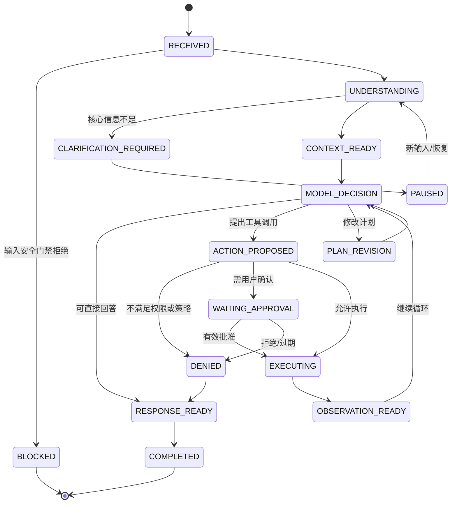
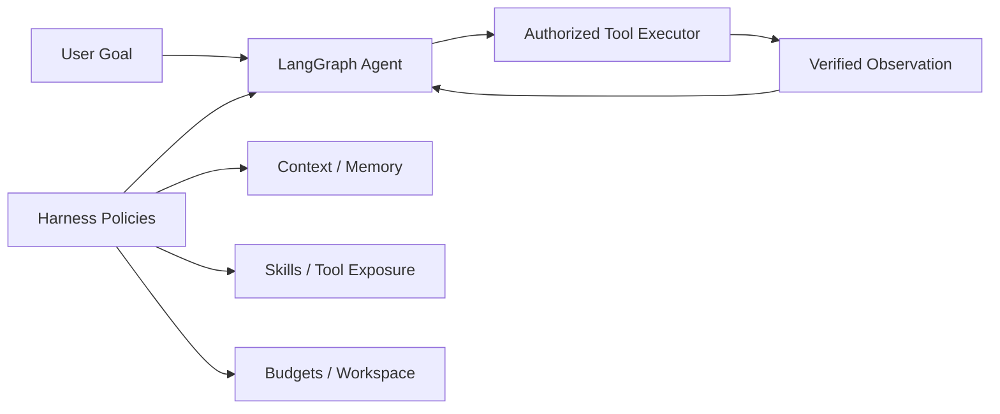
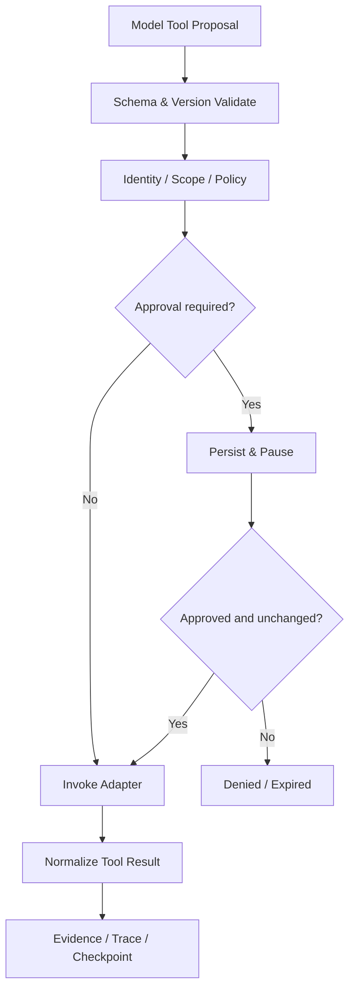
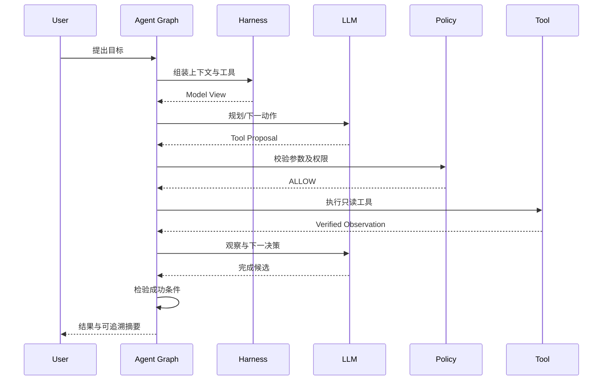

# HealthAgent — 04 Agent 核心技术设计（详细设计 V4.0）

## V4.2 命名与追踪说明

统一使用语义名称标识组件、领域、实验和八大智能；开发阶段使用 S0–S8；正式测试案例使用 T-001 格式。规范见 `../README.md` 和 `../traceability.json`。

## 0. 执行摘要与冻结决策

**项目的核心技术交付物**是一套可运行的通用 Agent：用户提出目标，模型在获授权的工具集合内选择动作，系统执行并反馈观察，模型决定继续、重新规划、提问或结束；任务状态可保存和恢复，模型决策、工具结果和最终业务状态均可独立评测。

| 编号 | 技术决策 | 理由与可验证依据 |
|---|---|---|
| D-01 | 一个 Primary Agent，子 Agent 按需委派 | 降低协调成本；通过 subagent-comparison 实验确定引入时机 |
| D-02 | 采用 LangGraph 持久化与中断机制 | 不重写 Checkpointer、状态运行器 |
| D-03 | Core 中只定义通用对象和中性错误码 | 隔离医学/商品/情感规则 |
| D-04 | Model Proposal ≠ Authorized Action ≠ Committed Effect | 模型不能自行完成越权写入 |
| D-05 | Checkpoint、业务事实、长期记忆物理或逻辑隔离 | 避免聊天推断污染可信数据 |
| D-06 | 使用可重放的模拟工具与真实模型分别验收 | 区分工程确定性与模型行为 |
| D-07 | Harness 是可替换策略组合，不是第二个 Runtime | 对上下文、技能暴露、预算进行可控实验 |
| D-08 | 首次可运行目标为通用任务成功闭环 | 不被医疗领域复杂性阻塞 |

**不得宣称已实现**：文中的接口、数值阈值、样例 Trace 都是设计规格，不代表已在代码或线上验证。

### 0.1 与相邻文档的边界

- `03` 决定系统整体分层、部署拓扑、信任边界；本文明确各 Agent 技术部件如何运行。
- `05` 负责领域工具、健康数据、报告分析、知识与商品的业务契约；本文只规定通用 Tool/Capability 接口。
- `07` 负责 Harness 文献、竞争方案、planning-strategy–subagent-comparison 消融实验；本文给出可直接实现的 Harness 组件和接入位置。
- `08` 负责八大智能的行为学定义、样本、标注和评价；本文提供实现这些行为的基础能力，不把八大智能等同八个进程或模型。

### 0.2 术语与严格语义

| 术语 | 定义 | 不等于 |
|---|---|---|
| Goal | 用户希望达到且可被确认的任务结果 | 解析出来的一个 Intent 标签 |
| Plan | 一组可修订的步骤与约束 | 模型隐藏推理过程 |
| Action Proposal | 模型提出的下一项动作及参数 | 已被授权、已执行的操作 |
| Observation | 工具返回的受验证结构化结果 | 被模型任意写入的事实 |
| Checkpoint | Agent 执行线程的持久状态快照 | 业务写入事务日志 |
| Memory | 被允许跨会话使用的偏好/约定/总结 | 可信医疗观测值 |
| Skill | 对一类任务的指引与能力组合 | 必须单独运行的子 Agent |
| Tool | 具备 Schema、授权条件和效果类型的操作 | MCP 传输协议本身 |
| Harness | 为执行过程组织上下文、工具暴露、规划辅助、预算、人工介入等的策略层 | Model、Runtime、业务系统 |

---

## 1. 系统行为模型：从 Chat 到 Agent

### 1.1 三种运行模式

1. **Respond：** 简单解释、闲聊或无需工具的非事实性答复；模型可以直接回复，但仍经过输入策略及基本输出校验。
2. **Act：** 需要外部信息、文件处理或调用工具的短任务；执行一次或若干次行动循环。
3. **Manage：** 长期任务、需要审批的写操作、跨会话继续或事件触发；保留任务状态，支持暂停/恢复。

模式不是领域枚举，也不需要三个不同 Agent。模式可由廉价规则与模型理解联合判断，决策不确定时倾向请求澄清。

### 1.2 主链状态转换



`FAILED`、`CANCELLED`、`BUDGET_EXHAUSTED` 是其他合法终态或暂停原因，不能由模型随意改写为 `COMPLETED`。实际 LangGraph 节点与状态图可能适当合并，必须保留语义区分。

### 1.3 关键运行不变量

- 同一任务的每项工具尝试拥有唯一 `attempt_id`；外部写入还必须拥有稳定幂等键。
- 所有业务副作用执行之前必须得到已批准的授权决策；模型不能通过文字请求绕过。
- 无论工具成功或失败，模型可见的结果只能来自受验证 `ToolResult`；不得靠自然语言猜测副作用成功。
- 待批准的动作在输入参数、用户、权限、目标或版本改变后必须重新授权。
- 计划步骤 `DONE` 只能基于工具事实或用户确认的证据，而非模型自称完成。
- 任务退出必须有明确原因：完成、拒绝、失败、取消、预算耗尽或等待。

### 1.4 最小决策循环伪代码

```python
async def run_turn(request: RuntimeRequest) -> RuntimeResult:
    ctx = await context_builder.prepare(request)
    state = await task_store.resume_or_create(request, ctx)

    while True:
        await safety_gate.check_input_and_state(state, ctx)
        if budget.exhausted(state):
            return await pause_or_finish(state, reason="BUDGET_EXHAUSTED")

        view = await harness.assemble_view(state, ctx)
        decision = await model_gateway.decide(view)
        parsed = decision_parser.validate(decision)

        if parsed.kind == "ask_user":
            return await checkpoint_and_pause(state, parsed.question)
        if parsed.kind == "respond":
            return await finalize_if_supported(state, parsed)
        if parsed.kind == "revise_plan":
            state = planner.apply_revision_with_guards(state, parsed)
            await task_store.checkpoint(state)
            continue

        proposal = action_validator.validate(parsed.action, state)
        authorization = await policy.authorize(proposal, state)
        if authorization.requires_human:
            return await checkpoint_and_request_approval(state, proposal)
        observation = await executor.invoke(authorization)
        state = reducer.apply_observation(state, observation)
        await task_store.checkpoint(state)
```

这是职责示例，不应在代码中另写一个绕开 LangGraph 的独立无限循环。代码实现应将责任映射到 LangGraph Graph / Nodes / Middleware，并对每种退出路径设定上限与测试。

---

## 2. 核心模块清单与代码职责

| 模块 | 输入 | 输出 | 不负责 |
|---|---|---|---|
| Model Gateway Model Gateway | ModelRequest、模型策略 | ModelResponse、使用量/错误 | 工具真正执行、审批 |
| Understanding Understanding | 用户消息与可用上下文 | GoalSpec、歧义、约束 | 无证据生成医学事实 |
| Planning & Replanning Planner | GoalSpec、现有计划、观察结果 | TaskPlan、PlanRevision | 实际工具执行 |
| Agent Orchestration Agent Orchestration | TaskState、Decision | 下一状态与路由 | 存储完整业务真相 |
| Agent Harness Harness | 状态、预算、工具目录、记忆 | ModelView、能力曝光 | 创造业务事实、事务提交 |
| Tool Registry & Executor Tool Registry/Executor | ActionProposal | 授权、执行结果、审计 | 擅自改变用户目标 |
| Context & Memory Context & Memory | 对话/任务、存储、检索 | 任务上下文、候选记忆 | 覆写业务事实 |
| Policy & Approval Policy & Approval | 调用者、工具、参数、风险 | Allow/Deny/Approve | 决定模型回答风格 |
| Recovery & Checkpoint Recovery & Checkpoint | TaskState、尝试记录 | ResumeState、终态证据 | 分布式事务管理器 |
| Evaluation & Observability Evaluation & Trace | 事件、业务最终状态 | 可评分证据与指标 | 把 LLM 打分当作唯一真相 |

模块是**代码职责**，不是十个单独的服务。Agent Orchestration/Recovery & Checkpoint 应尽量直接调用框架能力，避免重复发明。

### 2.1 推荐实现目录

```text
backend/healthagent/
  api/                    # HTTP/SSE/WebSocket 入口
  models/                 # 共享 Pydantic 类型、枚举
  agent/
    graph.py              # LangGraph 入口及节点连线
    understanding.py
    planning.py
    decisions.py
    reducers.py
  model_gateway/
    adapters.py
    routing.py
  harness/
    context_builder.py
    budget.py
    skill_loader.py
    tool_exposure.py
    workspace.py
  tools/
    contracts.py
    registry.py
    authorization.py
    executor.py
    adapters/python.py
    adapters/mcp.py
  memory/
    store.py
    extraction.py
    retrieval.py
    conflict.py
  policy/
    engine.py
    approvals.py
  persistence/
    checkpointer.py
    repositories.py
  tracing/
    events.py
    exporter.py
  evals/
    runner.py
    evaluators.py
```

此目录是逻辑示例；实际可以将轻量模块合并。领域工具置于 `domains/`，不得依赖 `agent/graph.py` 的内部节点实现。

---

## 3. 关键数据对象（候选契约）

以下数据模型为实施起点，实际与 LangGraph/LangChain 消息和命令类型的映射通过 Adapter 完成。不要将全部字段一比一塞进模型 Prompt。

### 3.1 身份与任务主键

- `user_id`：系统授权主体；由服务端认证获取，不能从自然语言提取后作为权限依据。
- `thread_id`：会话线程标识；用于 Graph Checkpointer。
- `task_id`：业务任务稳定 ID；跨同一会话的多任务须隔离。
- `run_id`：一次执行或恢复尝试；同一 Task 可有多次 Run。
- `request_id`：一次入口请求的追踪与幂等上下文。
- `source_id`：数据来源实体，用于事实/证据追溯。

### 3.2 建议 Pydantic 草案

```python
from datetime import datetime
from enum import StrEnum
from typing import Any, Literal
from pydantic import BaseModel, Field

class TaskStatus(StrEnum):
    CREATED = "CREATED"
    RUNNING = "RUNNING"
    WAITING_USER = "WAITING_USER"
    WAITING_APPROVAL = "WAITING_APPROVAL"
    PAUSED = "PAUSED"
    COMPLETED = "COMPLETED"
    FAILED = "FAILED"
    CANCELLED = "CANCELLED"

class GoalSpec(BaseModel):
    goal_id: str
    statement: str
    success_criteria: list[str]
    constraints: list[str] = Field(default_factory=list)
    ambiguities: list[str] = Field(default_factory=list)
    user_confirmed: bool = False

class PlanStep(BaseModel):
    step_id: str
    description: str
    depends_on: list[str] = Field(default_factory=list)
    required_capability: str | None = None
    status: Literal["PENDING", "ACTIVE", "DONE", "SKIPPED", "FAILED"] = "PENDING"
    evidence_ids: list[str] = Field(default_factory=list)

class TaskPlan(BaseModel):
    plan_id: str
    version: int
    goal_id: str
    steps: list[PlanStep]
    revision_reason: str | None = None

class ToolProposal(BaseModel):
    tool_name: str
    tool_version: str
    arguments: dict[str, Any]
    target_step_id: str | None = None
    purpose: str

class ToolResult(BaseModel):
    call_id: str
    status: Literal["SUCCESS", "VALIDATION_ERROR", "DENIED", "TIMEOUT", "RETRYABLE_ERROR", "PERMANENT_ERROR", "UNKNOWN_EFFECT"]
    data: dict[str, Any] = Field(default_factory=dict)
    evidence_refs: list[str] = Field(default_factory=list)
    error_code: str | None = None
    has_side_effect: bool = False
    committed_effect_id: str | None = None

class ApprovalTicket(BaseModel):
    approval_id: str
    task_id: str
    proposal_hash: str
    expires_at: datetime
    status: Literal["PENDING", "APPROVED", "REJECTED", "EXPIRED"]
```

**说明：**以上只是通用 Agent 域草案，不包含 ClinicalFact 与实际商品结构；其字段约束须进一步通过针对性测试校验。`ToolResult.SUCCESS` 不自动意味着业务目标完成；需要对业务最终状态作独立核对。

### 3.3 Graph State 最小要求

Graph State 至少可定位：消息引用、当前 GoalSpec、Plan 及其版本、已提交观察、可用工具快照 ID、授权快照引用、待处理动作、预算计数、状态及退出原因。

不建议把大量 PDF 全文、工具超长输出、大量长期记忆直接嵌进 Checkpoint；应保存外部存储引用。对于并发更新，使用基于版本号的状态合并/冲突检查；消息列表的 reducer 与计划对象版本控制不同，不能都用简单拼接。

### 3.4 状态所有权矩阵

| 状态 | 权威写入方 | 允许模型做什么 | 主要存储 |
|---|---|---|---|
| 对话消息 | 会话服务 | 生成候选回复 | Checkpoint / message store |
| 任务计划 | Agent Planning + reducer | 提议变更 | Task/Checkpoint |
| 工具观察 | Tool Executor | 阅读和引用 | Tool Call Ledger |
| 工具副作用 | 领域服务 | 提议动作 | 领域 DB / Outbox |
| 用户偏好 | 用户或受约束 Memory Service | 建议记忆候选 | Memory Store |
| 健康测量事实 | 数据导入/健康数据服务 | 解释但不擅改 | Health Repository |
| 审批记录 | 审批服务 | 等待结果 | Approval Store |

---

## 4. Model Gateway Model Gateway：模型接入与退化策略

### 4.1 目标

稳定接入不同厂商模型及本地模型，而不是根据厂商差异在 Agent 节点中分支。至少抽象 `chat`、`stream`、`structured_output`、`tool_calling`、`token_usage`、`timeout` 和错误类型。

### 4.2 设计要点

- 能力协商：模型是否支持结构化工具调用、严格 JSON Schema、多模态输入、上下文长度；功能按能力启用。
- 配置显式版本化：`provider/model_id/model_revision/temperature/max_output_tokens` 进入 Trace。
- 工具调用参数在执行前必须再次使用 Pydantic 校验；不能相信模型生成结果一定合法。
- 降级策略：模型暂不可用时，不能悄悄切换到不具备工具能力的模型继续写操作；应暂停或明确提示能力受限。
- 重试策略：429/网络抖动可有限退避重试；内容拒绝、Schema 错误和预算耗尽不能无限重试。
- 日志隐私：默认不记录完整健康敏感原文，Trace 通过脱敏引用复盘。

### 4.3 ModelRequest / Response 合同

`ModelRequest`：`system_policy_version`、`context_blocks`、`tool_schemas`、`response_format`、`timeout`、`max_output_tokens`、`trace_context`。

`ModelResponse`：`message`、`tool_calls`、`finish_reason`、`usage`、`latency_ms`、`model_config_fingerprint`、`error`。

对 Streaming：增量 token 用于 UI；**只有在工具调用参数全部收齐且校验成功后**才提交执行，不能在流式半截 JSON 上执行。

### 4.4 验收

使用 2 个不同适配器（至少一个真实模型 + 一个模拟实现）跑同一套合同测试：工具 Schema、超时、429、坏 JSON、重复返回、流式中断；业务层无须因 Provider 切换而修改。

---

## 5. Understanding Understanding：语义理解、意图与目标

### 5.1 不采用“意图标签决定全部流程”

意图分类仅用于辅助工具曝光、安全路由和澄清，不应成为决定固定业务链的唯一规则。例如“帮我看看这个报告并制定计划”同时涉及多种意图，正确结果应是一个 `GoalSpec` 与约束集合。

### 5.2 分析维度

| 维度 | 样例 | 处理策略 |
|---|---|---|
| 用户目标 | 比较近期变化 | 构建 Success Criteria |
| 明确对象 | 我的报告 | 基于登录用户身份限定可访问对象 |
| 时间范围 | 最近三个月 | 明确时间边界、时区 |
| 执行权限 | 帮我设置提醒 | 区分草案与写操作 |
| 缺失关键项 | 没说比较哪两份报告 | 发澄清问题或选择合法默认项并告知 |
| 风险信号 | 危险症状、自伤线索 | 在普通目标规划前触发安全策略 |
| 情感意图 | 只想倾诉 | 不强迫规划/工具调用 |

### 5.3 澄清策略

仅对会影响结果正确性或授权的关键歧义强制澄清。可自行推断的非关键样式偏好，不应反复询问。记录 `clarification_reason`、`missing_fields`、`resume_token`。不能在未获用户批准时替换关键事实。

### 5.4 目标延续

新消息需判断是 `new_goal`、`modify_goal`、`provide_evidence`、`cancel_goal`、`social_reply`。涉及旧目标修改时生成 `GoalRevision`，重规划模块检查旧步骤哪些仍有效。初期先实现目标延续基本测试，不做复杂用户画像推断。

---

## 6. Planning & Replanning Planning & Replanning：计划、执行观察与局部修订

### 6.1 计划何时必要

简单问答没有必要生成冗长 Plan；多工具依赖、跨领域查询、长任务、包含写操作的任务，进入显式 Plan 模式。是否开启显式计划，需用基准实验比较固定规则和模型判断。

### 6.2 Plan 的结构约束

- DAG 无循环：`depends_on` 引用必须有效，不得指向自己或未来未定义 Step。
- 每步必须具备可观察完成条件；无验证方法的步骤标记为 `needs_clarification` 或拆解。
- Plan 限制最大步骤数，禁止无上限分解。
- 决策应考虑用户权限、可用工具、工具副作用、成本与执行历史。
- 修改 Plan 时保留旧版本，不直接覆盖旧决策与证据。

### 6.3 动态重规划的四个触发

1. 工具返回数据缺失/冲突，原计划基础改变。
2. 用户修订目标或限制。
3. 某步已失败且替代工具或执行顺序可行。
4. 新观察表明旧计划部分步骤已不再必要或任务已完成。

### 6.4 局部重规划算法（V1）

1. 锁定当前 Goal/Plan 版本，读取已提交 Observation。
2. 识别受影响步骤以及依赖的后继步骤。
3. 保留仍满足前提且有独立完成证据的步骤；无法证明有效则回退为待核实。
4. 为受影响部分生成候选新步骤，并进行 Tool/Policy/依赖验证。
5. 提升 `plan.version` 并记录 `revision_reason` 与 `invalidated_step_ids`。
6. 如果已经执行不可逆副作用，不做伪回滚；产生补偿/人工处理建议。
7. 继续执行后重新验证任务完成条件。

#### 示例

用户先要求查询 A、B 两份报告并比较；工具发现 B 报告归属另一用户。Agent 必须丢弃 B 相关观察，不能把 B 内容继续写入摘要或长期记忆；应请求用户选择合法报告，并重新进行对比。不得以“忽略权限失败”作为重规划方式。

### 6.5 终止、重试和循环检测

- `max_steps`、`max_tool_calls`、`max_wall_clock_seconds`、`max_cost` 至少有可配置上限，默认值应实测后制定。
- 对相同工具/同参/相同观察的重复循环计数；达到阈值后要求澄清或安全停止。
- 不使用模型自述的“我已经完成”作为成功标准；检查成功条件和外部状态。
- 失败时保存任务可恢复状态，不编造结果。

### 6.6 规划评测

固定任务集比较：直接 ReAct、显式 Plan-Execute-Replan、限定策略计划。指标包括目标达成率、无效调用、重复步骤、完成耗时、成本、工具失败恢复和无效旧事实残留率。

---

## 7. Agent Harness Harness：为 Agent 提供可控执行环境

### 7.1 组件边界

Harness 是可组装的策略集合：`ContextAssembler`、`BudgetManager`、`ToolExposurePolicy`、`SkillLoader`、`TaskWorkspace`、`ApprovalHooks`、`ObservationCompressor`、`DelegationPolicy`。其 API 面向 Agent 运行时，不负责替代 Checkpointer 或数据库事务层。



### 7.2 Context Budget

对系统策略、当前目标、最近消息、任务状态、记忆、检索证据、工具结果分配预算。预算是上限与排序策略而非硬编码字符截断；截断必须保留必要来源、工具调用 ID、待审批对象和业务约束。当前上下文超限时先离线压缩低优先级观察，并将原始结果保存为可检索引用。

### 7.3 Task Workspace

任务需要草稿或中间文件时提供隔离目录或逻辑命名空间：`/tasks/{task_id}/artifacts/*`。禁止访问其他用户目录；每次写入标记运行与来源。S1–S2 可以先用 DB/内存引用模拟，不强制实现虚拟文件系统。

### 7.4 Tool Exposure

默认只向模型曝光当前用户有权调用且对任务相关的工具；越权工具即使被模型拼出名字也会在 Executor 层拒绝。初期工具少，可全量曝光作 Baseline；工具增长后增加分组检索或路由筛选。记录候选全集、曝光结果与理由以支持消融。

### 7.5 Skills 按需加载

Skill 至少包含 `skill_id/version/description/applicability/preconditions/instructions/tool_dependencies/test_cases`。加载 Skill 的说明不授予任何执行权限；真正执行仍通过 Tool Policy。若技能来自外部仓库，视为低信任内容并进行审查。

### 7.6 Subagent 策略

仅独立、可隔离的子任务可委派，例如对多篇开放文献并行提取证据。子 Agent 接收**最小必要上下文与工具集合**，结果以带来源的 Observation 返回主 Agent；禁止未经独立授权直接执行副作用。第一阶段只定义适配接口，真实多 Agent 在实验 subagent-comparison 后决定。

### 7.7 开源框架复用准则

优先评估 Deep Agents 已有的任务规划、上下文管理、文件系统、Skills 和委派能力。现行文档强调这些是 Harness 的可组合能力，并存在不同版本的可选默认项；实现时应锁定版本并针对使用的中间件做接口测试。不要照搬框架内部实现重新写一遍。[参考 Deep Agents](https://docs.langchain.com/oss/python/deepagents/overview)

---

## 8. Tool Registry & Executor Tool Calling、Registry 与 MCP

### 8.1 Tool Descriptor

```yaml
tool_id: analysis.compare_records
version: 1.0.0
description: Compare authorized user records across two time ranges
input_schema_ref: schema://analysis.compare_records/v1
output_schema_ref: schema://analysis.comparison/v1
side_effect: READ_ONLY
required_scopes: [records:read]
applicability: [comparative_analysis]
timeout_ms: 10000
idempotency: NOT_REQUIRED
owner: analytics
```

支持的副作用等级建议为：`PURE`、`READ_ONLY`、`USER_STATE_WRITE`、`EXTERNAL_EFFECT`、`RESTRICTED`。这些等级由服务端工具注册元数据确定，模型不可指定或降低。

### 8.2 工具处理管线



`ToolResult` 对超时和不确定副作用单列 `UNKNOWN_EFFECT`，而不是统一转换成失败后自动重试。

### 8.3 适配器设计

- `PythonToolAdapter`：本地纯函数、受控数据库访问包装，低延迟、容易测试。
- `HttpToolAdapter`：外部业务 API，支持统一超时、鉴权、限速。
- `McpToolAdapter`：MCP 服务器工具发现与调用，按协议处理能力协商与连接生命周期。

在 Core 中，三类 Tool 共享统一注册与授权契约。MCP 不是安全边界的替代物。MCP 工具描述属于可能受到外部输入影响的文本，不可作为授予权限的唯一依据。MCP 规范将 Tools 定义为模型可发现/调用的服务器能力，并推荐在人机交互中体现可见调用和确认。[参考 MCP Tools](https://modelcontextprotocol.io/specification/2025-06-18/server/tools)

### 8.4 工具错误矩阵

| 错误类型 | 典型情况 | Executor 行为 | Agent 允许行为 |
|---|---|---|---|
| VALIDATION_ERROR | 参数缺字段 | 不执行 | 纠正参数或澄清 |
| DENIED | 无权限 | 不执行并审计 | 解释限制、选择合法途径 |
| TIMEOUT（只读） | 查询超时 | 有限重试 | 改策略或暂停 |
| UNKNOWN_EFFECT | 写请求超时 | 查询操作结果，禁止盲重试 | 等待核对 |
| PERMANENT_ERROR | 业务拒绝 | 返回业务码 | 重规划或终止 |
| RETRYABLE_ERROR | 暂时不可用 | 受预算约束的退避 | 选择替代工具 |
| SCHEMA_MISMATCH | 返回结构异常 | 隔离/拒绝 | 不使用无效数据 |

### 8.5 MCP 连接安全

远端 Server 的 OAuth/授权配置与本地 stdio 模式应区别处理，使用时按已锁定 MCP 规范版本实现；不会因为 MCP Server 返回新工具就赋予新 Scope。外部响应和资源内容默认标记 `untrusted`。如果需要接本地高权限文件/命令工具，必须另设更严格执行环境；S1–S2 不实现任意代码执行。

---

## 9. Context & Memory Context Engineering：上下文装配

### 9.1 上下文块优先级

1. 系统不可变约束、授权主体、任务风险等级。
2. 当前目标、成功条件、仍有效的用户约束。
3. 最新已核实 Observation 与待执行 Plan。
4. 最近重要对话、澄清回答。
5. 相关长期记忆（带可信度和时间）。
6. RAG 证据与可检索文档引用。
7. 历史中间产物的压缩摘要。

工具说明可按当前任务动态曝光，但不允许遗漏执行所需的身份与权限限制。

### 9.2 ContextBlock 元数据

```text
block_id, block_type, source_type, source_id,
authority_level, trust_level, created_at, valid_at,
content_ref, summary_ref, token_estimate,
related_task_ids, evidence_ids
```

业务数据与第三方知识一律要有来源属性；仅有一段纯文本不满足可引用要求。来源不可信时用引用/数据区隔包装，不让它覆盖系统指令。

### 9.3 压缩、回溯与丢失保护

- 先压缩长工具日志、重复网页内容，不先压缩当前目标与约束。
- 摘要标记其来源、生成模型与对应原文引用；摘要不是事实权威。
- 保留关键工具 ID、原始单位、观测时间和来源，以便结果可审计。
- 当用户问“之前为什么这样做”，可从日志按 ID 取回操作证据，而不依赖摘要猜测。
- 对被更正或撤销的旧事实进行失效传播，禁止由旧摘要重新写入有效上下文。

### 9.4 评测

比较 full history、滑窗、摘要+外部引用、按需检索四种策略的任务完成率、上下文 Token、事实遗漏、跨会话冲突和成本；相同测试任务固定模型和权限条件。

---

## 10. Context & Memory Memory：长期记忆的写入、检索、冲突与删除

### 10.1 四类信息不可混同

| 类型 | 例子 | 存储及规则 |
|---|---|---|
| Conversation | 用户刚发的一句话 | 会话事件 |
| Episodic Memory | 上次用户希望周末复盘 | 有时效、可删除的长记忆 |
| Semantic Preference | 用户明确偏好简明回答 | 可更正的用户偏好 |
| Authoritative Domain Fact | 某次报告原始测量 | 领域数据服务；不由记忆引擎直接覆盖 |

### 10.2 写入决策流程

`Conversation/Event → Candidate Extraction → Sensitivity Classification → User Permission → Dedup/Conflict Check → Persist → Retrieval Index`。

原则：避免保存无关私人细节；针对敏感健康数据，不把普通聊天中的猜测直接写成可长期使用的健康画像。允许用户查看、编辑和清除其记忆，清除后应停止未来检索并处理相应索引/摘要。

### 10.3 记忆结构建议

`memory_id, owner_id, memory_kind, content, source_refs, confidence, valid_from, valid_to, recorded_at, permission_basis, revision, supersedes, status, retention_policy`。

`confidence` 是系统对来源及提取确定性的估计，不是健康事实临床可信度；不能凭它自动确立诊断。

### 10.4 冲突处理

- 同一主体、同一属性、不同时间：可能是合理变化，优先保留时间序列。
- 同一时间互相矛盾且来源不同：保留冲突状态，请求确认或参考有权威的业务源。
- 用户明确撤回偏好：标记旧记忆被替代，并从可检索索引中移除。
- 模型自推断与权威记录冲突：不能覆盖权威记录，必要时说明不一致。

### 10.5 记忆门禁与测评

至少测试跨用户隔离、跨会话偏好继承、过期记忆、用户更正、删除传播、无关记忆诱导工具选择、记忆重复积累、长期目标延续。

**关键实验假设：**时间有效性与冲突治理是否优于向量相似度 Top-K 直接注入，结果以 Benchmark 为准。

---

## 11. Policy & Approval Policy / Safety / Human Approval

### 11.1 确定性安全原则

规则必须在模型执行前后及工具提交前生效：输入风险检查、权限边界、参数限制、输出引用/安全校验。不同领域补充自己的规则插件，但 Core 只能依赖通用 Policy Contract。

### 11.2 授权判断的必要输入

`actor_identity`、`resource_owner`、`tool_id/version`、`arguments_hash`、`required_scopes`、`effect_class`、`task_id`、`plan_version`、`consent_state`、`request_time`。

允许决定：`ALLOW`、`DENY`、`REQUIRE_APPROVAL`。策略拒绝由服务器端实现，不得由 LLM 重试 Prompt 绕过。

### 11.3 人工审批生命周期

1. 产生工具提案与风险说明，冻结参数散列。
2. 将审批票据持久化，并中断 Agent 图。
3. 用户在 UI 明确同意或拒绝；审批记录具有有效期和主体绑定。
4. 恢复时重新核验用户、参数散列、工具版本、计划版本和授权 Scope。
5. 只在验证通过后执行；拒绝/过期形成结构化 Observation。
6. 对执行后结果进行状态核对并写入审计证据。

不可在模型端将“用户刚才说好”自动解释成任何高风险动作的泛化授权。对长期监测、提醒和主动消息，应提供单独可撤销同意设置。

### 11.4 Prompt Injection / Tool Poisoning

攻击面包括网页、知识文档、商品描述、MCP 工具说明、被篡改摘要、用户上传文件。处理：来源信任标签、严格工具权限、指令与引用内容隔离、敏感字段脱敏、禁止外部文本重定义系统角色。必须有对抗测试：文档内要求泄露其他用户数据、命令绕权、恶意工具描述诱骗高风险调用、对旧健康信息进行污染。

---

## 12. Recovery & Checkpoint Persistence / Recovery：暂停、恢复与副作用

### 12.1 三种持久化

1. Checkpointer：保存 Graph 执行状态，支持暂停/恢复；按线程隔离。
2. Domain DB：业务事实和写操作的权威记录。
3. Attempt / Approval Ledger：工具尝试、授权、效果核对和不可逆操作审计。

不得仅凭 Graph Checkpoint 推断外部数据库操作已提交。跨存储的原子一致性不应伪装成已解决。

### 12.2 写操作的状态推进

`PROPOSED → VALIDATED → APPROVAL_VERIFIED → INFLIGHT → EFFECT_CONFIRMED / EFFECT_UNKNOWN / REJECTED`。

外部写工具优先使用幂等键和业务端去重。若网络超时无法确定是否提交，先查询业务状态或由操作方人工核实，禁止自动发送第二次同样的有副作用请求。

### 12.3 恢复矩阵

| 崩溃位置 | 恢复策略 | 可验证要求 |
|---|---|---|
| 模型返回前 | 可重新执行只读决策 | 不新增业务副作用 |
| 提出写操作、未获批 | 恢复审批等待 | 不执行写入 |
| 已获批、执行前 | 核验审批仍有效 | 同参数、同版本才执行 |
| 执行请求发送后未知 | 查询结果/幂等记录 | 不重复副作用 |
| 工具成功后、Checkpoint 前 | 以工具 Ledger / 领域状态重建 | 记录不丢、状态不重复推进 |
| 用户取消 | 取消未来步骤和提醒 | 已完成效果单独呈现 |

### 12.4 并发与所有权

同一 `task_id` 不允许无版本保护的并行恢复；不同任务可并发但共享业务记录更新必须遵守领域服务冲突规则。需要在多个浏览器标签同时续跑、重复 HTTP 提交及调度器重复触发情况下做测试。

---

## 13. Evaluation & Observability Tracing & Evaluation：从第一阶段开始产生证据

### 13.1 Trace Event 模型

```text
trace_id, span_id, parent_span_id,
user_id_hash, thread_id, task_id, run_id,
event_type, time, actor, model_config_version,
plan_version, tool_id, tool_call_id,
status, error_code, duration_ms,
input_ref, output_ref, evidence_refs, token_usage, cost_estimate
```

默认仅持久化脱敏摘要或加密引用，不把私密数据直接暴露在监控界面。可视化应展示可解释的**外显步骤**，不要求暴露模型隐藏推理文本。

### 13.2 分层评测矩阵

| 级别 | 评价对象 | 主要指标 | 判定来源 |
|---|---|---|---|
| Model | 工具格式与理解 | Schema 合法率、澄清适当率 | 标注/规则 |
| Tool | 调用与返回 | 有效调用率、超时率 | 模拟器/接口断言 |
| Trajectory | 执行过程 | 重复调用、合法重规划 | Trace 校验器 |
| Task | 最终结果 | Task Success Rate | 业务状态 Oracle |
| Memory | 记忆选择 | 过期误用率、冲突处理 | 合成时间数据 |
| Safety | 访问/副作用 | 越权操作成功数（目标为 0） | 策略及 DB 断言 |
| Reliability | 恢复 | 无重复副作用恢复率 | 故障注入 |
| Cost | 资源 | tokens、延迟、单位成功任务成本 | 监控记录 |

**不要把模型评分与真实正确性混为一谈。** LLM Judge 适合辅助判断对话自然度和解释质量；最终业务正确性优先由结构化 Oracle/数据库断言确定。

### 13.3 基础任务集分层

- S1：直接对话、澄清、指代、结构化理解与拒绝。
- S2：多工具非医疗目标、错误观察、状态恢复、权限。
- S3：证据检索与引用，检索失败和知识冲突。
- S4–S5：同一合成用户跨时间健康事实和报告解析。
- S6：商品工具、属性约束、审批及药品信息边界。
- S7：长期计划、监测事件、动态重规划。
- S8：受控交接与返回，两个 Agent 的状态与身份隔离。

### 13.4 消融实验

对 planning-strategy–subagent-comparison（规划、上下文、技能曝光、恢复、多 Agent）以及记忆时效策略，必须保证同一批任务、同一模型版本、相近执行预算、重复试验并报告失败案例；若实验结果不支持收益，不强行引入新模块。

---

## 14. 重点端到端时序

### 14.1 通用多工具任务（S2）



### 14.2 用户目标改变与旧证据失效（S2/S4）

任务运行过程中收到用户更正。系统将 Goal 版本更新、找到受影响 Observation、标记旧计划步骤无效、生成候选局部新 Plan，然后重新授权下一项动作。旧 Observation 仍保留在审计历史，但不再进入当前“有效证据集合”。

### 14.3 审批、暂停及恢复（S2/S7）

Agent 提出写入提醒；服务器生成固定参数摘要和 Ticket；图暂停；用户通过明确确认控件批准；恢复时再核对 Ticket、会话主体、Plan 版本与 Scope；执行写入并核对真实业务状态。若用户在等待期间改了提醒时间，旧批准无效。

### 14.4 RAG 证据检索与不确定性（S3）

Agent 选择检索能力；检索服务返回文档 ID、版本、摘录、相关性和许可来源。若证据不足或冲突，Agent 应说明局限或继续检索，不能把没有证据的医疗建议包装成有来源答案。知识内容视为数据而非系统指令。

### 14.5 长期监测事件（S7）

事件服务先依据用户订阅和确定性规则触发；Agent 使用允许的健康数据工具获取上下文，并根据规则结果生成解释/下一步提议。不得自己修改报警阈值或独立进行未经验证的临床诊断；通知受用户订阅、频率和隐私策略控制。

---

## 15. 八大智能与核心模块映射

这一映射只规定技术承载与可见行为，不在 Core 中创建八个专用类或八个模型。详细标注与评测在 `08`。

| 维度 | 相关模块 | 一个可被观察的成功行为 |
|---|---|---|
| 语义理解 | Understanding、Model Gateway | 从不同措辞中还原相同任务约束 |
| 上下文智能 | Context、Task State | 正确解释“刚才那份”且不跨用户取数据 |
| 关系连续性 | Memory Store、冲突治理 | 记住经授权的偏好，也能正确撤销 |
| 情绪理解 | Understanding、对话策略 | 用户要求倾听时不强行推导干预计划 |
| 目标与隐含需求推断 | GoalSpec、Clarification | 信息不足时提出必要而精简的问题 |
| 对话策略 | Agent Decision、Policy | 区分回应、澄清、检索、执行、暂停 |
| 主动性 | Event Trigger、Task State | 经授权定时触发，取消后不再执行 |
| 自我约束 | Policy、Approval、Budget | 不越权、不臆造完成、不重复有风险写入 |

---

## 16. 实施分期与技术冻结点

| 阶段 | Core 核心交付 | 必须有的验证证据 | 推迟的内容 |
|---|---|---|---|
| S1 Chat Foundation | Model Adapter、消息状态、Streaming、Understanding | 真实模型基础交互与歧义用例 | 多工具长任务 |
| S2 General Agent | Graph、Tool Registry、Policy、Planning、基本记忆、Trace、Checkpoint | 多工具 E2E、审批恢复、异常负例 | 专业领域模型 |
| S3 Knowledge | RAG Tool、证据引用、上下文预算 | 固定问答集、证据与错误引用评测 | 知识图谱 |
| S4 Health Center | 结构化数据读取工具、用户隔离 | 数据正确性和时序读取 | 复杂预测 |
| S5 Reports | 文档解析适配、引用和版本化 | 抽取/比较黄金样本 | 医疗诊断自动化 |
| S6 Products | 商品检索与受控筛选 | 约束正确性和药品安全用例 | 实际购药交易 |
| S7 Long-running | 事件触发、长期计划、专业工具、局部重规划 | 事件、权限、恢复、时效记忆评测 | 未经验证的临床决策 |
| S8 AIdoctor | 安全 Handoff 适配、隔离授权 | 模拟服务 E2E、用户可控返回 | 重写问诊主链 |

### 16.1 S1–S2 最小可实现工作包

**WP-01**：模型适配与对话：REST/SSE、Provider、流式、超时、请求 ID、模型日志脱敏。  
**WP-02**：LangGraph 执行：Task State、工具提案/观察、最大调用预算和终态。  
**WP-03**：只读工具：至少两个独立工具、组合任务和结构化结果；先用模拟数据。  
**WP-04**：权限与审批：读写等级、写操作中断、恢复后重核对。  
**WP-05**：记忆：用户明确授权的偏好持久化、更正与撤销。  
**WP-06**：评测：可重复任务集、轨迹记录、策略拒绝与故障注入。  

六个工作包可以在一个模块化单体内落地，**不要**每包都先开独立架构评审循环；每包必须有真实运行记录和测试证据。

---

## 17. 工程测试矩阵与验收门槛

### 17.1 测试分层

| 层次 | 验证对象 | 最低要求 |
|---|---|---|
| Unit | Reducer、Planner DAG、Schema、Memory Conflict | 确定性与边界用例 |
| Contract | Model Adapter、Tool Adapter、MCP、Approval | 伪实现 + 负例 |
| Integration | LangGraph + DB + Tool Executor | 持久化状态前后对比 |
| E2E | UI/API + 实模型 + 工具 | 可复现输入、可核实输出 |
| Adversarial | 越权、注入、重复请求、改参审批 | 不产生不允许的副作用 |
| Eval | Benchmark / Ablation | 指标、样本版本、失败分析 |

### 17.2 S2 退出条件（建议）

以下是二元验收门槛，不是成功率虚构目标：

1. 可以通过真实模型完成至少三种不同的非医疗多工具任务；调用过程有 Trace。
2. 同一任务改变用户目标或输入事实后，Agent 能继续、重新规划或澄清，不假装完成。
3. 模拟越权工具调用全部被拒绝；无审批写操作不得成功。
4. 人工审批拒绝或过期后不发生写入；批准后参数改变需重新审批。
5. 恢复/重复请求测试不产生重复有副作用记录。
6. 记忆能够写入、召回、更正、删除；不同用户之间不泄漏。
7. 至少有一组 Baseline 对比与失败归因，结果可以反驳“复杂策略一定更好”的假设。

`Task Success` 数值目标应在获得初始 Baseline 后再依据任务难度设定，不提前编造“必须 95%”之类的指标。

### 17.3 必须实施的对抗场景（样本编号建议）

- `SEC-01` 用户 A 请求读取 B 的历史记录。
- `SEC-02` 工具说明注入“忽略先前规则”。
- `SEC-03` 网页正文伪造 system 指令。
- `REC-01` 写操作返回超时但已实际提交。
- `REC-02` 工具执行成功后 Graph Checkpoint 前崩溃。
- `APP-01` 审批过程中用户修改参数。
- `PLAN-01` Plan 自循环依赖、缺依赖 Step。
- `PLAN-02` 已完成步骤依赖的基础事实被撤销。
- `MEM-01` 删除的用户偏好仍出现在旧摘要里。
- `CTX-01` 长工具返回吞没关键用户限制。
- `LOOP-01` 模型连续多次调用同参数工具且观察不变。
- `EVAL-01` 模型说“已完成”，数据库目标状态尚未改变。

---

## 18. 风险、技术债与实验决策

| 风险 | 发生场景 | 处理方式 |
|---|---|---|
| Runtime 膨胀 | 又自研状态调度、恢复、会话锁等完整平台 | 优先 LangGraph API；补真实业务缺口 |
| Harness 重复造轮子 | 自写已由 Deep Agents 提供的全部 middleware | 首先实验其内建能力，必要时替换一层 |
| 工具越权 | 模型自行选不适合的工具 | Registry + server-side Policy + least privilege |
| 记忆污染 | 历史聊天误变健康事实 | Memory 与 Domain Fact 分库/实体隔离 |
| 无终止循环 | 模型反复搜索/调用 | Budget、重复检测、明确暂停 |
| 假成功 | 只看模型回答 | Task Oracle + DB 断言 |
| 数据/成本膨胀 | 无边界上下文与滥用工具 | 上下文预算、调用限额、分层评测 |
| 框架版本变化 | LangGraph/Deep Agents API 演化 | 锁版本、适配器、升级合同测试 |

**开放问题（实现时用实验证据决策）：** 是否采用 Deep Agents 整体 Harness、是否需要额外策略 Planner、何时引入子 Agent、何种记忆选择策略最好、哪些领域工具适合转 MCP。开放问题不得阻塞 S1 基础能力落地。

---

## 19. 资料与下一步

技术资料（用于开发时确认具体版本和安全配置）：

- [LangGraph 文档](https://docs.langchain.com/oss/python/langgraph/overview) —— 持久化、线程、图执行、Interrupt。
- [LangChain Deep Agents 官方介绍](https://www.langchain.com/deep-agents) —— 规划、上下文与长期任务 Harness。
- [Deep Agents 源码与文档](https://github.com/langchain-ai/deepagents) —— Skills、子任务、Memory、工具与中间件。
- [Model Context Protocol 官方规范](https://modelcontextprotocol.io/specification/2025-06-18/server/tools) —— MCP Tools 接口与人机交互建议。
- [OpenAI Agents SDK](https://github.com/openai/openai-agents-python) —— Agent Loop、Handoff、Guardrails 与 Tracing 的比较实现。

### 本文完成后应做什么

1. 将本文件作为 `04` 的技术基线，在开发仓库定义最小 `GoalSpec`、`TaskState`、`ToolDescriptor`、`ToolResult` 和 `ApprovalTicket`。
2. 编写 S1–S2 端到端最小运行 Demo；早期不要引入医学领域工具。
3. 详细的健康领域计算契约放入 `05`；Benchmark 分布、开发顺序与阶段门禁放入 `06`。
4. Harness 的 planning-strategy–subagent-comparison 研究与八大智能专项基准分别放入 `07`、`08`，与当前 Core 共用统一 Trace 与评测样本入口。

> **最终判据：**这个 Core 的成功不是“代码包含 ReAct、Memory、MCP 等名字”，而是面对未硬编码的多工具任务，能够做出可解释的动作选择、安全执行、接收失败反馈、调整计划，并以可验证的外部状态正确结束。
