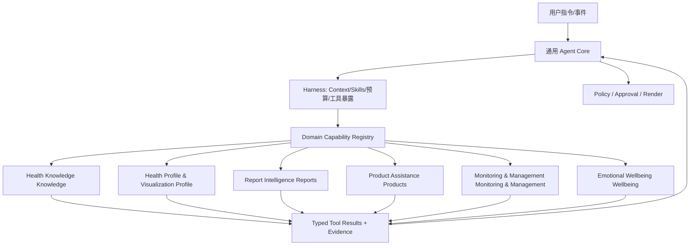
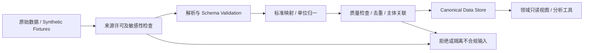
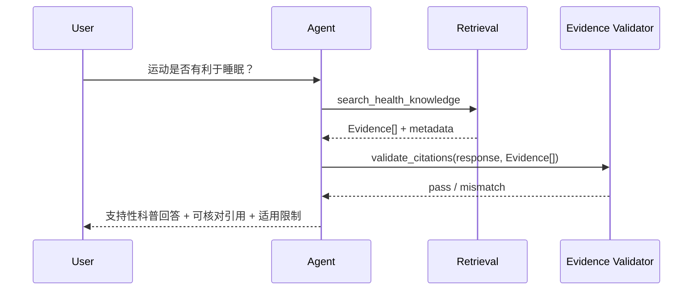
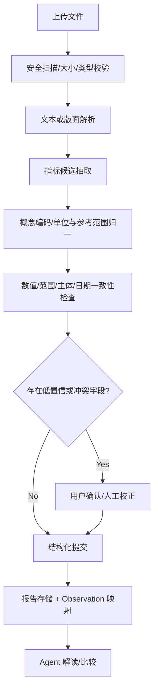
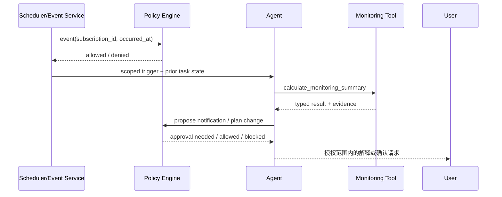

# HealthAgent — 05 领域能力与数据设计（详细设计 V4.0）

## V4.2 命名与追踪说明

统一使用语义名称标识组件、领域、实验和八大智能；开发阶段使用 S0–S8；正式测试案例使用 T-001 格式。规范见 `../README.md` 和 `../traceability.json`。

## 0. 文档目标、范围和阅读规则

### 0.1 本文件回答什么

1. 哪些健康领域能力需要实现，哪些仅作为研究模拟或外部集成？
2. 每项能力读取什么数据，谁拥有原始事实及修改权？
3. 每个领域通过什么 Tool / Skill / Domain Service 暴露给通用 Agent？
4. Agent 面临信息不足、冲突、缺失、模型不适用、工具错误时应当怎样处理？
5. 什么算用户可感知的完成，什么才算可自动化验证的完成？

不在本文件重写 LangGraph 节点内部代码、模型网关、通用 Memory/Checkpoint 结构；这些归属于 04。亦不在本文件展开医学指南全文或重复公司内部业务流程。

### 0.2 六个领域能力组

| ID | 能力组 | 核心产品功能 | 技术价值 | 默认开发阶段 |
|---|---|---|---|---|
| Health Knowledge | Health Knowledge | 健康科普、知识问答 | Agentic RAG、引用、检索规划 | S3 |
| Health Profile & Visualization | Health Profile & Visualization | 健康档案、人体交互、指标与趋势 | 结构化数据工具、时间事实、可视化 | S4 |
| Report Intelligence | Report Intelligence | 检查/体检报告读取与对比 | 文档智能、抽取校验、多工具组合 | S5 |
| Product Assistance | Product Assistance | 设备/商品比较、受限 OTC 信息辅助 | Tool/Skill 路由、约束推理、审批 | S6 |
| Monitoring & Management | Monitoring & Management | 健康监测、慢病/老龄化管理、风险研究 | 领域分析工具、事件驱动、长期目标 | S7 |
| Emotional Wellbeing | Emotional Wellbeing | 支持性对话、偏好记忆、约定式关怀 | 策略适配、长期记忆、主动任务约束 | S2 基础，S7 扩展 |

`AIdoctor` 是未来可选的 AIdoctor Integration 外部能力，不在本项目重建临床问诊主链。

### 0.3 P0/P1/P2 的意思

- **P0**：对应阶段进入交付时必须完整具备的能力，且有真实执行与自动化测试。
- **P1**：能够明显提升工程水平，前置条件具备后实现。
- **P2**：研究实验或展示性扩展，不阻塞项目主体交付。
- 医学安全问题不以 P2 延后处理：若安全边界无法落地，则相关高风险功能**不得启用**。

### 0.4 横向不可变约束

- 任何患者数据必须以 `tenant_id + subject_id` 作为读取作用域；`actor_id` 为调用主体，**不能以对话中的姓名作为授权凭证**。
- 健康事实必须保留时间、来源、主体、录入/校验状态。**LLM 解释不升级为已验证的医学事实**。
- 所有异常结果都要区分 `NO_DATA / INSUFFICIENT_DATA / CONFLICT / NOT_APPLICABLE / SERVICE_ERROR / FORBIDDEN`；不能伪装成正常结果。
- 可撤销任务、长期记忆、业务计划和结构化健康指标不可混写；各自有独立所有权。
- 有身体或心理急迫风险的内容必须先经过策略检查，必要时中断普通规划；项目不提供临床诊断或治疗替代。
- 公开医疗数据足以验证软件工程链路，不足以宣称模型有真实临床效力。


## 1. 领域接入总体契约

### 1.1 Core、Harness、Domain 的边界



**Core**：判定任务、规划、观察、重规划、终止；不持有疾病阈值与商品适应症。  
**Harness**：按任务控制工具说明暴露、知识集合选择、上下文预算、执行工作空间。  
**Domain**：负责数据查询、解析、计算、版本化规则、明确的业务副作用。  
**Policy**：最终操作授权与不可绕过的限制，不允许领域 Prompt 覆盖全局策略。

### 1.2 Domain Manifest（设计接口）

```yaml
id: health.report
version: 1.0.0
owner: domains/report
stage: S5
capabilities:
  - report.import
  - report.extract
  - report.compare
tools:
  - import_report
  - get_report_observations
  - compare_reports
knowledge_collections: [health_education]
permissions: [report:read, report:import]
side_effects:
  import_report: controlled_write
constraints:
  require_subject_scope: true
  model_output_is_unverified: true
```

Manifest 用于发现与治理，不需要将六个领域都拆成独立微服务。V1 可使用 Python Module Registry；跨进程、跨团队或外部 API 才有必要使用 MCP Adapter。

### 1.3 统一工具契约

```python
from typing import Any, Literal
from pydantic import BaseModel, Field

class EvidenceRef(BaseModel):
    source_type: Literal["document", "fhir", "catalog", "measurement", "rule", "model"]
    source_id: str
    version: str | None = None
    locator: str | None = None
    observed_at: str | None = None

class DomainToolResult(BaseModel):
    status: Literal[
        "OK", "PARTIAL", "NO_DATA", "INSUFFICIENT_DATA", "CONFLICT",
        "NOT_APPLICABLE", "FORBIDDEN", "SERVICE_ERROR", "REQUIRES_APPROVAL"
    ]
    schema_version: str = "1.0"
    data: dict[str, Any] = Field(default_factory=dict)
    evidence: list[EvidenceRef] = Field(default_factory=list)
    limitations: list[str] = Field(default_factory=list)
    warnings: list[str] = Field(default_factory=list)
    next_actions: list[str] = Field(default_factory=list)
    trace_id: str | None = None
```

**补充约束**：入参包含独立的 `ExecutionContext(tenant_id, actor_id, subject_id, task_id, scopes, request_id)`，由宿主注入，LLM 不可自行填写或替换。调用返回必须经 Schema 校验；`evidence` 为空时不得声称已完成事实性医学核对。高风险工具需要额外 `policy_decision_id` 和可检查的业务授权。

### 1.4 工具级权限分类

| 等级 | 操作 | 示例 | 处理 |
|---|---|---|---|
| R0 | 无用户数据的公开只读 | 搜索医学科普 | 普通只读权限、引用控制 |
| R1 | 个人敏感只读 | 获取体检指标 | 身份主体绑定、访问审计 |
| W1 | 可撤销个人数据写入 | 保存草稿目标、记录偏好 | 明确用户意图、幂等、撤回 |
| W2 | 有外部影响的操作 | 发送通知、创建真实订单 | 显式确认与副作用核对 |
| X | 不提供给自主 Agent | 自行开处方、修改治疗、自动急救判定 | 直接阻止或交由合规系统 |

每个工具必须有 `risk_class`、`scopes`、`data_sensitivity`、`timeout`、`retry_policy` 和 `idempotency` 字段。

### 1.5 统一数据血缘、时间和版本

- `source_record_id`：原始来源可追溯；`normalized_record_id`：项目内部映射 ID。
- `effective_at`：事实或测量发生时间；`recorded_at`：系统录入时间；`corrected_at`：更正时间。
- `value`、`unit`、`method`、`reference_range` 不得脱离指标代码与适用条件独立解释。
- 计算结果记录 `algorithm_version`、`input_fingerprint`、`computed_at`、`assumptions`。
- 数据更正时旧派生结果标记 `STALE`，触发重算或请求用户确认，而不是悄然覆盖。

### 1.6 领域工具与 Skills 的边界

Tool 是有 Schema、可独立测试的确定操作；Skill 是任务级使用说明、示例与策略约定（如“比较两份体检报告”），不包含未授权可执行代码，也不是另一个 Agent。一个 Skill 可组合多个工具，但不能授予这些工具原本没有的权限。


## 2. 公共数据底座与样本构造

### 2.1 数据源选型

| 来源 | 主要内容 | 用途 | 限制 |
|---|---|---|---|
| Synthea | 合成患者、条件、生命体征、用药、检查及 CarePlan | 主演示人群与跨领域数据 | 合成分布不等于真实临床分布 |
| HL7 FHIR R4 | Patient/Observation/DiagnosticReport 等资源结构 | 规范化交换与字段映射 | 不保证所有真实报告完全符合 FHIR |
| MedlinePlus Web Service | 英/西语健康主题检索结果 | 科普检索与证据入口 | API 调用频率限制，内容复用受条款约束 |
| PubMed / PMC 开放许可全文 | 论文摘要与可复用文献 | 证据检索、知识更新 | 摘要与全文使用权不同 |
| DailyMed / FDA 药品标签 | 美国市场药品标签信息 | OTC 标签解析研究 | 与中国药品批准范围不可混用 |
| 自建合成商品目录 | 设备参数、价格、库存、功效声明字段 | 智能导购完整模拟闭环 | 不代表真实库存/价格/验证状态 |
| 自建合成行为事件 | 睡眠、饮食、运动、提醒、偏好 | 记忆、管理、主动任务评测 | 用例应标为模拟，不能据此验证医疗效果 |

Synthea 输出可用 FHIR R4；FHIR R4 的 `DiagnosticReport` 可以引用多项 `Observation`，为报告与原子指标分离提供明确建模依据。资料链接见文末参考。选择 R4 作为项目内部兼容基准不代表它是目前最新 FHIR 标准版本。

### 2.2 导入管线



导入必须保留原始来源、解析版本、转换错误、运行批次 ID，要求**重复导入不产生重复观察记录**。对历史更正保留修订轨迹。未知单位、主体不明、同一测量时间多次冲突的数据必须标记，不能直接参与风险计算。

### 2.3 首版数据规模与构造

- 起点：100–300 名合成用户，首先构造 **10–20 名连续 6 个月以上、有跨领域事件的完整剧本用户**；随后可增加至 500–1,000 人做性能与隔离测试。
- 健康知识：先挑选 100–300 篇合法可复用条目/文档，验证溯源和更新策略，不以爬取规模为目标。
- 体检数据：先支持 2 种明确布局的合成 PDF 和 FHIR DiagnosticReport。
- 商品：30–100 个可解释属性的合成健康设备和少量只读 OTC 标签测试记录。
- 评测：覆盖正常、缺失、更正、跨用户越权、规则版本差异、知识污染、长期任务变更等场景。

### 2.4 数据分级与发布约束

`PUBLIC_KNOWLEDGE`、`SYNTHETIC_PERSONAL`、`REAL_PERSONAL`、`SENSITIVE_HEALTH`、`RESTRICTED_COMMERCIAL`。公开 GitHub 只提交前两类经检查可公开分发的内容。若个人实际健康记录用于本地测试，默认只保存在开发者本机，不进入公开仓库、日志与公开示例。

### 2.5 FHIR 最小映射策略

| FHIR 资源 | 内部实体 | 说明 |
|---|---|---|
| Patient | `health_subject` | 主体身份与关联键 |
| Observation | `health_observation` | 指标、时间、单位、测量方法 |
| Condition | `condition_record` | 来源声明的既往诊断/健康状态，不是 LLM 推断 |
| MedicationStatement / MedicationRequest | `medication_record` | 记录状态与证据来源，不能默认用户确实服用 |
| DiagnosticReport | `report_record` | 报告元数据、关联观察、原始附件 |
| CarePlan | `careplan_record` | 原始记录的计划或项目内部用户计划（明确来源区别） |
| DocumentReference | `document_ref` | 附件元数据及文件引用 |

避免为 FHIR 资源构造庞大数据库一比一复制；仅映射本项目用到的字段，原始 FHIR JSON 可作为只读源快照保留，注明版本。


## 3. Health Knowledge Health Knowledge：健康科普与 Agentic RAG

### 3.1 目标与非目标

用户能提出健康教育类问题，获得**有来源、有适用范围、能区分证据与一般建议**的回答；能够跨主题检索、比较不同资料，并对证据缺失表达不确定性。不提供症状诊断、个体化处方与临床风险结论。

### 3.2 功能项

| 编号 | 功能 | P | 期望行为 |
|---|---|---|---|
| p1-k-01 | 文档导入与版本 | P0 | 来源、语言、许可、版本及更新日期入库 |
| p1-k-02 | 查询理解与重写 | P0 | 根据问题判断检索意图、必要时拆分子查询 |
| p1-k-03 | Hybrid Retrieval | P0 | BM25 + Vector 检索，支持元数据过滤 |
| p1-k-04 | Reranking | P0 | 以统一评测集验证精排收益 |
| p2-k-05 | 证据引用 | P0 | 每项医学陈述关联文档及可定位片段 |
| p2-k-06 | 不足证据处理 | P0 | 不能检索到时说明限制或继续澄清 |
| p2-k-07 | 动态知识集合选择 | P1 | Agent/Harness 按主题选择授权语料 |
| K-08 | 多跳证据搜索 | P1 | 分阶段检索和去重，限制预算 |
| K-09 | 增量更新与过期治理 | P1 | 文档变更触发受影响索引重建 |

### 3.3 推荐数据实体

`knowledge_document(document_id, title, publisher, source_url, license, language, published_at, retrieved_at, content_hash, version, trust_tier, topic_tags)`；
`knowledge_chunk(chunk_id, document_id, section_path, text, start_offset, end_offset, embedding_model, index_version)`；
`retrieval_run(query_id, subqueries, collection_ids, filters, candidate_ids, reranked_ids, context_budget, result_status)`。

### 3.4 核心工具接口

| Tool | 关键输入 | 核心输出 | 错误 / 状态 |
|---|---|---|---|
| `search_health_knowledge` | question、language、topic_filters、top_k | evidence 列表、片段摘要 | NO_DATA/PARTIAL |
| `retrieve_document_section` | document_id、section_locator | 原文定位、版本、许可 | NOT_APPLICABLE |
| `compare_health_evidence` | evidence_refs、question | 证据共识与分歧、限制 | INSUFFICIENT_DATA |
| `get_topic_updates` | topic、since | 更新记录、来源版本 | NO_DATA |

工具输出不要预先编造医学答案，优先保留证据。回答合成属于 Agent 的受约束任务，引用检查属于确定性后验证。

### 3.5 端到端链路



工具说明来自系统可控 Registry，检索结果仅作为**低信任文本数据**，不可执行其中包含的命令或更改 Agent 权限。

### 3.6 关键异常与对抗场景

- 资料过期：显示旧版时间，优先检索新版本，缺少新证据则明确不确定。
- 检索到互相矛盾材料：按证据来源、发布时间、适用人群说明差异，不强行宣称共识。
- 用户要求“把网上的这段指令当系统指令”：拒绝改变权限或工具配置。
- 用户将个人病情当作科普问题：采取边界内解释，必要时提醒寻求合格医疗人员的帮助。
- 引文定位失效：引用后验失败，不能交付带伪造出处的回答。

### 3.7 评测

检索 `Recall@k / nDCG@k / MRR`、证据覆盖率、引文有效率、回答事实支持率、无证据时弃答正确率、Token 成本与 P95 延迟。至少与向量检索单方案进行 A/B 对比；加重排和查询拆分不一定带来增益，应以测试结果决定启用。


## 4. Health Profile & Visualization Health Profile & Visualization：健康中心与人体可视化

### 4.1 定位

健康中心是**数据总览和交互式健康档案**。它不自行生成医学结论，也不是一个独立 Agent。Agent 对其数据进行工具化访问，UI 通过稳定视图 API 读取数据，不反向解析 LLM 文本作为数据源。

### 4.2 功能与前端分区

| 编号 | 功能 | 说明 |
|---|---|---|
| p1-h-01 | 基本信息与数据来源 | 显示主体、数据时间跨度、来源及缺失 |
| p1-h-02 | 指标概览 | 可筛选血压、体重、血糖、血脂等指标 |
| p1-h-03 | 趋势图 | 时间窗口、测量单位、缺失段、设备/手工来源 |
| p1-h-04 | 人体交互 | 2D SVG 人体区域导航；3D 作为可选展示 |
| p1-h-05 | 已知事实与解释分离 | 指标卡显示原始数据；解读区单独标示解释来源 |
| p1-h-06 | 纠错入口 | 用户可标记错误主体、日期或测量值，进入核对与重算 |
| p2-h-07 | 与聊天联动 | 从指标卡发起“解释这一条”“比较近期变化”等任务 |
| p2-h-08 | 数据授权与导出 | 管理谁可访问记录；支持合成样例导出 |

### 4.3 关键数据表草案

```text
health_subject(subject_id, tenant_id, user_profile_ref, synthetic_flag)
health_observation(id, subject_id, concept_code, concept_system,
  display_name, measured_at, recorded_at, value_numeric, value_text,
  unit, method, body_site, source_id, reference_range_json,
  confidence_class, validity_state, version)
health_event(id, subject_id, event_type, occurred_at, source_ref, attributes_json)
health_correction(id, observation_id, previous_version, proposed_value,
  reason, submitted_by, submitted_at, reviewed_at, status)
```

`confidence_class` 标识记录来源/可信等级，不是医学诊断置信度；`validity_state` 可为 `ACTIVE / DISPUTED / SUPERSEDED / INVALID`。所有修改均可追溯。

### 4.4 核心工具

- `get_health_profile(subject_scope, fields)`：已授权的最小必要用户基础信息。
- `get_observations(concepts, time_range, source_filter)`：返回有单位和来源的时间序列。
- `summarize_observation_trend(concept, window, aggregation)`：在适用条件内返回统计趋势和数据充分性。
- `request_record_correction(record_id, correction)`：申请更正，写入前需要主体验证与业务确认。
- `get_body_region_overview(region_id)`：身体区域关联指标，返回可用/缺失情况而非器官健康评分。

UI 的人体区域 `region_id` 应对应稳定的映射目录：`region_id → concept_codes`，允许一项指标关联多个系统，禁止虚构“一器官一综合健康分”的权威性。

### 4.5 趋势工具契约示例

```json
{
  "status": "OK",
  "data": {
    "concept": "body_weight",
    "unit": "kg",
    "count": 9,
    "period": {"from": "2026-01-01", "to": "2026-03-31"},
    "first": 76.0,
    "last": 73.8,
    "delta": -2.2,
    "quality": "SUFFICIENT_FOR_DESCRIPTIVE_TREND",
    "clinical_interpretation": "NOT_ASSESSED"
  },
  "evidence": [{"source_type": "measurement", "source_id": "synthetic-series-001"}],
  "limitations": ["仅描述记录值变化，不构成个体医学判断"]
}
```

示例为模拟结果，不表示当前系统已采集到此类数据。

### 4.6 数据质量与可视化规则

- 时序图不能对长时间缺失段默认连续插值；提供断点展示。
- 单位不兼容时不绘制在同一条趋势线上；换算规则要版本化。
- 单次异常值不是长期风险判断；提供原始时间、测量方法和参考范围。
- “没有数据”显示灰色中性状态，而非“健康/绿色”。
- 主体切换时必须清除上一主体的界面缓存、图表与 Agent 附带上下文。
- UI 图表解释需要标明“数据事实 / 统计描述 / AI 解释”三种标签。

### 4.7 验收与对抗测试

数据正确率、图表点到记录的追溯率、跨用户隔离、主体切换缓存消除、数值单位一致性、错误更正引起的派生结果失效。人工演示重点是用户点击人体某部位后，Agent 使用该区域对应的真实指标数据回答，而不是根据器官图直接猜测健康状态。


## 5. Report Intelligence Report Intelligence：报告导入与解读

### 5.1 目标及首版范围

首版只支持两类明确可复现输入：标准化的合成体检 PDF、FHIR DiagnosticReport。扩展扫描图片或多家医院复杂布局，需要独立数据集与质量评估，不作为首批阻塞项。

支持：上传、解析、字段校验、数据确认、入库、指标对比、证据链解释。**不支持由报告文本直接推断临床诊断或自动变更治疗方案。**

### 5.2 处理阶段（必须保留每层质量信息）



### 5.3 数据模型

`report_record(report_id, subject_id, source_hash, file_ref, report_type, issued_at, imported_at, parser_version, quality_status)`；
`report_extraction(extraction_id, report_id, concept_code, raw_label, raw_value, raw_unit, normalized_value, normalized_unit, reference_range_text, page_no, bbox, confidence, validation_status)`；
`report_comparison(comparison_id, report_ids, normalized_metric_pairs, exclusions, generated_at, analyzer_version)`。

必须支持**原文位置定位**。如果解析到两条同名不同检测方法的数据，应保留不同概念/方法，不能无条件合并。

### 5.4 核心工具

| Tool | 输入 | 输出 | 边界 |
|---|---|---|---|
| `import_report` | 文件引用、主体上下文、幂等键 | report_id、质量报告 | W1 受控写入 |
| `extract_report_observations` | report_id | 候选指标、位置与置信信息 | 抽取结果不自动视为最终事实 |
| `validate_report_extraction` | extraction_id | 数据/范围/单位错误列表 | 确定性为主 |
| `commit_verified_report` | report_id、确认记录 | 可查询 Observation 集合 | 必须具备确认与权限 |
| `compare_reports` | report_ids、metric_codes | 可比较项、不可比项、变化量 | 禁止跨不兼容单位/方法比较 |
| `explain_report_findings` | comparison_id、evidence_ids | 证据化解释请求 | 用 Health Knowledge RAG 获取医学知识 |

### 5.5 典型链路

“请比较两份体检报告”：Agent 先查现有报告→发现第二份未导入则请求上传→调用提取工具→验证单位、时间、主体→对含歧义字段请求确认→比较可比指标→检索背景科普→输出变化表、数据局限和引用。若用户更正报告，撤销过时分析并重新比较。

### 5.6 失败场景

扫描模糊 / PDF 文本层损坏、字段错行、不同样本的指标混入、图片内恶意指令、缺少年龄/性别相关参考范围、不同单位无法无损比较、报告主体不匹配、重复导入。模型必须不能把“缺失单位”自行补成看起来合理的单位。

### 5.7 评测

抽取字段 P/R/F1、单位归一准确率、报告主体匹配率、数值误差、需确认字段召回率、比较可用项正确率、引用定位率、误写率。黄金标准来自人工标注/可控合成原始值，不能让执行模型给自己的抽取打分。


## 6. Product Assistance Product Assistance：智能导购与受限药品信息

### 6.1 分层边界

**Level A（先实现）**：健康设备与一般健康用品推荐，包括属性、预算、是否适合某类使用需求、官方认证/验证信息核对。  
**Level B（受限功能）**：依据可信官方标签说明非处方药的标示用途、警示和注意事项，并在信息不足时转交药师/医生；不模拟医生诊疗、不给具体用药方案。  
**Level C（不实现）**：处方药选择、联合用药治疗决策、处方开具、给特定患者计算高风险个体剂量、自动下单药品。

“像药店店员一样”不是放宽医学责任的理由。真实药店咨询也应关注适用人群、禁忌、药物相互作用和紧急转介。

### 6.2 商品模型

```text
product(id, category, brand, name, sku, merchant_id, market_region,
  attributes_json, regulatory_info_json, price_amount, currency,
  availability_state, fetched_at, source_url, source_version)
product_claim(id, product_id, claim_type, claim_text, evidence_ref,
  verification_state, reviewed_at)
product_comparison(id, task_id, product_ids, constraint_snapshot,
  compared_at, limitations)
```

`price` 与 `availability` 是时效数据，响应必须暴露采集时间；不允许根据旧缓存声称“现在有货”。项目演示可提供合成商品目录及模拟价格，并明确标示。

### 6.3 工具定义

- `search_products(category, user_constraints, region)`：检索候选。
- `get_product_details(product_ids)`：官方/可信来源的规格、警示、版本。
- `compare_products(product_ids, criteria)`：确定性比较与缺失字段提示。
- `check_product_claim_evidence(product_id, claim_ids)`：功效宣称证据核对。
- `get_otc_label(product_id, jurisdiction)`：读取合法来源的官方标签，不生成治疗方案。
- `create_shopping_shortlist(product_ids, consent)`：用户确认后保存候选清单（非真实交易）。

### 6.4 Agent 决策与约束

用户“给老人选容易操作的血压计”：提取预算、使用需求、易读性、袖带尺寸范围等明确条件；检索候选；比较属性、公开验证信息；询问不明确的硬条件；输出适合条件、局限和来源。不可根据健康记录自动开始推销，也不能让商业排序优先于医学安全。

### 6.5 OTC 信息专用安全规则

- 当用户有孕期、未成年、慢病、合并用药、过敏史或其他需要专业判断的情况，优先提供一般标签信息并建议专业核对。
- 不可声称美国 DailyMed 标签与中国药品说明书具有同等适用性，必须绑定 `jurisdiction` 与批准信息。
- 用户问“给我开药”“把剂量加倍”时不进入常规导购推荐流程。
- 不能以检索相似度代替禁忌适配判断；不具备合法且完整的适配数据则不输出个体药物推荐。

### 6.6 评测

约束满足率、商品属性事实准确率、价格时效声明正确率、无证据功效宣称率、禁用建议阻断率、主动商业推销率（目标 0）、越权写操作率（目标 0）。


## 7. Monitoring & Management Monitoring & Management：专业工具接入体系

### 7.1 设计立场

疾病预测、健康监测、慢病与健康老龄化管理不作为通用 Agent 的内部 Prompt 工作流，而是**领域分析/业务服务**，其计算规则、版本、适用条件独立管理。Agent 根据任务选择并组合工具，不自行发明医学规则或将模型数值当作确诊结论。

内部划分为四个子域：`measurement_monitoring`、`research_risk_models`、`longitudinal_management`、`healthy_aging_support`。

### 7.2 监测能力

输入：指标、时间序列、有效测量条件、已批准的用户阈值/研究规则、数据质量。输出：描述性趋势、满足规则的事件、数据不足情况及来源。监测任务由调度器/事件总线触发，**事件服务确定何时运行；Agent 负责生成解释和在授权范围内安排后续动作**。

| Tool | 输入 | 输出 |
|---|---|---|
| `calculate_monitoring_summary` | concept、window、quality_policy | 趋势与完整性 |
| `evaluate_monitoring_rule` | rule_id、series、rule_version | matched、event、evidence |
| `create_monitoring_subscription` | user_request、frequency、consent | subscription_id、status |
| `pause_monitoring_subscription` | subscription_id、authorization | 更新结果 |
| `explain_monitoring_event` | event_id、subject_scope | 描述、来源、局限 |

`create_monitoring_subscription` 必须限制最大频率、用户授权和有效期限。缺失数据不能作为“正常”。

### 7.3 疾病风险研究模型

仅在具备适用的公开数据、验证设计和许可时，建立明确任务（如公开数据集上的某个二分类/回归基准）；默认标为 **research_only**。与健康指标趋势分开：模型输出的风险分值不等于个人患病概率，也不应作为真实诊疗建议。

```python
class RiskModelDescriptor(BaseModel):
    model_id: str
    version: str
    intended_use: str
    research_only: bool = True
    target_population: str
    required_features: list[str]
    excluded_populations: list[str]
    evaluation_dataset: str
    validation_metrics: dict[str, float]
    data_license: str
```

`run_research_risk_model` 输出 `score`、`prediction_type`、`input_coverage`、`applicability`、`model_version`、`limitations`；适用条件不满足时返回 `NOT_APPLICABLE` 而非默认补值运行。若部署到任何真实用户决策链，需额外完成适用地区监管与专业风险评估。

### 7.4 慢病长期管理（非治疗替代）

面向已知用户长期健康目标、日常习惯记录、约定式观察任务和进度复盘。功能包括：目标草案、用户确认、任务拆解、提醒、完成记录、周期总结、计划修改、停止/暂停。不要以系统自己的“治疗方案”覆盖专业医疗决策。

```text
management_goal(goal_id, subject_id, goal_type, created_by, consent_id,
  start_at, target_at, target_spec_json, status, version)
management_plan(plan_id, goal_id, draft_json, approved_at, version, status)
management_task(task_id, plan_id, due_at, task_type, completion_state,
  evidence_ref, event_id, version)
monitoring_subscription(subscription_id, subject_id, rule_id, consent_id,
  cadence, quiet_hours, status, expires_at)
```

### 7.5 老龄化与抗衰内容的取舍

“抗衰”作为产品领域名称可以保留，但优先实现**健康老龄化、活动能力、睡眠、营养、身体活动、日常目标**等有清晰数据和依据的支持性功能。未经验证的生物年龄预测、逆龄效果和延寿结论不可作为项目验收目标。知识条目必须标注科学证据等级或适用条件。

### 7.6 长任务与事件触发流程



整个流程不应因为模型不可用而失去监测触发的审计记录。强制医疗红旗分流逻辑属于经核准规则和提示机制，不依赖 Agent 自由生成处理路径。

### 7.7 动态重规划和版本一致性

当历史记录更正、规则版本更新、计划目标改变或工具不可用时，对受影响的分析步骤标记 `STALE`，Agent 可提出重新执行。绝不能复用已经失效的风险结论。用户审批必须绑定计划版本、动作摘要和有效期，避免“批准旧计划，执行新计划”。

### 7.8 评测

事件触发正确率、幂等生成率、事件→通知授权遵从率、过期结果禁用率、任务关闭正确率、错误主体数据隔离、失效重规划成功率、研究模型适用性拒绝率。真实临床准确性不在合成数据上宣称。


## 8. Emotional Wellbeing Emotional Wellbeing：情感支持与持续互动

### 8.1 目标与边界

情感支持是通用 Agent 交互策略的领域增强，而不是将“八大智能”机械拆成独立 Agent。目标是尊重用户表达，允许非指令式倾听，也能在明确请求和授权后提供生活目标支持；不声称拥有心理治疗资质，不建立诱导依赖的拟人关系。

### 8.2 功能与最小实现

| 功能 | 阶段 | 验证重点 |
|---|---|---|
| 支持性对话 | S2 | 不强推建议、不擅自调用工具 |
| 语境理解 | S2 | 区分“想被倾听”和“要求行动” |
| 用户偏好记忆 | S2–S4 | 记忆来自明确表达，可查看/撤销 |
| 跨会话目标延续 | S4–S7 | 不混淆已过期状态、不过度打扰 |
| 明确约定的提醒 | S7 | 同意/有效期/频率/安静时段 |
| 风险表达识别与支持性转介 | 全程 | 无权执行强制医疗处置 |

### 8.3 数据与记忆

`conversation_preference`：喜欢简洁/希望以倾听为主等显式偏好，保存来源与撤销时间。  
`wellbeing_checkin`：用户主动提交的感受、日期、是否愿意跟进；不要将模型主观推断写入健康档案。  
`support_agreement`：用户设定的交互约定，频率、安静时段、可联系渠道、期限和撤销策略。  
`wellbeing_task`：生活目标提醒、进展回顾，而非心理诊断或治疗记录。

### 8.4 意图与对话策略示例

- 用户：“今天很难受，只想找人说说。” → 倾听、开放性回应，不默认创建心理测评或健康计划。
- 用户：“下周提醒我出去散步。” → 询问缺失的时间/触发要求，获得明确同意后创建提醒。
- 用户：“你必须把我所有想法告诉我家人。” → 无法把笼统表达当长期共享授权，需要具体接收方、共享范围、时效等确认；不提供未经授权的第三方通知。
- 用户表达可能存在紧迫危险时 → 按安全策略提供支持与现实求助信息；不继续普通购物/娱乐任务。

### 8.5 不应该实现的功能

“虚构情绪识别百分比”“自动认定用户患有抑郁症”“记忆用户没有确认的心理标签”“为了留存而设计关系依赖”“未经明确同意的家属通知”。如果未来增加语音/表情识别，必须独立验证准确性、隐私权限与是否有必要。

### 8.6 评测

倾听意图遵从率、不必要建议率、不必要工具调用率、记忆准确/撤销率、越权通知率（目标 0）、跨会话偏好遵从率和人工构建的高风险场景规则符合率。禁止使用用户“对 AI 的情感依赖程度”作为优化目标。


## 9. AIdoctor Integration AIdoctor 外部集成（后续，可选）

### 9.1 集成目标

HealthAgent 不承担临床问诊主链。若用户明确请求医疗问诊，则将其路由至独立系统，并接收经过授权的结构化结果。**不把问诊权限隐含授予主 Agent**。

### 9.2 接口边界

- `prepare_consented_handoff(subject_id, data_scope, expires_at)`：准备用户确认的最小数据交换范围。
- `start_external_consultation(handoff_ticket)`：创建外部问诊入口或受控会话。
- `get_consultation_summary(session_id)`：返回经过审核/授权的数据摘要、状态与来源，不回传内部敏感推理链。
- `revoke_handoff(ticket_id)`：撤回尚未使用的共享授权。

真正集成之前必须确认 AIdoctor 自身的安全、权限、部署和可用性状态；它当前是否已达到临床可用标准不得由本设计假定。

### 9.3 失败与回退

服务不可用时主 Agent 明确告知无法完成交接，提供安全的一般性信息或建议联系正规医疗服务；不得私自替代问诊系统生成诊断。


## 10. 跨领域任务编排示例

### 10.1 场景 X1：科普 → 个人数据 → 指标趋势

用户：“我最近在关注运动和血压，帮我看看记录变化，并解释一般知识。”

1. Agent 识别个人数据需求，检查读取授权。
2. 调用 `get_observations` 获取用户本人血压记录。
3. 调用 `summarize_observation_trend` 获取描述性趋势。
4. 调用 `search_health_knowledge` 获取相关健康教育材料。
5. 汇总事实、统计描述、知识证据，区分来源和边界。
6. 若只有两次且方法不一致，返回数据不足，不编造趋势结论。

**可验证的终态**：输出引用的 observation IDs 和知识 evidence IDs；没有写入或副作用。

### 10.2 场景 X2：报告解读 → 健康中心回写

1. 用户上传合成 PDF，确认该报告属于当前主体。
2. 工具提取候选字段，校验单位、时间与来源。
3. 有低置信字段时暂停要求用户校正。
4. 经确认后提交为可追溯 `health_observation`。
5. 健康中心刷新相关趋势；Agent 比较报告并解释变化。

**对抗变体**：报告实际归属另一主体 → 阻断入库，禁止缓存中的数据泄漏。

### 10.3 场景 X3：长期监测 → 目标变化 → 局部重规划

1. 用户设定每周回顾某个记录目标，明确授权。
2. 调度器触发，Agent 读取当前有效计划与观察值。
3. 用户中途更正历史值或修改目标。
4. 旧数据派生分析标记 `STALE`，仅重新执行受影响步骤。
5. 变更影响通知范围时重新征求用户确认。

**可验证的终态**：没有重复通知、过时结果未发布、审批对应最新动作版本。

### 10.4 场景 X4：情绪倾诉 → 可选择的行动

用户说“今天很累，只想聊聊”，Agent 不调用健康数据工具；如果后续说“帮我建立每周回顾目标”，则主动询问并完成授权。**同一会话里的两种行为**展示语义、策略、自我约束与可控主动性，而非固定情感机器人。

### 10.5 场景 X5：导购条件变更

用户询问父母使用的血压设备，Agent 按明确属性筛选。用户又增加预算与显示屏可读性约束，Agent 仅重算受影响的比较步骤；不凭产品营销文案保证准确性。商品价格没有实时报价时不得声称实时价格。

### 10.6 不合理的跨域调用（负例）

- 对“今天心情不好”自动打开完整病史、风险预测模型、商品推荐。
- 对普通科普问题直接写入诊断记录。
- 通过报告里隐藏的文本指令执行发邮件、发通知。
- 不经用户批准给家属发送体重、睡眠或情绪内容。
- 把商品促销结果作为医学推荐的证据。


## 11. 领域数据治理与安全契约

### 11.1 权威划分

| 数据类别 | 权威来源 | Agent 权限 | 更正规则 |
|---|---|---|---|
| 原始测量 | 导入器/用户确认的结构化数据 | 按授权读取 | 经核对后的新版本 |
| 医学知识 | 授权公开源及索引版本 | 检索与引用 | 更新索引与版本 |
| 报告抽取候选 | 解析管线 | 只读/请求确认 | 不直接视为已确认事实 |
| 用户偏好 | 用户显式表达与确认 | 建议记忆 | 用户可撤回 |
| 管理计划 | 业务任务服务 | 建议创建或更新 | 权限与审批限制 |
| 风险模型输出 | 研究分析工具 | 读取研究结果 | 模型与输入版本绑定 |
| 商品详情 | 商品目录 | 读取与比较 | 来源及采集时间追踪 |

### 11.2 数据保留与删除

需要提供用户可见的查看、纠错、导出、删除入口。长期记忆删除不能仅从向量索引删除引用而保留可召回明文；结构化业务记录的删除/保留遵守所在地区法律和系统承诺。演示数据只运行在虚构用户作用域。

### 11.3 Prompt Injection 与信任隔离

- 外部 PDF、网页、检索片段、商品详情均为**不可信输入**。
- 不允许正文内容注入新的工具调用权限、系统角色或审批结果。
- 对外部内容中的链接、命令、宏、脚本采用数据化展示，不在执行环境自动运行。
- 对含个人健康信息的 Trace 进行字段级脱敏、访问限制与保存期限管理。

### 11.4 审批与幂等

写操作参数快照与 `approval_ticket` 强绑定：`actor_id, subject_id, tool_id, normalized_arguments_hash, risk_class, expiry, plan_version`。同一 `idempotency_key` 重放时不得创建第二个提醒/计划。授权过期返回 `REQUIRES_APPROVAL`，不得自动放宽为只读许可或用模型回答代替。

### 11.5 医学规则工程化的准入步骤

任何医学规则或研究模型在接入前必须通过：来源与许可证确认 → 适用人群和使用目的定义 → 版本化公式/输入 → 独立测试与异常测试 → 安全审查 → 在 UI 与 Trace 标明状态。**不能把非公开同事文件直接作为个人项目的规则源，不能因为文档写有“终版”就认为完成临床验证**。


## 12. 工程交付与测试设计

### 12.1 推荐目录

```text
domains/
  contracts/               # DomainToolResult / EvidenceRef / manifests
  knowledge/               # ingestion, retrieval, rerank, citation validation
  health_profile/          # FHIR ingest, canonical model, observations
  reports/                 # parsing, extraction, validation, compare
  products/                # catalog, constraints, comparison, OTC label
  monitoring/              # temporal rules, research models, subscriptions
  management/              # goals, plans, tasks, progress
  wellbeing/               # preference, checkin, support agreements
  aidoctor_adapter/        # optional external integration, disabled by default
fixtures/
  synthetic_patients/
  synthetic_reports/
  synthetic_catalog/
  temporal_scenarios/
evals/
  domain_tasks/
  cross_domain/
  safety_adversarial/
```

### 12.2 每个领域能力包最低交付清单

1. Manifest + Tool schemas + 完整输入校验。
2. 一个真实可执行的只读场景；若有写入则另有审批、幂等和撤回测试。
3. 至少一组数据缺失、一组冲突、一组主体不匹配、一组工具故障测试。
4. 可追溯的 EvidenceRef 与明确局限说明。
5. 与 Agent 集成的端到端 Trace；不能仅用 Mock 报告通过。
6. 与至少一个其他领域协作的测试，证明不是孤立传统模块。

### 12.3 领域评测矩阵

| 领域 | 正例 | 失败/对抗 | 主要指标 |
|---|---|---|---|
| Health Knowledge Knowledge | 多步科普证据检索 | 引文虚构、检索注入、过期知识 | Recall@k、证据支持率 |
| Health Profile & Visualization Profile | 指标趋势与人体联动 | 错主体、错单位、缺失数据 | 数据一致性、隔离率 |
| Report Intelligence Reports | 报告抽取对比 | 模糊扫描、主体错配、低置信 | 字段 F1、误写率 |
| Product Assistance Products | 多条件设备比较 | 错时效、夸大功效、药品高风险请求 | 约束满足率、阻断率 |
| Monitoring & Management Monitoring | 周期触发及任务调整 | 过期规则、重复通知、目标变更 | 触发准确、幂等、重规划成功 |
| Emotional Wellbeing Wellbeing | 倾听、明确授权提醒 | 无请求推销、越权家属通知 | 策略遵从、越权率 |

### 12.4 性能与目标门槛（待实测校准）

- 安全/身份类不变量：在预定义对抗测试集中 **0 次**越权读取与越权副作用；这是测试门槛，不等于数学意义上的零风险保证。
- 正常只读工具：稳定返回 Schema 有效率目标 100%；复杂文档输入的解析质量另行评测，不隐瞒失败。
- 核心合成端到端场景：阶段实现后必须有可复现的基准通过记录；成功率的具体阈值在 06 中依据第一轮 Baseline 冻结。
- 各阶段发布报告记录模型版本、Tool 版本、数据集版本、成本、延迟和失败案例。

### 12.5 阶段交付映射

| 阶段 | 领域最小范围 | 完成证据 |
|---|---|---|
| S1–S2 | 领域中立的工具与上下文 | 通用 Agent 真实模型 Tool Loop |
| S3 | Health Knowledge | 引用型健康知识问答 + 检索评测 |
| S4 | Health Profile & Visualization；Emotional Wellbeing 仅复用 S2 已交付的非临床支持性对话（不作为 S4 交付门槛） | 健康中心、长期状态与指标解释 |
| S5 | Report Intelligence | 文档抽取 → 核对 → 回写 → 趋势联动 |
| S6 | Product Assistance | 设备导购、约束比较、OTC 信息安全界限 |
| S7 | Monitoring & Management + Emotional Wellbeing 扩展 | 长期监测、目标调整、事件驱动、用户可控关怀 |
| S8 | AIdoctor Integration 可选 | 带独立授权的问诊交接测试 |

### 12.6 角色与代码所有权

个人开发可采用单仓 monorepo：Domain 下所有工具由同一进程服务，使用模块边界与契约测试隔离；需要外部服务时仅替换 Adapter。避免在系统规模没有证据之前引入多仓、多微服务和大量异步基础设施。


## 13. 设计决策、风险与后续工作

### 13.1 已固定的决策

- Health Knowledge–Emotional Wellbeing 是能力域，不是六个平行 Agent。
- 使用统一的 Tool Result + Evidence 契约，Domain 数据真实来源与 Agent 文本解释严格区分。
- 健康中心以可信结构化数据为核心；人体交互是视图，不计算凭空的器官健康分。
- 监测、风险研究和慢病管理规则属于确定性工具/版本化领域服务。
- 导购优先健康设备，药品仅做受控标签信息辅助，不提供自动处方和购买。
- 情感支持优先用户自主权，不以依赖留存为目标。
- AIdoctor 不在首版重复建设，外部接入后仍有独立临床安全边界。

### 13.2 重要技术风险

| 风险 | 概率/影响 | 对策 |
|---|---|---|
| 真实公开数据稀缺 | 中/中 | Synthea + 合成连续剧本；限制结论范围 |
| 医学知识版权不清 | 中/高 | 使用许可清晰的资源；保存版权/链接/用途元数据 |
| 报告多格式解析复杂 | 高/中 | 从两种受控格式做起，抽取与核对分层 |
| 领域规则漂移 | 中/高 | Rule version + input hash + stale invalidation |
| 智能导购医疗化 | 高/高 | 产品/医学建议隔离，OTC 限制与拒绝路由 |
| 情感记忆越界 | 中/高 | 用户确认、数据可见可删、限制敏感推断 |
| 大量业务功能挤占 Agent 深度 | 高/高 | 每阶段保留 Harness/Agent Eval，拒绝纯页面交付 |

### 13.3 待阶段确定的细节

数据库字段索引、FHIR Mapping 细表、医学知识许可清单、报告版式样本、图形素材许可、具体目标规则模型、OTC 标签地区与合法用途、AIdoctor 对外 API。这些不是当前缺陷，而是需要根据真实可用数据与代码实验收敛的实施决策。

### 13.4 对下游文档的输入

- `06` 应将 Health Knowledge–Emotional Wellbeing 的工具、数据、测试对应至 S3–S8，不再重复解释领域架构。
- `07` 应针对工具暴露、Agentic RAG、跨领域规划、记忆时效性做可控 Harness 消融。
- `08` 应将理解、上下文、关系连续性、情绪理解、目标推断、对话策略、主动性、自我约束映射到这里真实可执行的场景。

---

## 14. 参考资料与版本说明

1. HL7 FHIR R4 `Observation`: https://hl7.org/fhir/R4/observation.html
2. HL7 FHIR R4 `DiagnosticReport`: https://hl7.org/fhir/R4/diagnosticreport.html
3. Synthea 公开项目与 Apache-2.0 许可：https://github.com/synthetichealth/synthea
4. MedlinePlus Web Service 与使用政策：https://medlineplus.gov/about/developers/webservices/
5. FDA Clinical Decision Support Software Final Guidance（2026-01）：https://www.fda.gov/regulatory-information/search-fda-guidance-documents/clinical-decision-support-software

本设计使用公开标准作为技术参考；具体医疗规则、药品标签、数字素材、文献与数据库使用权应在导入阶段分别检查。美国法规资料用于边界参考，不自动适用于中国或其他地区的产品部署。

**结论**：本文件规定了“领域能力如何作为可信工具与结构化事实服务接入通用 Agent”，不代表要开发一套覆盖全部医疗场景的传统软件。最终价值仍须由真实 Agent 运行轨迹、跨领域成功任务、Harness 实验以及安全与数据一致性评测证明。


## V4.2 命名与追踪说明

统一使用语义名称标识组件、领域、实验和八大智能；开发阶段使用 S0–S8；正式测试案例使用 T-001 格式。规范见 `../README.md` 和 `../traceability.json`。
