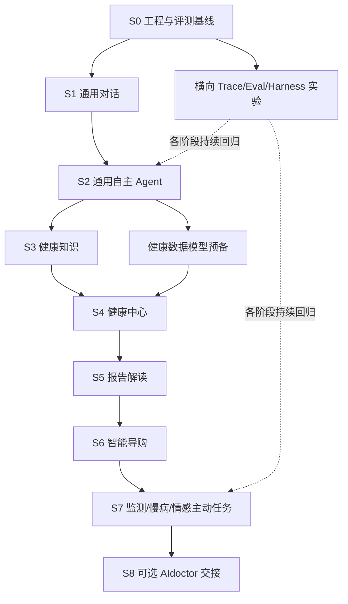

# HealthAgent — 06 分阶段实施与验收（详细设计 V4.0）

## V4.2 命名与追踪说明

统一使用语义名称标识组件、领域、实验和八大智能；开发阶段使用 S0–S8；正式测试案例使用 T-001 格式。规范见 `../README.md` 和 `../traceability.json`。

## 0. 文档定位与使用方式

### 0.1 本文件解决的问题

本文件把产品需求和技术架构翻译成开发计划，明确每个阶段：前提条件、实现范围、建议代码目录、接口与数据、最小端到端场景、功能和非功能验收、可量化指标、可提交证据、退出门槛以及未完成时的处理方式。它不是完整需求清单（详见 02），不是代码级 API 规范（详见 04/05），也不是医学知识文件。

### 0.2 项目交付原则

1. **纵向切片优先**：每个阶段从用户入口贯通到真实结果、持久化、Trace、自动化测试；不能只有模块空壳。
2. **模型真实运行优先**：契约单元测试不能代替至少一条使用实际模型服务的 E2E。允许把付费模型 E2E 列为显式手动门禁，但不得虚构通过。
3. **通用能力先行**：S1、S2 禁止依赖医疗业务，至少使用通用非医学任务证明 Agent 自主执行。
4. **最小基础设施**：复用 LangGraph、PostgreSQL、FastAPI 等成熟实现。未出现可靠性瓶颈不得自造 Scheduler、分布式协调和一整套 Runtime。
5. **需求追溯与可复现**：功能需求 ID → 测试 ID → 运行证据 → 阶段验收结果；所有关键测试都保存模型、提示词、数据和工具版本。
6. **安全与真实性**：医学与药品模块使用公开许可或合成数据；未经验证的模型结果须标注研究/演示性质；未经授权不写入健康事实或发送外部通知。
7. **项目可就业展示**：每个里程碑都提供可点击 Demo、可阅读的运行轨迹及失败案例，不仅提供架构图。

### 0.3 不做事项

不建设全病种医疗产品、不训练通用大模型、不重写 LangGraph Runtime、不把业务模块设计为固定的七个 Agent、不追求第一版生产医疗合规、不自称临床诊断系统。完整 Web 支付、真实患者接入、真实家属报警、临床治疗方案调整均不纳入个人演示版。

### 0.4 优先级和依赖定义

- **P0**：进入该阶段必须真实交付；失败禁止宣称阶段完成。
- **P1**：有明确价值，应在相应里程碑内完成；确需延期必须记录原因和风险。
- **P2/Research**：对照实验或后续扩展，不阻断核心作品完成。
- **Hard Gate**：未满足就不能进入依赖它的下游功能开发；可以并行进行不受影响的独立任务。
- **Evidence Gate**：必须有测试日志/数据或可运行演示佐证，不接受“代码看上去已实现”作为完成结论。

### 0.5 文档阶段索引

| 阶段 | 用户可见成果 | 主要 Agent 能力 | 领域化程度 | 里程碑 |
|---|---|---|---|---|
| S0 基线准备 | 一键启动开发环境、首个测试报告 | 追踪、评测基线 | 无 | M1 前置 |
| S1 通用对话 | 流式聊天、上下文连续 | Model Gateway、Understanding | 无 | M1 |
| S2 通用 Agent | 自主多工具任务、记忆、反馈重规划 | Agent Loop、Planning、Tools、Harness、Memory | 无 | M1 |
| S3 健康知识 | 可追溯健康科普问答 | Agentic RAG、证据治理 | 轻 | M2 |
| S4 健康中心 | 人体交互 + 指标趋势 + Agent 数据问答 | 数据工具、结构化 Context | 中 | M2 |
| S5 报告解读 | 导入、核验、对比报告 | Document AI、任务编排、审批 | 中 | M2 |
| S6 智能导购 | 健康设备比较、受限 OTC 信息支持 | 约束规划、MCP、工具权限 | 中 | M2 |
| S7 专业工具与情感支持 | 监测、计划调整、主动提醒、支持性陪伴 | Event-driven、Temporal Memory、Replanning | 深 | M3 |
| S8 AIdoctor 集成（可选） | 受控问诊转介和结果回传 | Handoff、跨系统授权 | 深 | M3 扩展 |
| 横向 R | Benchmark、Harness 消融、八大智能评测 | Eval/Observability | 全程 | M1–M3 |

> 阶段 S0 是实际工程前置，不改变用户最初确定的 S1–S8 功能路线。情感支持自 S2 开始做非临床对话表现，S7 才做长期主动互动。

---

## 1. 交付与质量门禁体系

### 1.1 四层质量验证

**L0 静态与单元测试**：类型检查、代码检查、格式、Schema、解析器与纯函数；不需要外部模型。  
**L1 集成测试**：测试 PostgreSQL、检索、模拟 MCP、任务持久化与 API；外部接口 mock 必须明确标注。  
**L2 真实模型端到端测试**：真实模型 + 真实内部工具 + 数据库 + API/页面；用受控合成数据，记录外部依赖版本与费用。  
**L3 鲁棒与 Benchmark**：多任务、重复运行、异常注入、消融和回归分析；不以单一演示成功冒充稳定性。

### 1.2 通用完成定义（Definition of Done）

功能项完成的必要条件：

- 与需求编号关联，可从页面或 API 发起；能走通非 mock 的业务路径。
- 输入/输出模式明确、错误码可解释、主体/任务身份可追溯。
- 成功、拒绝、空结果、超时、权限和重复请求按风险覆盖测试。
- L0、适用的 L1 通过；该功能首次涉及真实模型时 L2 有记录。
- 持久化行为具备可复核最终状态；只读行为具备来源与时间。
- 有 Trace ID、工具动作、模型配置和 Token/耗时数据；敏感内容脱敏。
- 文档和 Demo 与实际行为一致；没做的能力不能在 README 写成已实现。

### 1.3 CI 最小门禁

起步命令建议：`pytest -q`、`ruff check .`、`ruff format --check .`、`mypy agent services`、前端 `lint/typecheck/build`。引入 DB 后增加迁移检查和 Postgres 集成测试。真实模型测试因成本和网络波动可采用 CI 手动触发，但发布里程碑前必须真实运行并保存结果。

### 1.4 环境矩阵

| 环境 | 用途 | 依赖 | 必须具备 |
|---|---|---|---|
| Local dev | 日常开发 | Python、Node、Docker Compose | 一键启动、种子数据 |
| Test | 集成/失败注入 | 隔离 PostgreSQL、模拟工具 | 可重置数据、可复现 |
| E2E | 模型行为验证 | 真实 LLM、受控工具 | 可记录 token 和费用 |
| Demo | 招聘展示 | 最小服务编排、合成患者 | 安全默认、无真实私有数据 |

兼顾 Windows + WSL2：Python 代码可跨平台运行；包含容器和数据库的验收推荐在 WSL2/Docker 下统一。不能假定 Linux 专属文件系统语义在原生 Windows 有效。

### 1.5 证据目录规范

```text
artifacts/
  runs/<date>-<run_id>/manifest.json
  runs/<date>-<run_id>/trace_redacted.json
  runs/<date>-<run_id>/tool_results.json
  evals/<dataset_version>/<experiment_id>/metrics.json
  evals/<dataset_version>/<experiment_id>/failures.md
  demos/<scenario_id>/README.md
  releases/<milestone>/acceptance.md
```

`manifest` 至少记录：Git SHA、数据集哈希、测试配置、模型提供商及标识、Prompt 版本、工具清单版本、运行时间、测试数量、预算、是否执行真实调用。不要保存真实 API Key 或私人健康信息。

### 1.6 质量目标如何设置

**下面所有数值是个人作品的初始工程目标，不是外部行业标准，也不是已取得成果。** 未经过首轮基准测试前不要在简历里使用具体百分比。

| 维度 | S2 初始目标 | M2 目标 | 评价方式 |
|---|---|---|---|
| 核心任务完成率 | ≥75%（简单任务集） | ≥80%（锁定跨领域集合） | 业务状态自动判定 |
| 工具参数有效率 | ≥95% | ≥98% | Schema + 工具输入验证 |
| 未授权写操作 | 0 | 0 | 对抗场景硬门禁 |
| 中断后重复外部写入 | 0 | 0 | 重放与幂等测试 |
| 证据引用可追溯率 | 不适用 | 100%（声明使用资料时） | Source ID → 文档快照 |
| 明显虚构工具结果 | 0（指定对抗集） | 0 | 工具轨迹与回答比对 |

门槛必须与任务难度和样本数一同报告。达到目标但样本太少，只能称作阶段试验通过，不能声称通用可靠性。

---

## 2. 项目工作包与依赖总览

### 2.1 横向组件编号

| 代码工作包 | 内容 | 首次进入 | 主要依赖 |
|---|---|---|---|
| WP-BASE | 仓库、环境、CI、测试数据基线 | S0 | 无 |
| WP-MODEL | LLM Provider/Streaming/Tool Schema | S1 | BASE |
| WP-DIALOG | 会话、理解、交互与反馈 | S1 | MODEL |
| WP-AGENT | Agent Loop、规划、观察、终止 | S2 | DIALOG |
| WP-TOOLS | Tools、Registry、MCP、Permissions | S2 | AGENT |
| WP-CONTEXT | State、Context、Memory、Checkpoint | S2 | DIALOG/AGENT |
| WP-HARNESS | Context Budget、Skills、Workspace、预算 | S2 持续迭代 | TOOLS/CONTEXT |
| WP-RAG | 文档、索引、检索、证据 | S3 | TOOLS |
| WP-PROFILE | 健康数据 API、可视化、趋势 | S4 | CONTEXT/RAG |
| WP-REPORT | 解析、校验、报告对比 | S5 | PROFILE |
| WP-PRODUCT | 商品检索、比较、受控推荐 | S6 | TOOLS/RAG |
| WP-LONG | 监测/计划/事件/陪伴 | S7 | CONTEXT/PROFILE |
| WP-HANDOFF | 问诊系统交接接口 | S8 | POLICY/PROFILE |
| WP-EVAL | Trace、Benchmark、实验框架 | S0 全程 | BASE |

### 2.2 依赖路径



主交付顺序遵循用户确定路线；S4 的数据模式研究可与 S3 并行，但不提前开发完整健康 UI。S8 不阻止独立求职作品在 M3 发布。

### 2.3 阶段规模控制（建议，不是工期承诺）

每阶段只设 **1 个主功能工作包 + 1 个横向验证包**；一次交付原则上不超过 3 个必须联合变更的技术模块。发现更多需求时写入 Backlog，不在当前阶段不断扩大范围。优先关闭端到端纵向切片，再丰富覆盖。

---

## 3. S0 — 工程基础、数据隔离与评测基线

### 3.1 目标与退出定义

完成仓库骨架、开发环境、持续集成、运行日志、测试框架和零领域依赖的评测框架；不需要能回答医学问题。退出条件是一个新开发者能按 README 在干净环境运行 API、单元测试及一个确定性假任务。

### 3.2 开发项

1. 初始化单仓库：`apps/api`、`apps/web`、`agent/`、`domains/`、`services/`、`evals/`、`tests/`、`docs/`。
2. 创建 Python 项目依赖锁、前端包锁、`.env.example`、配置校验与密钥屏蔽。
3. 配置本地 PostgreSQL（pgvector 后续启用）、数据库迁移、独立测试 DB。
4. 建立 `/healthz`、`/readyz` 和结构化日志；生成 Request/Conversation/Task/Trace ID。
5. 建立 LLM 测试双层入口：Fake Provider（确定性）与 Real Provider（未配置时显式跳过）。
6. 建立数据集 `task.jsonl` 的 Schema：任务输入、测试角色、环境快照、期望最终状态、评分函数、风险等级。
7. 初始化 GitHub Actions 的静态/单元门禁；运行环境说明覆盖 Windows+WSL2。

### 3.3 建议代码交付

```text
apps/api/main.py
agent/config.py
agent/contracts/identity.py
evals/contracts.py
evals/runner.py
evals/datasets/smoke-v1.jsonl
tests/unit/test_contracts.py
tests/integration/test_healthz.py
compose.yml
.env.example
```

### 3.4 验收样例

- **S0-AC01**：干净容器环境执行 Compose，API、DB 启动，健康检查正确。
- **S0-AC02**：无模型密钥运行全部 L0/L1 不失败；真实模型测试被清楚标记为 skip。
- **S0-AC03**：错误配置、数据库不可用、请求超时有可定位日志，不打印密钥。
- **S0-AC04**：评测 Runner 运行 5 个确定性样例生成 `metrics.json` 和 `manifest.json`。

**明确不做**：任务队列集群、线上 SSO、长期记忆算法、多智能体。

---

## 4. S1 — 通用对话与目标理解

### 4.1 用户功能

用户可以创建会话、连续对话、看到流式回复、中止响应、切换模型配置、查看当前会话历史；对于需澄清的请求，系统能明确询问而不是凭空假设。

### 4.2 工作包

**S1-W1 Model Gateway**：统一消息、工具调用能力声明、温度/预算/Token 上限、超时、断流和供应商异常；适配至少一种真实 LLM，保留替换接口。禁止默默将调用失败伪装成成功。  
**S1-W2 Conversation API**：`POST /conversations`、`POST /conversations/{id}/messages`、`GET /conversations/{id}`、SSE 输出；消息持久化与用户隔离。  
**S1-W3 Understanding**：轻量结构化意图/目标提取，仅用于辅助计划与澄清，不以固定意图标签决定所有业务。  
**S1-W4 Web Chat**：消息列表、流式停止、失败重试标记、模型不可用提示。

### 4.3 最小数据契约

```python
class ChatRequest(BaseModel):
    conversation_id: str | None
    user_message: str
    client_request_id: str

class ChatEvent(BaseModel):
    type: Literal["message_delta", "message_done", "error", "usage"]
    conversation_id: str
    message_id: str
    payload: dict
```

最终接口按 04 模型细化；此处只是阶段验收所需最小边界。

### 4.4 风险与失败行为

SSE 客户端断线不应把半截回答当成完整历史；取消信号要使本次生成停止或进入可确认的取消状态。输入超长时返回可解释错误或压缩策略，不静默删掉关键用户约束。测试供应商超时、重复提交、不同用户读取同一会话。

### 4.5 实验与验收

- **S1-AC01**：真实模型连续五轮交流，后续问题能引用前面明确提供的非敏感事实。
- **S1-AC02**：SSE 可见增量事件、完成事件和使用量；主动停止不再追加内容。
- **S1-AC03**：用户 A 不能查询用户 B 的会话。
- **S1-AC04**：歧义请求给出澄清问题；不要求此时自动调用工具。
- **S1-AC05**：至少记录 10 条不同输入的真实运行日志，输出延迟及 Token 指标。

**S1 完成声明**：只能称为通用对话基础，不得称为具有自主工具执行能力的 Agent。

---

## 5. S2 — 通用 Agent 自主执行闭环（最高优先级）

### 5.1 退出目标

在没有医学领域代码的前提下，系统能够处理**未硬编码完整流程的多步任务**：自主选择工具、读取反馈、必要时澄清或重规划、产生可验证结果；跨会话恢复并在有副作用的动作前申请授权。

### 5.2 内部交付顺序

**S2-A 最小 Agent Loop**
- 在 LangGraph 之上实现 Model → Tool Proposal → Validation → Tool Execution → Observation → Model 的闭环。
- 明确终止原因：完成、需澄清、需审批、安全阻断、预算超限、工具不可用、用户取消。
- 记录每步模型决策、可见工具、参数验证结果、执行次数、耗时。
- 增加最大迭代次数、Token/费用预算、重复动作检测，避免死循环。

**S2-B 工具与 Skills**
- 注册至少 4 个通用工具，例如时间/日期读取、数学计算、模拟数据查询、生成并保存受控任务草案。工具必须有 JSON Schema/Pydantic 校验。
- 区分只读、草案写入、需要审批的持久操作；外部工具通过 MCP Client 接入一个隔离的演示 MCP Server。
- Skills 先用可版本化的指令+工具声明，不在 S2 搭建 Skills Marketplace。
- 不允许通过工具返回的文本直接提升权限或改写系统指令。

**S2-C 规划、任务状态和 Replanning**
- 简单任务允许直接 ReAct，多工具或长任务触发显式 TaskPlan。
- 计划状态支持 `pending/running/succeeded/failed/skipped/blocked`；目标变化后保留可证明有效的完成步骤。
- 工具失败按可重试/不可重试/业务冲突分类，允许模型重新规划，但须尊重权限。
- Observation 必须是执行返回的真实结果，不能由模型自行伪造。

**S2-D Memory/Context/Harness 基线**
- 会话记录、任务 Checkpoint、用户长期偏好分开存储。
- Context Builder 只装载必要信息，记录被选择的信息、摘要来源与 Token 预算。
- Memory Write Policy：只保留明确有跨会话价值的非敏感偏好，支持查看、修改、删除；不在此阶段保存医疗事实。
- Harness V0：Context Budget、Tool Exposure、Task Workspace、执行预算与结果材料，能通过 feature flag 打开/关闭实验能力。

**S2-E 审批、恢复与防护**
- 有副作用的动作先产生可审计 Proposal，等待用户确认；审批需绑定任务、用户、参数摘要和有效期。
- 使用 Checkpoint 恢复；对持久操作使用幂等键并核验最终状态，防止超时重试造成重复提交。
- 明确工具输出为低信任内容：即使输出要求改变政策，也不执行。

### 5.3 通用真实演示任务

**案例 GEN-01（多工具规划）**：用户请求读取两个模拟数据源、比较结果、计算差异、保存一份草案。工具顺序不是一条预先固定的业务链。  
**案例 GEN-02（数据更正）**：第一轮用户给出数值，第二轮纠正其中一项；Agent 应重算受影响步骤而非照搬过期结论。  
**案例 GEN-03（失败恢复）**：中途工具超时，重新调用或替代工具后生成符合事实的结果。  
**案例 GEN-04（审批）**：用户要求创建一个真实持久任务，系统暂停等批准，取消时无写入。  
**案例 GEN-05（跨会话）**：用户稍后返回继续未结束的任务，状态仍可恢复。

### 5.4 S2 核心门禁

| 编号 | 测试 | 通过依据 |
|---|---|---|
| S2-AC01 | 未预设顺序的 3 步多工具任务 | 真实工具轨迹 + 正确最终状态 |
| S2-AC02 | 工具 Schema 无效参数 | 调用前拒绝，记录参数校验原因 |
| S2-AC03 | 工具异常触发继续决策 | Trace 包含 Observation 与新 Action |
| S2-AC04 | 用户中途修改目标 | 受影响部分重算，未受影响步骤保留 |
| S2-AC05 | 审批拒绝 | 无持久副作用；任务可继续以只读方式服务 |
| S2-AC06 | 重复投递/断点恢复 | 一次写入、状态一致，具有幂等证据 |
| S2-AC07 | 工具输出注入 | 不执行来自低信任数据的越权指令 |
| S2-AC08 | 长期记忆更正与删除 | 修改后检索不再引用旧偏好，且保留审计信息中不得暴露已删内容 |
| S2-AC09 | MCP 工具连通与失败 | 成功调用并能应对协议或超时错误 |
| S2-AC10 | 基准评测 | ≥30 条锁定通用任务，给出成功率、工具错误率、Token 成本 |

### 5.5 与 Harness 专题的分界

S2 必做的是 Harness V0 基础功能，**不是证明复杂 Harness 一定优于简单 Agent**。关于上下文压缩、Skills 动态选择、子 Agent 的增益和代价，由 07 的 A/B 实验验证。任何实验结果为负的高级功能可关闭或回退，不因“前沿”强行保留。

### 5.6 M1 发布门槛

S1/S2 全部 P0 通过；真实模型演示至少 5 条、锁定任务集 ≥30 条；可以播放一条失败后重规划的轨迹；提交任务状态结果；README 不包含不存在的复杂医疗能力。M1 发布后才将核心精力转向领域扩展。

---

## 6. S3 — 健康知识科普与 Agentic RAG

### 6.1 范围

建立首个领域插件 Health Knowledge：公开授权健康教育材料，支持检索、重排、证据引用和证据不足时拒绝编造。系统定位健康科普，不执行个体化临床诊断。

### 6.2 工作包

1. `knowledge_ingest`：来源许可登记、文档版本、更新时间、正文清洗、切片与索引构建。
2. `retrieval`：关键词/BM25 与向量召回、候选融合、Reranker；支持过滤领域、语言、时间。
3. `knowledge_tools`：`search_health_knowledge`、`get_document_section`、`verify_citations`。
4. `agent_integration`：由主 Agent 决定是否检索、何时补充检索、是否因证据不足要求澄清。
5. `rag_eval`：问题→期望来源→证据充分性→答案支持度，不以 LLM 自评取代人工/规则验证。

### 6.3 最小知识集合

选定 3–5 个可公开复现的健康主题，使用许可明确的公开资料；建立 50–100 条经过人工抽样检查的评测问答。项目公开仓库不直接捆绑未经授权的医学原文。每条内容保留 `source_url/license/doc_version/retrieved_at`。

### 6.4 必须有的异常场景

资料相互冲突、无文档可支撑、文档过期、文档中出现指令注入、检索结果是商业宣传、用户索取个体诊断。知识库不会变成执行权限来源。

### 6.5 验收

- **S3-AC01**：主 Agent 自主决定是否检索，非相关闲聊不强制调用 RAG。
- **S3-AC02**：回答包含可解析到具体来源片段的引用；不存在伪造 URL 或文档 ID。
- **S3-AC03**：有缺失证据时表达不确定性，不强行给出医学结论。
- **S3-AC04**：混合检索与纯向量方案进行固定数据集 A/B，公开 Recall@k、MRR/nDCG（适用时）及成本差异。
- **S3-AC05**：向量库不可用或文档权限不符时降级/拒绝，保留证据。

> S3 技术亮点：RAG 不是“把文件放进向量库”，而是由 Agent 决策检索行为，并用可追溯证据验证输出。

---

## 7. S4 — 健康中心与可视化交互

### 7.1 交付形态

用户进入健康中心看到 2D 人体轮廓（可逐步升级 3D），选择身体部位或健康系统可查看相关指标、测量时间、变化趋势和数据缺失情况；对话 Agent 可以调用相同的数据接口进行查询和解释。

### 7.2 数据优先级

从 Synthea 合成 FHIR 数据和自建合成时间序列开始。首版覆盖个人档案、体重/BMI、血压、血糖或血脂中的有数据指标。禁止把缺失数据显示为“健康”。数据来源为其他虚拟用户时必须拒绝。

### 7.3 工作包

1. FHIR → 自有 `Patient/Observation/Condition` 最小映射，保留测量时间、录入时间、单位、来源和主体。
2. 数据访问工具：`get_health_profile`、`get_observations`、`summarize_health_trends`（确定性统计）。
3. Web：人体导航、指标卡片、时间范围、图表与数据出处。
4. Agent Context：按需检索相关指标，不能将全部健康档案无差别塞进 Prompt。
5. 指标与身体部位映射表：医学上无法直接映射的综合指标允许放在“全身/代谢”等中性分组。

### 7.4 数据治理与校验

标准化计量单位；区分测量与录入时间；处理异常缺失、重复上传、来源冲突；不使用模型自动推断并写入未经确认的事实。用户更正记录时保留版本历史、旧值不可继续进入活跃上下文。

### 7.5 验收

- **S4-AC01**：切换人体部位呈现一致的对应数据和测量时间。
- **S4-AC02**：Agent 查询与 UI 展示来自同一权威数据服务，不出现两个不一致的指标值。
- **S4-AC03**：跨用户请求不可读取其他虚拟患者数据。
- **S4-AC04**：缺失指标展示“无数据/无法判断”，不生成器官健康评分。
- **S4-AC05**：单位转换和时间排序由代码完成、可单测，数据更正后图表及回答一致更新。

---

## 8. S5 — 报告解读与文档工具链

### 8.1 范围控制

首版优先处理文本型 PDF 和结构化报告，再扩展图片扫描件。若图片需要 OCR/视觉模型抽取，所有数字必须显示置信和来源位置，低置信结果经用户确认后才可进入健康档案。

### 8.2 处理链路

`上传 → 类型与来源检查 → 解析 → 指标抽取 → 单位归一 → 异常/缺失检查 → 用户核对 → 写入或只读分析 → 跨报告比较 → 解释与引用`。

### 8.3 工作包

- 安全上传：文件大小、格式、恶意内容和隔离存储；严禁把报告文字当系统指令。
- 抽取结果：保留原始值、单位、参考范围、页码/文本坐标和解析模型版本。
- 结构化校验：不合理单位、不兼容检测方法、同名项目歧义、主体不一致。
- 对比工具：按可比性决定是否允许数值比较，不可比时明确说明。
- Agent：决定是否需要追问或请求用户确认，解释结果但不直接诊断。

### 8.4 验收

- **S5-AC01**：上传两个合成报告后生成含具体指标、时间与来源的比较结果。
- **S5-AC02**：错误主体报告被拒绝纳入健康档案。
- **S5-AC03**：含工具指令诱导文本的 PDF 不能触发非授权 Tool Call。
- **S5-AC04**：用户否决低置信抽取值后，数据库无该未确认健康事实。
- **S5-AC05**：报告解析错误可定位到源字段/页面并可重试。

S5 的首要工程成果是 **可信文档到结构化数据**，而非生成长篇听起来专业的报告。

---

## 9. S6 — 健康设备智能导购及受限 OTC 信息

### 9.1 交付范围

P0 先做血压计等健康设备的筛选、参数比较和推荐理由；P1 再做受限的非处方药信息查询与标签提示。禁止个人演示系统提供处方、擅自修改药物用量、自动付款或暗示商业结果优先于用户健康利益。

### 9.2 工作包

1. 商品目录：产品 ID、品类、特征、适用场景、来源、更新时点和演示价格（标明模拟）。
2. `search_products`、`compare_products`、`check_product_constraints`；导购 Agent 先获取必要约束再检索。
3. 如需外部检索，接入一个明确限制权限的 MCP Server，并做对比“原生 Tool”与“MCP Tool”的可用性。
4. OTC 信息工具使用权威标签与地区适用性，不允许基于广告直接得出剂量/安全结论。
5. 推荐展示：满足条件、不满足条件、信息缺失、数据更新时间、为什么没有推荐某项。

### 9.3 典型场景

预算受限/手臂围度要求/老年人易用性/设备有无验证证据/候选缺货/商品信息冲突。对于“给我买某个药”要求，先明确只是提供可核验的商品信息，并识别需专业咨询的情形。

### 9.4 验收

- **S6-AC01**：同一用户两套相反预算约束得到不同、可解释的候选结果。
- **S6-AC02**：没有产品证据时不编造认证、价格或库存。
- **S6-AC03**：用户取消/拒绝时不产生订单或外部副作用。
- **S6-AC04**：商品广告中隐藏提示词不能覆盖系统安全政策。
- **S6-AC05**：OTC 条目缺乏完整适用信息时系统停止具体产品判断并建议药师咨询。

---

## 10. S7 — 专业健康工具、长期管理与情感主动支持

### 10.1 目标和边界

这一阶段不是“把医疗规则放进 Prompt”，而是建立**有边界的领域服务**：独立实现确定性趋势/监测工具、部分研究性预测工具、慢病与生活方式计划服务，以及获得用户同意的情感支持与主动任务。医疗风险判断的适用人群、指标、方法和证据必须明确。

### 10.2 子包划分

**S7-A Monitoring/Events（P0）**：测量记录 → 数据质量检查 → 规则计算 → 事件发布 → 任务触发 → Agent 查询上下文 → 经政策允许的通知或建议。事件触发可使用轻量调度/队列，不由常驻 LLM 自行“无限思考”。

**S7-B Chronic/Lifestyle Plan（P0）**：结构化目标、周期任务、复盘结果和计划草案；Agent 自主协调数据和领域工具，但治疗方案修改只能引导专业确认。更新操作必须审批或可验证授权。

**S7-C Research Risk Tool（P1）**：基于公开数据的限定任务建立预测模型实验，返回研究性质分数、模型版本、输入覆盖、不确定性、适用人群与限制。不能把分数直接当临床个人患病概率。

**S7-D Wellbeing & Companion（P1）**：支持性对话、偏好记忆、用户指定的提醒/回顾频率、静默时段和随时退出；潜在危机事件按安全策略处理，不擅自通知家人或声称提供心理治疗。

**S7-E Temporal Memory & Replanning（P0）**：区分“历史事实/当前有效事实/未核实推断”，新指标变化时只修订受影响任务；评估记忆时效性而非机械增加记忆量。

### 10.3 关键接口（阶段层）

```text
evaluate_monitoring_rule(subject_id, metric_set, policy_version)
propose_lifestyle_plan(subject_id, goals, evidence_refs)
review_management_progress(plan_id, time_window)
analyze_research_risk(subject_id, dataset_scope, model_version)
create_opt_in_reminder(subject_id, schedule, channel, consent_id)
revoke_reminder(reminder_id, actor_id)
```

规范要求：输入权限、同意记录、数据窗口、算法/规则版本；输出状态、证据、失败理由和是否需要人工确认。不能让 LLM 修改工具内部的阈值常量。

### 10.4 重点 E2E

**LONG-01**：用户已设置每周回顾 → 新记录到达 → 触发确定性事件 → Agent 汇总差异 → 提议下一周非诊疗目标 → 用户确认后创建任务。  
**LONG-02**：历史记录错误更正 → 撤销受影响结论 → 保留其他可靠状态 → 重新生成摘要。  
**LONG-03**：用户取消主动问候 → 调度不再发送 → 审计中保留最少必要的取消记录。  
**LONG-04**：模型调用失败 → 监测规则仍可独立运行，任务保留可恢复状态。  
**LONG-05**：模拟危险症状或明显安全问题 → 优先执行受控安全响应，不让普通导购/科普任务抢占。

### 10.5 验收

- **S7-AC01**：监测任务由事件触发，非实时重复 LLM 轮询；事件幂等。
- **S7-AC02**：规则输出可复核、可回溯来源和版本。
- **S7-AC03**：用户修改计划目标后，Agent 展示局部重规划的保留/失效步骤。
- **S7-AC04**：跨会话引用的长期记忆可被用户查看、修正和删除。
- **S7-AC05**：取消提醒、免打扰、隐私限制由确定性策略强制执行。
- **S7-AC06**：研究性预测明确标注非临床验证，样本外/缺失输入拒绝给出貌似精确的诊断概率。
- **S7-AC07**：至少三类长期任务失败注入（重启、重复事件、工具故障）后数据保持一致。

---

## 11. S8 — AIdoctor 受控集成（非核心发布阻断项）

### 11.1 前置条件

AIdoctor 拥有独立可调用、经过测试的安全入口、身份边界和结构化结果协议；其未成熟或默认关闭的临床功能不得由 HealthAgent 绕过或直接调用。没有符合条件的服务时，S8 维持“未集成”状态，不以伪 API 演示冒充集成。

### 11.2 交接模式

`HealthAgent 提议转介 → 用户确认 → 最小必要事实清单 → AIdoctor 入站校验 → 专业服务自行决策 → 结构化回执 → HealthAgent 仅展示允许的结果`。

严格禁止向 AIdoctor 传入未经用户授权的长期记忆、让主 Agent 覆盖问诊安全决策、把不确定性描述成临床结论。

### 11.3 验收

- **S8-AC01**：转介有显式同意、主体绑定、目的和数据最小化。
- **S8-AC02**：专业服务拒绝或超时后，主 Agent 不伪造结果；可安全返回用户。
- **S8-AC03**：回传数据类型、来源与时间可核实；撤销权限后不可继续拉取。
- **S8-AC04**：两套系统版本不兼容时拒绝而不放宽约束。

---

## 12. 横向专项：Harness 的渐进实施与技术研究

### 12.1 研究目标

Harness 定义为**围绕 Agent Loop 的执行环境与能力编排组合**，而不是另一套 Runtime。重点研究上下文组织、Skills、工具暴露、任务工作空间、子任务委派及执行预算如何影响复杂任务成功率、成本和可靠性。具体方法见 07。

### 12.2 阶段落点

| Harness 能力 | 引入阶段 | 最小实现 | 实验阶段 |
|---|---|---|---|
| Context Budget | S2 | 消息选择/预算与截断记录 | S2/07-context-strategy |
| Task Workspace | S2 | 任务产物与步骤记录 | S2 |
| Skill Loading | S2 | 按任务读取版本化 Skill | S2/07-skill-loading |
| Tool Exposure | S2 | 权限过滤与任务相关工具列表 | S2/07-skill-loading |
| Planning Helper | S2 | 显式计划开关 | S2/07-planning-strategy |
| Recovery Policy | S2 | 执行观察、恢复及幂等 | S2/07-recovery-strategy |
| Subagent | S7 研究项 | 独立上下文的特定子任务 | 07-subagent-comparison |

### 12.3 实验设计纪律

同任务、同数据快照、同模型、尽量一致的 Token 上限与工具集合，对比 Baseline 与改进策略；每组至少重复执行并报告方差。记录正例、失败例、成本与回归问题。高级能力未获得明显收益时保留开关，不强行合入默认路径。

### 12.4 防止 Harness 失控

不得为 Harness 自造通用分布式事务、第二套模型协议、全面替代 LangGraph Checkpoint、完整 Web IDE 和沙箱云服务。若候选改进只增加抽象而无明确失败案例、性能指标或安全需求，延后实现。

---

## 13. 横向专项：八大智能与行为评测

八大智能不是八个 Agent、八个模型或八条 Workflow，而是产品中可观察的智能行为维度，具体技术与指标见 08。

| 智能维度 | 首次纳入 | 代表验收任务 | 主要证据 |
|---|---|---|---|
| 语义理解 | S1 | 模糊表达、实体与目标识别 | 澄清/目标提取正确性 |
| 上下文智能 | S1→S2 | 多轮约束与长对话压缩 | 约束保持率/事实一致性 |
| 关系连续性 | S2→S7 | 跨会话偏好延续、撤销记忆 | 记忆准确性/可删除性 |
| 情绪理解 | S2→S7 | 只倾听、不强行给建议 | 回应合宜性及安全性 |
| 目标与隐含需求推断 | S2 | 任务真实目标和缺失条件 | 澄清决策/目标正确率 |
| 对话策略 | S2 | 解释/询问/工具/审批选择 | 行为决策与费用 |
| 主动性 | S7 | 经同意的周期回顾及取消 | 触发正确性/无骚扰 |
| 自我约束 | S2 全程 | 越权/提示注入/风险分流 | 安全违规数 |

八维之间不是互相独立的精确心理学量表。避免简单把八项打分平均成“总体智能 95 分”。每项应独立报告测试集、成功定义和失败案例。

---

## 14. Benchmark 设计与规模规划

### 14.1 数据集版本

- `general-v1`：≥30 条，S2 起，覆盖工具、规划、异常、重规划和权限。
- `knowledge-v1`：50–100 条，S3，含证据、无答案与注入。
- `health-data-v1`：≥30 条，S4，含主体隔离、数据质量、时间与单位。
- `report-v1`：≥20 个多文档任务，S5，含解析错误、报告冲突。
- `products-v1`：≥20 条，S6，含约束变化和安全边界。
- `longitudinal-v1`：≥30 条，S7，含跨月历史变化、触发、重规划。

数量是**建议构造规模**；重点是封闭任务集和可验证最终状态。各数据集不可随意用真实私人医疗资料补齐。

### 14.2 任务格式示例

```json
{
  "task_id": "GEN-REPLAN-003",
  "dataset_version": "general-v1",
  "input": "先查询记录，再生成对比结果。注意后续用户会更正一项数据。",
  "fixture_id": "fixture-replan-003",
  "expected_final_state": {"corrected_value_used": true, "duplicate_write": false},
  "allowed_tools": ["read_record", "compare_values", "save_draft"],
  "forbidden_actions": ["send_external_notification"],
  "max_steps": 12
}
```

这里的 `expected_final_state` 是关键，防止只凭 LLM Judge 的语言印象判断任务成功。

### 14.3 指标定义

**Task Success Rate** = 正确最终业务状态的任务数 / 已执行的有效任务数。  
**Tool Call Validity** = 符合 Schema 且权限允许的调用数 / 全部发起的调用数。  
**Recovery Success** = 故障后最终正确完成数 / 可恢复故障任务总数。  
**Citation Support** = 经证据核对可支撑的核心事实断言数 / 抽样核查断言数。  
**Cost Per Successful Task** = 总模型调用成本 / 成功任务数；同时报告 P50/P95 延迟、Token 和失败次数。

必须区别“调用合法”和“选择正确工具”：前者只衡量 Schema/权限，后者需判断任务目标与工具语义是否吻合。

### 14.4 评测流程

1. 固定代码 SHA、数据快照、模型、Prompt 与工具版本。
2. 预注册预期指标、Baseline 和候选方案，防止只挑成功任务报告。
3. 先跑快速 Smoke，再跑锁定 Benchmark；高成本实验设置预算上限。
4. 对错误分类：理解、检索、参数、规划、上下文、工具、权限、恢复、外部数据。
5. 输出完整结果：样本数、平均/方差、成功率、置信区间（样本足够时）、成本、失败案例。
6. 将实验结论反推技术决策：保留、调整、回滚，而不是永远叠加组件。

---

## 15. 安全与数据边界的阶段门禁

### 15.1 所有阶段共用红线

- 不将模拟数据与真实患者资料混用；不复制公司的非公开临床路径、文档、源代码、数据库或商业数据。
- 健康事实与 Agent 推断分开；模型输出不可直接写入已核实数据。
- 对外文件、网页、RAG 检索、工具响应均按低信任内容处理；拒绝其中的权限提升指令。
- 未经用户具体授权不做外部通知、商品下单、数据库敏感修改。
- 模型不单独控制危机安全和医疗临床规则；危险提示要进入确定性安全处理或明确的人工转介。
- 不发布涉及私人医疗信息的 Trace；演示资源默认使用虚构身份和合成数据。

### 15.2 发布检查

| 类别 | 必查项目 | 失败后处置 |
|---|---|---|
| 数据 | 权限、来源、许可、隐私 | 拒绝发布相关内容 |
| Tool | 参数、越权、写操作授权 | 停用或只读降级 |
| Prompt | 注入、角色覆盖、敏感信息提取 | 添加隔离/拒绝测试 |
| 模型结果 | 无依据医学结论、虚构数值 | 修复或标注不可用 |
| 运行 | 断点恢复、重复副作用 | 禁止自动写入 |
| 用户体验 | 可撤销提醒、记忆可删 | 停用主动功能 |

---

## 16. 阶段交付矩阵：代码、数据、UI、证据

| 阶段 | 代码与接口交付 | UI/可见交付 | 数据/测试交付 | 必留证据 |
|---|---|---|---|---|
| S0 | API 骨架、CI、配置 | 状态页 | Smoke 数据 | CI log、manifest |
| S1 | Gateway、会话、SSE | Chat | 10+ 对话场景 | 真实模型 Trace |
| S2 | Graph、Registry、Harness V0、Memory | 工具轨迹、任务/审批 | general-v1 | 失败重规划/恢复录像 |
| S3 | RAG Pipeline 与 Tool | 引用视图 | knowledge-v1 | 检索和回答指标 |
| S4 | FHIR 导入、趋势 Tool | 人体交互、趋势 | synthetic health | UI/API 一致性报告 |
| S5 | Report Parser/Compare | 上传与核对 | 合成报告 | 抽取准确与来源证据 |
| S6 | Product Tools、MCP | 约束比较 | 商品种子目录 | 约束与越权测试 |
| S7 | Events、Monitoring、Plans、Wellbeing | 长期任务与订阅 | longitudinal-v1 | 触发/取消/恢复实测 |
| S8 | Handoff Adapter | 转介确认 | 模拟合法交接数据 | 身份/权限/失败验证 |

---

## 17. 开发执行流程与变更管理

### 17.1 每个阶段的固定循环

`选 1 个端到端用例 → 确定工具和数据契约 → 实现最短可运行路径 → L0/L1 → 真实模型 L2 → 异常与对抗测试 → Benchmark → 发布/回滚结论`。

### 17.2 提交策略

一个阶段可分 2–4 个有意义的 PR：核心实现、产品联动、评测/可靠性、收尾文档。只有必要时再拆，禁止把单个契约字段、设计复审和纯说明更新都扩成连续多轮独立 PR，除非存在真实安全或回归风险。

### 17.3 阶段退出记录模板

```markdown
# Stage Sx Acceptance
- Target version / Git SHA:
- Scope completed:
- Known exclusions:
- L0/L1 results:
- L2 real-model result:
- Benchmark dataset/version/sample size:
- Success, latency, cost:
- Security negative tests:
- Demo / trace links:
- Remaining known risks:
- Decision: PASS / PASS_WITH_LIMITATIONS / FAIL
```

`PASS_WITH_LIMITATIONS` 表示可以进入不依赖缺口的后续工作，**不能**写成已完整通过；阻断条件未满足不得进入依赖其功能的阶段。

### 17.4 范围变更触发条件

仅当新的招聘需求、实验结果、性能瓶颈或产品关键用例证明原方案不足时，调整技术选型。变更应简短记录：问题、证据、方案、替代、影响阶段及回退策略。任何“因为某技术新就要加入”都不构成单独的变更理由。

---

## 18. 求职交付与作品集验收

### 18.1 最终仓库最少呈现

1. 统一 Chat + 健康可视化 Demo（合成数据）。
2. 一段真实 Agent 跨多个工具完成任务的录屏与脱敏 Trace。
3. 一段执行失败后观察、重规划、正确恢复的轨迹。
4. 公开可复现的 Benchmark、数据格式、Baseline 与结果脚本。
5. 一个 Harness 对照实验报告，说明效果与成本的取舍。
6. 八大智能映射表、典型行为用例与真实失败分析。
7. 明确的医疗非临床声明、公开数据许可证清单和安全限制。

### 18.2 推荐三条简历演示主线

**Demo A — Agent 智能性**：未写死流程的通用任务，展示动态工具选择/反馈/重规划。  
**Demo B — 跨领域能力**：体检或健康档案查询 → 报告比对 → 证据检索 → 待确认的计划草案。  
**Demo C — 长期可靠性**：用户更正数据 → 记忆时效治理 → 任务局部重规划 → 故障恢复与审批。

### 18.3 项目成熟度表达规范

- `DESIGNED`：只完成方案/接口设计。
- `IMPLEMENTED`：代码与基础测试存在。
- `INTEGRATION_VERIFIED`：有真实依赖的集成验证。
- `E2E_VERIFIED`：有真实模型运行与业务结果证据。
- `BENCHMARKED`：锁定集合重复评测，公开结果与失败。
- `DEMO_READY`：可一键启动、展示、无非法数据或虚假能力。

不得因为 pytest 全绿直接宣称 Agent 已经能够真实完成复杂任务；不得把开发用 mock 结果描述成生产或真实临床效果。

---

## 19. 关键风险、对策和阶段停止条件

| 风险 | 早期信号 | 对策/停止条件 |
|---|---|---|
| Runtime 过度设计 | S2 多周只有类型/锁/状态合同 | 以 GEN-01 真实工具演示为硬门槛；停止抽象扩张 |
| 模型成本失控 | 单任务频繁循环、Token 无上限 | 步数/预算上限，缓存/对照评测 |
| 医学业务吞没 Agent 主线 | 大量疾病评分，通用任务不能做 | 暂停业务开发，修复主 Agent Loop |
| 数据许可不清 | 复制内部材料或受限医疗数据 | 隔离并移除，不发布 |
| Agent 虚假自主 | 全是硬编码路径 | 引入目标变化与工具故障对抗用例 |
| 记忆污染 | 模型猜测写为健康事实 | 来源/确认/时效/可删分层 |
| 工具不安全 | 外部文本触发越权写入 | 执行侧 policy gate 和审批 |
| 评测不可复现 | 模型/任务集经常更换 | 锁定集、记录版本、失败回放 |
| 前端投入过多 | 3D 人体效果好但核心执行弱 | 首版 2D，先 API/UI 数据一致 |
| 多 Agent 过早引入 | 协作比单 Agent 更慢更不稳 | 先 A/B 对照，收益不足不启用 |

---

## 20. 当前进入开发的第一批任务

在 S0 完成前，先确认当前代码仓库是否为空或已有可复用基础。如果没有新仓库，优先建最小结构；如果已有基础，首先对照 S0 清单审查，不要重新生成重复骨架。

**第一批可执行任务（建议合并为一个迭代）**：

- 初始化 Python/FastAPI、React、PostgreSQL Compose 和配置样例。
- 实现对话 API 与 SSE 骨架，Mock Provider 与 Real Provider 的统一契约。
- 实现最小 Evals Runner、任务 JSONL Schema 和 Trace Manifest。
- 写入 5 条 Smoke 用例及最小自动化门禁。
- 编写一次从空环境启动、执行测试到查看结果的 README。

**本批完成标志**：在全新环境中运行 API、检查数据库迁移、执行 5 条 Smoke，生成一份包含 SHA、测试结果和 Trace 的可复核报告。此时不宣称 Agent 完成，下一迭代进入 S1 真实模型对话。

---

## 附录 A：需求与验收映射约定

本项目沿用 02 的需求编号类别：G（通用会话）、A（Agent 决策）、M（记忆）、T（工具）、E（评测）、K（健康科普）、H（健康中心）、R（报告）、P（导购）、L（长期管理）、W（情感）、I（问诊集成）。具体功能编号以 02 文件为权威来源。本文件用 `Sx-ACnn` 定义阶段验收，测试用例需携带双向索引：`requirement_ids[]` 与 `acceptance_ids[]`。不得在此另建一套相互冲突的功能要求。

## 附录 B：推荐外部参考入口

以下资料是技术选型参考，版本应在实际实施时核验，不等于本项目已部署或已验证：

- [LangGraph](https://github.com/langchain-ai/langgraph)：状态化执行、持久化与中断恢复。
- [Deep Agents](https://github.com/langchain-ai/deepagents)：规划、上下文、Skills 和子任务 Harness 思路。
- [OpenAI Agents SDK](https://github.com/openai/openai-agents-python)：工具、Handoff、Guardrail 与 Trace 的精简抽象。
- [Model Context Protocol](https://modelcontextprotocol.io/)：外部工具和上下文标准化连接。
- [Langfuse](https://github.com/langfuse/langfuse)：Agent/LLM 可观测与评测。
- [Synthea](https://github.com/synthetichealth/synthea)：合成健康数据。
- [HL7 FHIR](https://hl7.org/fhir/)：健康资源语义与互操作参考。

## 附录 C：下一文档边界

- 07《Agent Harness 研究与实验设计》：具体 planning-strategy–subagent-comparison 假设、对照组、数据集与统计报告模板。
- 08《八大智能能力模型与评测》：八个维度的行为定义、测试集和成功/失败判定。
- 本文件不重复前述专题的全部算法细节，只定义其进入工程的阶段、预算和验收门槛。

**最终实施原则：先真实闭环，再增加能力；先验证效果，再承诺先进性。**
