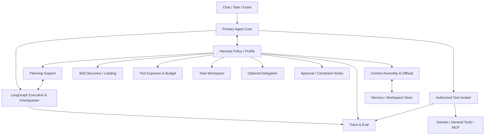
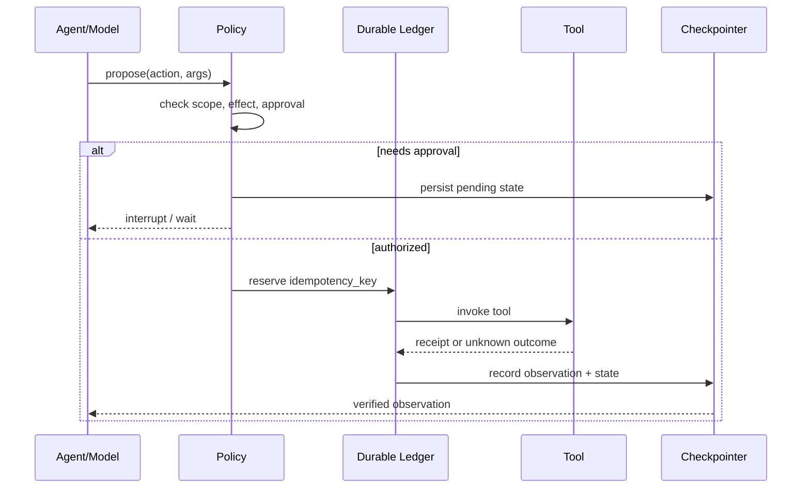

# HealthAgent — 07 Agent Harness 研究与实验设计（详细设计 V4.0）

## V4.2 命名与追踪说明

统一使用语义名称标识组件、领域、实验和八大智能；开发阶段使用 S0–S8；正式测试案例使用 T-001 格式。规范见 `../README.md` 和 `../traceability.json`。

## 0. 执行摘要与研究边界

### 0.1 核心研究问题

同一个语言模型、同一套工具和相同用户任务，在以下配置下为什么会出现截然不同的任务表现？

- 裸模型加简洁 Tool Calling 循环；
- 增加显式规划和进度管理；
- 增加任务工作区、上下文卸载和摘要；
- 根据上下文动态选择 Skills 和工具说明；
- 引入子 Agent 隔离子任务；
- 启用预算控制、审批、中断与恢复。

本专题把这组**围绕模型决策循环提供执行支撑的策略与能力组合**称为 Agent Harness。这里的 Harness 是本项目研究性定义，**不是**某个已经标准化的统一协议，也不等于任一具体框架。

### 0.2 不属于本专题的内容

| 对象 | 谁负责 | Harness 的责任边界 |
|---|---|---|
| 模型的基础推理能力 | Model Gateway / 模型提供方 | 控制呈现给模型的材料、工具、预算，不修改模型权重 |
| 图执行、检查点存储、interrupt 基础 | LangGraph Runtime | 接入并验证正确使用，避免重写状态运行器 |
| 业务数据正确性 | 领域服务、数据库 | 不用模型总结替代可信事实 |
| 医学规则与风险阈值 | 经验证的领域计算与策略 | 不生成或更新医学阈值 |
| MCP 协议与外部 API | Tool Adapters | 动态暴露、上下文、权限控制和返回值治理 |
| Agent 的主任务与业务目标 | Agent Core / Planning | 提供计划支撑、工作区和任务组织；不另建第二个主 Agent |
| 定量研究与实验报告 | evals/harness | 保存试验配置与真实运行证据 |

### 0.3 成功判据

不以“集成 Deep Agents”“加入五个 middleware”“有了多 Agent”作为完成标准，而以以下证据评判：

1. 同一个任务集上可重复运行至少两种 Harness 配置；
2. 能量化任务完成、工具错误、Token/时间成本以及恢复行为；
3. 能保留失败轨迹并解释失败属于模型、工具、上下文还是 Harness 决策；
4. 能指出至少一种 Harness 技术**不适用或负收益**的条件；
5. 能在 S2 通用场景和后期健康业务场景复用相同实验接口。

### 0.4 优先级

- **P0**：可配置 Harness Profile、基础 Trace、规划对照、Context Budget、工具暴露过滤、预算上限。
- **P1**：工作区/上下文卸载、Skills 渐进加载、恢复对照、跨会话长任务。
- **P2/研究**：Subagent、并行委派、代码执行沙箱、多模型策略、Harness 自动调参。

---

## 1. 研究背景与来源核验

### 1.1 来自成熟生态的设计依据

| 来源 | 能够直接确认的能力 | 本项目应当借鉴 | 不应直接推断 |
|---|---|---|---|
| [LangChain Deep Agents 官方介绍](https://www.langchain.com/deep-agents) | Planning、上下文管理、子 Agent 协作、持久工作区 | 将 Harness 看作 Agent Loop 外侧的可组合能力 | 集成后任务表现必然提高 |
| [Deep Agents 官方文档](https://github.com/langchain-ai/docs/blob/main/src/oss/deepagents/overview.mdx) | 可选规划、文件系统、Skills、工具、子 Agent、摘要、人工干预 | 研究可选能力及其组合的代价 | 所有能力必须默认开启 |
| [LangGraph Persistence](https://langchain-ai.github.io/langgraph/concepts/durable_execution/) | Checkpointer 与 Store 的不同用途 | 分离线程执行状态与跨线程长期数据 | Checkpoint 可以取代业务事务 |
| [LangGraph Interrupts](https://langchain-ai.github.io/langgraph/concepts/breakpoints/) | 暂停、持久化、外部恢复 | 人工审批和外部输入需要持续存在的执行上下文 | interrupt 能自动保证外部副作用恰好一次 |
| [Anthropic Engineering](https://www.anthropic.com/engineering) | 官方文章涉及 Context Engineering、长任务 Harness、Agent Evals | 参考上下文与长任务实验问题定义 | 单一厂商案例等同普遍最佳实践 |

**版本限制**：以上文档属于持续更新的项目资料。实施时应锁定具体 Python 包版本、文档检索日期和依赖快照。尤其 Deep Agents 的配置与默认启用功能可能随版本变化；例如其文档已经明确说明规划工具是可选项，不能沿用旧版默认行为假设。

### 1.2 本项目的技术主张与待证伪假设

| 假设 | 预计受益任务 | 可能反例 |
|---|---|---|
| 显式规划能改善多步骤依赖任务 | 多工具、长任务、用户变更目标 | 简单任务被规划开销拖慢 |
| 上下文卸载能减少污染与成本 | 长工具输出、多文档检索 | 压缩丢失关键事实 |
| 动态技能与工具暴露能减少误选 | 工具多且描述相近 | 筛选器漏掉必要工具 |
| 子 Agent 能隔离大量中间上下文 | 独立长子任务、并行研究 | 协作成本与结果整合超过收益 |
| 恢复策略改善中断任务 | 审批等待、外部任务失败 | 非幂等操作重复执行 |

每个主张都要通过实验检验；不能因为某项技术看起来“先进”就设为默认。

---

## 2. Harness 在整体架构中的位置



### 2.1 四类接口

1. **Before-Model**：组装最小足够上下文、挑选可见工具、加载相关技能、施加预算约束。
2. **After-Model**：校验模型动作建议和结构输出，区分规划更新、工具提案、澄清与最终响应。
3. **Before/After-Tool**：权限与副作用检查、参数约束、结果裁剪与可信度标签、观察写入。
4. **On-Checkpoint / Resume**：保存策略决定及其版本，恢复时重新校验权限、工具 Schema 和外部事实。

### 2.2 不采用两套相互竞争的规划器

Agent Core 保持唯一任务目标与执行状态。Harness 的 `PlanningSupport` 是提供计划列表工具、计划格式约束、计划压缩和进度摘要的辅助服务，**不是**另一套能绕过 Agent Core 的自主调度器。相同地，Subagent 是可选的委派机制，不是固定业务模块。

### 2.3 最小实现路径

- S1：仅模型与会话历史，保留事件埋点。
- S2：自定义轻量 Harness Profile + LangGraph 执行与 Checkpoint，构建真实通用任务基线。
- S3–S5：加入 Context Offload、RAG 证据裁剪、Skills 选择。
- S6–S7：针对外部副作用、长期任务、复杂子任务做恢复和委派实验。

---

## 3. Harness Profile：所有实验的配置单元

### 3.1 设计要求

配置必须是**可序列化、可散列、可回溯、可重放**的，不能靠手工修改 Prompt 后口头说明“这个版本更好”。Profile 只记录策略，不包含真实密钥或用户健康数据。

```yaml
profile_id: h-context-budget-v1
profile_version: 1
model_ref: provider/model-and-version
planning:
  mode: optional_todo       # off | optional_todo | required_for_complex
  complexity_threshold: 3
context:
  strategy: selective       # full | window | summarize | selective
  budget_tokens: 12000
  tool_output_cap_tokens: 1500
  evidence_preservation: true
skills:
  mode: progressive         # none | all | progressive
  max_candidates: 4
tools:
  exposure: filtered        # all | filtered
  max_visible: 12
  deny_unknown_effects: true
delegation:
  enabled: false
  max_children: 0
limits:
  max_model_turns: 18
  max_tool_calls: 20
  max_wall_seconds: 180
  max_estimated_cost_usd: 0.75
approval:
  writes_require_explicit_approval: true
```

上面数值是**实验初值而非验证后的最佳实践**；它们必须支持按任务分类覆盖。预算触发时优先保存状态并返回可解释的部分结果，而不是隐藏失败或无限追加调用。

### 3.2 配置对比的稳定因素

| 必须保持一致 | 允许成为自变量 |
|---|---|
| 模型版本、温度、工具实现与数据快照 | 规划策略 |
| 同一批任务与判分代码 | Context 策略 |
| 同一知识库快照 | Skills 暴露策略 |
| 同一每任务最大成本或明确另列成本曲线 | Delegation on/off |
| 同一评测环境、机器资源（尽可能） | 工作区策略 |

不得把 **更强模型 + 更长上下文 + 更高预算** 的效果全部归功于 Harness。

### 3.3 组合爆炸的处理

先单因素消融；只有单因素收益明确时才做两两交互试验。所有组合用 Profile ID 表示，禁止人工维护无法复现的口头配置。

---

## 4. 研究模块 H-CTX：Context Engineering

### 4.1 问题定义

Agent 的上下文不等于完整聊天记录。一次决策可能需要：用户当前目标、约束、计划摘要、相关工具结果、检索证据、用户偏好以及必要的执行历史。简单拼接容易造成 Token 浪费、关键事实淹没、污染与指令混淆。

### 4.2 上下文数据分区

| 分区 | 内容 | 保留原则 |
|---|---|---|
| Instruction | 系统指令、工具边界、Policy | 受控、不可被检索资料覆盖 |
| Goal | 当前用户目标、约束、确认项 | 高优先级、版本化 |
| Task | 当前计划、步骤状态、可继续位置 | 保存精简且完整的执行事实 |
| Evidence | 引用来源、数据快照、可验证观察 | 按当前问题检索；保留原始出处 |
| Memory | 用户允许保存的偏好与约定 | 作用域隔离、有效期和删除机制 |
| Tool Catalog | 当前授权且可能相关的工具说明 | 不必一次暴露所有工具 |
| Workspace Index | 产物路径、摘要、版本与校验信息 | 大结果存储于上下文外 |

### 4.3 Context Assembly 参考算法

```text
Input: run, goal, thread_state, user_scope, authorized_tools, profile
1. 加载不可覆盖的系统和安全策略
2. 加载最新 goal + 已确认约束 + 任务进度
3. 从业务服务读取经过授权的必要事实引用
4. 对长期记忆做作用域、时间与相关性过滤
5. 根据当前候选动作选择工具与 Skills 说明
6. 召回所需工作区片段和检索证据
7. 预算分配：保留安全、目标、必要原始证据；裁剪重复或低相关内容
8. 对各段附加来源与可信级别，不把工具文本当成指令
9. 输出 ContextBundle + 选择/裁剪解释 + 版本指纹
```

**底线**：涉及身份、数据所有权、药品禁忌、关键时间或单位的原始信息，不允许只留含糊摘要代替核查依据。

### 4.4 策略备选

- `full_history`：保留全部历史至模型限制，作为对照组；
- `sliding_window`：仅最近 N 轮 + 必要系统信息；
- `summary_plus_recent`：历史摘要 + 最近 N 轮；
- `selective_evidence`：目标/任务状态 + 相关记忆、证据、工具结果片段；
- `workspace_offload`：长输出存放工作区，模型只见元数据与按需读取接口。

### 4.5 压缩与外置的安全条件

- 摘要标记 `derived_from`，不得覆盖原始数据；
- 保留可追溯的 source ID 和不可篡改的数据版本；
- 若截断使关键证据缺失，必须以 `insufficient_context` 失败或重新读取；
- 不能将用户隐私在跨用户共享缓存中复用；
- 工具文本和检索结果中的类似“忽略系统指令”内容一律视为不可信数据。

### 4.6 对照实验 context-strategy

- **context-strategy-A** 全历史；**context-strategy-B** 固定窗口；**context-strategy-C** 摘要+近期；**context-strategy-D** 选择性检索+工作区卸载。
- 主要指标：任务成功率、关键事实遗失率、证据引用正确率、上下文 Token、端到端成本。
- 特殊测试：旧偏好被新偏好覆盖、相同指标不同日期、跨用户数据污染、超长工具返回、总结遗漏药品禁忌。
- 预期不是 D 在所有任务绝对最好，而是得到随上下文长度与任务依赖性变化的收益曲线。

---

## 5. 研究模块 H-PLAN：Planning & Progress Tracking

### 5.1 区分三个概念

- **Model reasoning**：模型内部如何形成决策，系统无法假设能访问完整推理过程。
- **Task plan**：可查看、可修订的显式执行步骤、依赖和验证条件。
- **Progress tracker**：步骤当前状态与观察事实，不一定需要大模型生成复杂计划。

### 5.2 触发显式计划的条件

推荐从简单规则开始：任务存在三个以上相互依赖步骤、多工具并用、用户要求产物、存在审批等待或预计跨会话时，为模型开放 `write_todos`/计划工具。简单百科问答不强制生成计划。

### 5.3 计划最小契约

```json
{
  "goal_id": "g-001",
  "plan_revision": 2,
  "steps": [
    {"step_id":"s1", "intent":"load_data", "requires":[], "done_when":"facts_verified"},
    {"step_id":"s2", "intent":"analyze", "requires":["s1"], "done_when":"analysis_grounded"},
    {"step_id":"s3", "intent":"deliver", "requires":["s2"], "done_when":"user_result_delivered"}
  ],
  "constraints": ["no_external_write_without_approval"]
}
```

计划由模型提议并由应用验证；不要求事前列出每个未来工具调用。任务变化时必须记录 revision、废弃步骤和保留的有效结果。

### 5.4 局部重规划规则

1. 工具失败：判断是否可重试、替代、澄清或终止；
2. 数据更正：追踪依赖旧数据的步骤并标记失效；
3. 目标变化：比较新旧 Goal 的约束，保留仍有效成果；
4. 外部操作已提交：不能靠改计划撤销客观副作用，须走显式补偿流程；
5. 不确定时先向用户澄清而非推测授权。

### 5.5 对照实验 planning-strategy

- planning-strategy-A：ReAct、无显式计划；
- planning-strategy-B：ReAct + 自愿维护 Todo；
- planning-strategy-C：复杂任务触发计划 + 进度监测；
- planning-strategy-D：加入失效依赖识别与局部重规划。

用无依赖任务、线性依赖任务、动态事实更正任务分别分层统计；同时计入计划开销和额外模型轮次。对于变更任务，判分不仅看最终回答，还要检查是否重复工具操作、是否用过期证据和是否保留有效步骤。

---

## 6. 研究模块 H-SKILL：Skills 与能力按需装载

### 6.1 Skill 与 Tool 的不同

Tool 是可执行操作与参数 Schema；Skill 是解决某类任务的说明、顺序建议、注意事项与工具组合。Skill 不能自行授予权限，也不能绕过 Tool Invoker。

### 6.2 Skill Manifest 草案

```yaml
id: report-comparison
version: 1.0.0
description: Compare structured reports across dates and cite evidence.
triggers:
  intents: [compare_reports, explain_change]
requires_tools: [get_reports, compare_structured_values]
requires_data_scopes: [own_reports_read]
instructions_path: skills/report-comparison/SKILL.md
outputs: [comparison_summary, evidence_refs]
risks: [incorrect_unit, wrong_subject, outdated_reference_range]
```

Manifest 只是一种项目可控的数据规范，不能把它误称为所有 Skills 框架共享的官方标准。

### 6.3 三级加载

1. **Discovery**：在有限的元数据列表中筛选候选 Skill；
2. **Instruction Load**：决定使用时读取具体 Skill 指令；
3. **Resources Load**：只有需要时读取模板、示例或知识片段。

### 6.4 防止 Tool/Skill 过载

- 同类工具描述应具备明确差异和使用条件；
- 筛选后的候选工具必须重新进行执行时鉴权；
- 候选置信度低时允许请求工具目录检索，而不是强行选择；
- 当必要工具被过滤掉时记录 `catalog_false_negative`；
- 版本变化后旧计划调用工具要先做兼容性校验。

### 6.5 对照实验 skill-loading

| 组 | 工具/Skill 暴露 | 关注问题 |
|---|---|---|
| skill-loading-A | 所有工具和说明全部展示 | 作为高 Token 开销基线 |
| skill-loading-B | 规则分类缩小工具集 | 便宜、简单，但可能漏选 |
| skill-loading-C | 动态检索候选 Tool + 按需 Skill | 准确性与召回的平衡 |
| skill-loading-D | skill-loading-C + 分层补充说明 | 面对歧义和复杂任务是否更稳定 |

指标：工具首次选择正确率、所需工具召回、无关工具调用率、权限阻断率、说明 Token、完成率；不要只统计工具调用次数。

---

## 7. 研究模块 H-WS：Task Workspace 与上下文卸载

### 7.1 为什么要工作区

长任务会产生报告解析结果、搜索页面、对照表和中间产物。全部塞进上下文既贵也容易污染决策。工作区作为可校验、可限制的产物存储，让模型按需读取摘要和片段。

### 7.2 Workspace 数据契约

```text
WorkspaceArtifact:
  artifact_id
  tenant_id / user_scope / task_id
  kind                    # raw_tool_output | evidence | draft | final
  storage_ref
  content_sha256
  size_bytes
  created_at / expires_at
  source_tool / source_version
  confidentiality_class
  allowed_readers
  derived_from[]
```

目录与权限必须按任务和用户隔离。对通用任务可先使用受控本地目录，健康数据正式接入后优先通过授权对象存储或加密数据库访问。工作区中的 `read_artifact` 也是一个授权工具，不是对文件系统的无约束访问。

### 7.3 读写行为

- 大工具结果先写入工作区，模型收到索引/摘要/引用；
- 需要判断关键事实时按行或范围读取原始产物；
- 引用的版本和来源不可因摘要更新丢失；
- 清理需符合用户删除与任务留存策略；
- 工作区不得成为偷偷持久化敏感健康推断的旁路。

### 7.4 context-strategy 扩展实验

在同一长任务下比较全文嵌入和工作区索引读取。对 10k、30k、60k 输入 Token 规模进行分桶（根据模型上下文限制调整），报告 Token 消耗、证据遗漏和检索重试次数。长文本生成必须使用合法授权数据。

---

## 8. 研究模块 H-DELEGATE：Subagent 与协作

### 8.1 默认不开启的理由

对于一个人开发的系统，子 Agent 会增加提示词、轨迹、预算、状态与错误传播复杂度。只有当子任务足够独立、需要上下文隔离或者并行确实节省总耗时时才启用。

### 8.2 委派适用条件

- 子任务可用清晰输入/输出约束描述；
- 子任务工具权限可以缩小，不扩大；
- 父 Agent 无需查看全部中间步骤即可验证结果；
- 独立失败不应破坏父任务的已提交数据；
- 总预算包含父子所有模型和工具调用。

### 8.3 子任务协议

```json
{
  "delegation_id":"dg-1",
  "parent_run_id":"r-1",
  "objective":"Collect and summarize permitted public evidence",
  "inputs":{"question":"...","evidence_scope":["doc-A","doc-B"]},
  "allowed_tools":["search_knowledge","read_evidence"],
  "max_model_turns":6,
  "max_wall_seconds":50,
  "expected_output_schema":"EvidenceSummaryV1"
}
```

子 Agent 结果需要父 Agent 验证来源和任务相关性。禁止把子 Agent 的自然语言总结直接作为新的可信健康事实。

### 8.4 并发与取消

支持每个子任务独立超时、取消、Trace 关联；并发上限从 2 开始实验。父任务结束或用户撤销时，未完成子任务必须取消或显式隔离其迟到结果。写操作默认禁止委派，除非有专门设计和验证的授权链。

### 8.5 subagent-comparison 对照实验

- subagent-comparison-A：单 Agent 顺序完成；
- subagent-comparison-B：单 Agent + 工作区卸载；
- subagent-comparison-C：单 Agent 委派一个专门研究子 Agent；
- subagent-comparison-D：并发处理两个独立只读子任务。

任务包括真正独立与高度耦合两组。指标包含：成功率、端到端延迟、总 Token、子 Agent 冗余、父子冲突率、Trace 可解释性。**预先允许结论是“不采用 Subagent”。**

---

## 9. 研究模块 H-BUDGET：预算、动作限制与退出策略

### 9.1 预算分类

| 限制 | 作用 | 超限后的动作 |
|---|---|---|
| Model turns | 防循环调用 | 退出并解释未完成项 |
| Tool calls | 防无效重复执行 | 暂停/降级/请求确认 |
| Cost estimate | 控制个人项目成本 | 输出部分结果及预估限制 |
| Wall time | 控制长任务等待 | 保存任务状态并中断 |
| Context tokens | 防上下文溢出 | 检索/摘要/裁剪或失败 |
| Delegation depth | 防递归子 Agent | 拒绝新增委派 |
| Side-effect quota | 防重复外部写入 | 强制审批和幂等核验 |

### 9.2 统一失败语义

必须区分 `BUDGET_EXHAUSTED`、`TOOL_PERMISSION_DENIED`、`TOOL_TIMEOUT`、`MISSING_REQUIRED_EVIDENCE`、`APPROVAL_REQUIRED`、`EXTERNAL_EFFECT_UNKNOWN`、`UNSAFE_REQUEST`。不能统一吞掉后让 Agent 捏造成功响应。

### 9.3 预算实验

固定模型与任务，测试不同模型轮次上限、上下文预算和成本限制产生的完成率—成本曲线。报告成功任务平均成本、全任务平均成本和 P95 延迟，不只报道最低平均成本。

---

## 10. 研究模块 H-RECOVERY：Checkpoint、审批与副作用恢复

### 10.1 Checkpoint 的边界

LangGraph Checkpointer 可以保持线程状态、支持中断后恢复，但它**不自动等同于**外部 API/数据库操作的 exactly-once 语义；一个模型动作从“提出”到“执行”再到“提交”必须经过明确的业务权威边界。

### 10.2 工具副作用分级

- `READ_ONLY`：无外部可见副作用，可安全重试但注意成本和速率限制；
- `INTERNAL_DRAFT_WRITE`：仅创建草案，可依据任务权限授权；
- `USER_VISIBLE_WRITE`：创建提醒、修改个人计划，需要显式确认或预授权策略；
- `EXTERNAL_EFFECT`：支付、消息发送等，首版默认禁用。

### 10.3 持久执行流程



这里的 Ledger 可以在个人项目里以 PostgreSQL 表实现，不需要单独部署复杂事务协调器。恢复时若状态为 `UNKNOWN`，先查询外部资源或对账接口，禁止直接盲重试。

### 10.4 recovery-strategy 对照实验

- recovery-strategy-A：无 Checkpoint 的进程内任务；
- recovery-strategy-B：Checkpoint + 重新恢复；
- recovery-strategy-C：Checkpoint + 幂等记录 + 外部结果核对；
- recovery-strategy-D：recovery-strategy-C + 用户审批 interrupt/resume。

故障注入点：工具调用前、工具调用后响应前、Checkpoint 持久化前、审批等待、审批过期、重复回调、恢复时工具版本变化。

判分应包含：已提交状态正确、外部副作用次数、恢复耗时、错误重复执行率、未经授权写入次数；不能用“对话最终返回了成功文字”替代判分。

---

## 11. 模块间的状态与契约草案

### 11.1 核心数据结构

```python
from dataclasses import dataclass, field
from typing import Literal

@dataclass(frozen=True)
class HarnessProfileRef:
    profile_id: str
    profile_version: int
    profile_hash: str

@dataclass(frozen=True)
class ContextSegment:
    segment_id: str
    kind: Literal["instruction", "goal", "task", "evidence", "memory", "tool"]
    source_ref: str | None
    trust_level: Literal["system", "trusted_fact", "untrusted_external"]
    token_estimate: int
    content_ref: str

@dataclass
class HarnessDecision:
    run_id: str
    profile: HarnessProfileRef
    visible_tool_ids: list[str] = field(default_factory=list)
    loaded_skill_ids: list[str] = field(default_factory=list)
    context_segment_ids: list[str] = field(default_factory=list)
    planning_mode: str = "off"
    delegation_enabled: bool = False
    reasons: list[str] = field(default_factory=list)
```

这些是研究接口草案；S2 工程实现应与 04 中的 `GoalSpec`、`TaskPlan`、`ToolProposal` 等对象合并映射，而非重复建模两份业务状态。

### 11.2 必须持久记录的决策

- `run_id`、`task_id`、`thread_id` 与用户/租户作用域；
- 模型版本、Prompt/工具注册表版本、Profile Hash；
- 哪些工具和 Skill 被暴露或过滤及原因；
- 上下文片段来源与裁剪事件；
- 计划增量变更及其触发观察；
- 工具调用、权限结果、输出摘要与副作用回执；
- 审批等待/恢复、预算触发和终止原因。

敏感原始内容不得直接写入普通 Trace；采用摘要、脱敏和受控证据引用。

---

## 12. 可实现的代码组织与组件接口

```text
agent/
  harness/
    profiles.py           # 校验、散列、加载 Harness Profile
    context_builder.py    # 来源隔离与 token allocation
    context_offload.py    # 输出工作区与按需读取
    planning_support.py   # 可选计划工具和步骤跟踪
    skill_selector.py     # Skill 检索与按需载入
    tool_exposure.py      # 授权范围内的工具候选筛选
    workspace.py          # 受限产物存储
    budget.py             # token / cost / turns / calls limits
    delegation.py         # optional subagent
    events.py             # HarnessDecision / BudgetEvent
  core/                   # 按 04 文档唯一 Agent Core 实现
  tools/                  # 独立 Tool Registry / Authorized Invoker
  memory/                 # 用户记忆，不混同 workspace

evals/
  harness/
    profiles/
    tasks/
    fixtures/
    runners/
    graders/
    reports/
```

### 12.1 关键接口

```python
class HarnessStrategy:
    def prepare_turn(self, run_context, profile): ...
    def validate_proposal(self, proposal, run_context): ...
    def process_observation(self, tool_result, run_context): ...
    def on_resume(self, checkpoint, profile): ...

class SkillSelector:
    def candidates(self, goal, authorized_scopes, registry): ...
    def load(self, skill_id, version, actor): ...

class BudgetManager:
    def admit(self, estimated_cost, planned_action): ...
    def record(self, model_usage, tool_usage): ...
```

不要求每个接口都是独立服务；S2 优先作为同一个 FastAPI 应用内的 Python 模块实现。对实时结果要么从实际 Token usage 获取，要么标明是估算；估算不得冒充账单实测。

---

## 13. Benchmark 设计与数据集

### 13.1 两级评测体系

**Level A：通用、与医疗无关的 Harness 任务。** 先在 S2 实现，证明能力没有依赖具体领域。示例：多文件事实汇总、跨工具日期比较、目标更改、工具超时、审批中的任务恢复。

**Level B：健康场景的 Harness 应用任务。** S3–S7 增量加入合成数据，不要求模型自主做医疗计算。示例：不同日期的体检数据比较、用户更正健康事实、缺少证据的知识问答、跨会话跟踪目标。

### 13.2 首版数据分布（研究计划，不是现成数据）

| 测试桶 | 任务数建议 | 关键扰动 |
|---|---:|---|
| 简短单工具任务 | 20 | 同义表达、工具别名 |
| 多步依赖与动态规划 | 30 | 中途改目标、数据版本变化 |
| 长上下文与检索 | 30 | 长工具输出、无关段落、冲突事实 |
| Skill/Tool 路由 | 25 | 相似工具、不可用工具、Schema 版本 |
| 任务恢复与审批 | 25 | 宕机、超时、重复回调 |
| 委派与并行 | 20 | 独立/耦合子任务、迟到结果 |
| 安全与权限 | 20 | 注入、越权、跨主体访问 |
| **合计** | **170** | 后续可扩展 |

保留约 20% 的最终测试集不参与 Prompt/Profile 调优；同一模板的变体必须按模板家族分组切分，避免泄漏。

### 13.3 每个任务 Fixture 的必备字段

```yaml
task_id: HCTX-003
family_id: longitudinal-fact-correction
category: long_context
input: "Compare the current measurements with last month."
initial_state_ref: fixtures/user-17-state.json
available_toolset: [get_measurements, read_artifact]
scenario_script: fixtures/HCTX-003-events.json
expected_effects: []
expected_facts_ref: fixtures/HCTX-003-ground-truth.json
forbidden_actions: [read_other_user, write_clinical_fact]
grader: structured_state_and_evidence_v1
max_budget_usd: 0.75
```

Fixture 内应存合成数据与确定的正确答案；任务失败必须能够复现工具回包和用户补充事件。

### 13.4 判分优先级

1. **确定性结果判分**：数据库快照、工具执行回执、目标条件、权限、状态一致性；
2. **证据判分**：输出引用是否支持结论、引用版本是否正确；
3. **路径判分**：是否发生无关调用、循环、重复写入或越权尝试；
4. **LLM-as-Judge（可选）**：仅评价解释清晰度等难以规则化的维度，需抽样人工校验；不得由它独立宣布工具执行成功。

### 13.5 主要指标定义

| 指标 | 明确口径 |
|---|---|
| Task Success Rate | 正确最终状态且必要条件满足的任务 / 全部任务 |
| Safety Violation Rate | 实际违反禁止动作或数据边界的任务 / 全部任务 |
| Tool Selection Accuracy | 首次/全部工具选择中符合任务预期的比例，分开报告 |
| Required Tool Recall | 需要的工具在候选列表出现的任务 / 需要该工具的任务 |
| Recovery Success Rate | 故障注入后状态、结果和副作用均正确恢复的任务 / 故障任务 |
| Evidence Faithfulness | 引用确实支持输出事实的断言比例 |
| Cost per Successful Task | 总成本 / 成功任务数量；同时报告全任务平均成本 |
| P50/P95 Latency | 从请求提交到终态的时间；审批等待时间单独列示 |
| Context Loss Rate | 由裁剪/摘要导致必要事实缺失的任务比例 |

安全失败不能被高质量语言输出抵消。模型拒绝高风险操作也需要检查它是否允许安全的替代路径。

---

## 14. 实验实施顺序与判定方法

### 14.1 实验批次

| 批次 | 阶段 | 内容 | 必须产出 |
|---|---|---|---|
| E0 | S1/S2 | Run Manifest、Trace、任务 Fixture、最简单 ReAct 基线 | 可复现基线报告 |
| E1 | S2 | planning-strategy 规划、skill-loading 基础工具筛选、预算上限 | 规划与工具策略效果表 |
| E2 | S3–S5 | context-strategy Context、Skills、Workspace、检索任务 | 上下文长度—效果—成本曲线 |
| E3 | S6–S7 | recovery-strategy 中断恢复、外部写操作审批与回执 | 副作用正确性与恢复矩阵 |
| E4 | S7 可选 | subagent-comparison 单/多 Agent、并行子任务 | 是否引入子 Agent 的量化决策 |

### 14.2 重复运行

初步探索每任务至少 3 次不同随机种子或独立采样；正式报告建议至少 5 次，并给出分桶结果及置信区间。模型服务端不能完全控制随机性时，应明确写出服务端变异性和采样参数。上述次数是项目建议值，可根据预算调整，但不能只展示一条成功轨迹。

### 14.3 实验对照及统计要求

- 成功率展示成功数/总数及区间估计；
- 成本与耗时用分布统计（均值、P50、P95），同时记录失败任务成本；
- 成对任务对比优于两个不重叠随机集合比较；
- 报告绝对差和相对差，不只报告百分比提升；
- 不把探索性调参的结果当成未见测试集表现；
- 若样本不足或波动大，结论应写“证据不足”，不写“显著领先”。

### 14.4 实验运行清单

```json
{
  "experiment_id":"context-strategy-selective-v1",
  "git_sha":"<commit>",
  "dataset_version":"harness-tasks-2026-01",
  "profile_id":"h-context-budget-v1",
  "profile_hash":"<sha256>",
  "model_id":"<provider-model-version>",
  "prompt_hash":"<sha256>",
  "tool_registry_hash":"<sha256>",
  "knowledge_snapshot":"<snapshot-id>",
  "seed":42,
  "run_timestamp_utc":"<timestamp>",
  "cost_basis":"provider_reported_or_estimated"
}
```

### 14.5 失败归因标签

使用固定的 `MODEL_DECISION`、`TOOL_UNAVAILABLE`、`BAD_TOOL_SCHEMA`、`TOOL_EXECUTION`、`CONTEXT_OMISSION`、`MEMORY_STALE`、`PLAN_INVALIDATION`、`UNAUTHORIZED_ACTION`、`CHECKPOINT_RECOVERY`、`BENCHMARK_ORACLE` 等标签。允许多因归类，但主要原因必须由证据支持。

---

## 15. 威胁模型与安全实验

### 15.1 重点攻击面

- 外部网页/文档通过 Prompt Injection 伪装系统指令；
- 工具返回内容试图修改权限或引导访问其他用户；
- Skill 文件被恶意篡改；
- 子 Agent 承袭了不该拥有的写入权限；
- 工作区跨任务读取、文件路径穿越；
- 审批状态被伪造、重放或过期复用；
- 历史记忆中嵌入虚假健康事实。

### 15.2 最低控制

- 外部内容统一标注不可信来源，不能升级为系统指令；
- 工具访问时重新鉴权，不以“已展示该工具”为授权依据；
- 所有写操作具备数据范围和效果类型；
- 高风险写入必须确认，研究演示禁用真实外部支付与临床修改；
- Skills 和 Prompt 使用版本及可信来源校验；
- 子 Agent 只继承显式允许的最小权限；
- Trace 与实验数据脱敏，优先使用合成用户。

### 15.3 安全验收门槛

本地模拟的禁止动作 **实际执行数必须为 0**。如果模型曾提出但被 Policy 阻断，分别记录 `unsafe_proposal` 与 `blocked_effect`，不能算成真正发生的越权副作用；二者都值得改善，但严重程度不同。

---

## 16. 性能与资源预算

### 16.1 个人开发者约束

- 先使用单进程服务 + PostgreSQL + 本地或 API 模型；
- 内部工具不为了展示 MCP 而全部远程化；
- 无需 Kubernetes、Kafka、分布式任务引擎；
- 真实外部模型费用设每月上限，超限自动停止实验；
- 任务中断后必须明确显示状态，不能后台悄悄反复调用。

### 16.2 实验成本粗算方法

```text
estimated_total_cost
  = Σ(model_input_tokens * input_unit_price)
  + Σ(model_output_tokens * output_unit_price)
  + Σ(tool_api_cost)
  + storage_and_compute_estimate
```

价格必须取实验执行日期的实际提供商报价并留存快照；不能在设计文件里把未知市场价格固定成事实。

---

## 17. S2 最小可交付版本（明确开发边界）

### 17.1 S2 应实现什么

1. `HarnessProfile` 读取、校验、散列；
2. `prepare_turn()`：必要上下文+授权工具集合；
3. 可选轻量 Todo/Plan 辅助；
4. Tool Invoker 统一授权与效果类型；
5. BudgetManager：模型轮次与工具调用上限；
6. LangGraph Checkpointer；
7. Trace：Profile/Model/Tool/State 的可审计信息；
8. 30–50 条非医学任务基线，至少一条真实模型 E2E；
9. planning-strategy 与 skill-loading 的初版成对对照实验。

### 17.2 S2 暂不实现什么

- 不做通用容器沙箱执行；
- 不做子 Agent 动态并行编排；
- 不做医学专项 RAG 或病种算法；
- 不做跨机器分布式恢复；
- 不做自动生成/自动安装外部未知 Skills；
- 不训练 Harness Policy 模型。

### 17.3 关键退出门禁

| 门禁 | 通过条件 | 失败时处理 |
|---|---|---|
| Functional | 可完成多工具真实任务，含澄清与终止 | 修 Agent Core 或工具契约 |
| Safety | 禁止动作实际执行为 0 | 阻断下一阶段 |
| Reproducibility | 相同 Fixture + Profile 可重复跑并生成 Run Manifest | 修实验基础设施 |
| Evidence | 至少给出一次成功、一次失败的真实 Trace | 不宣称 Demo Ready |
| Comparative | planning-strategy/skill-loading 有实际对照数据，允许无收益结论 | 不写“优化提升” |
| Scope | 不复制 LangGraph Runtime，不引入医学依赖 | 架构回收 |

---

## 18. 研究结论模板与简历证据

### 18.1 实验报告模板

```markdown
# Experiment context-strategy — Selective Context
- Hypothesis:
- Dataset and held-out split:
- Model / Tool / Profile versions:
- Baseline configuration:
- Treatment configuration:
- Task success (count / total):
- Evidence correctness:
- Input/output tokens and total cost:
- P50/P95 latency:
- Failure examples with trace IDs:
- Confounders / limitations:
- Decision: adopt / reject / conditional adoption
```

### 18.2 项目 README 展示方式

推荐用一张 Harness Profile 对比表、一组成功/失败 Trace 截图和一个复现命令代替抽象宣传。仅当实测支持时，才能写“引入 X 后提升了任务成功率 Y 个百分点”。

### 18.3 可以在面试中解释的技术取舍

- 为什么不把全部对话和全部工具都放进上下文？
- 为什么显式计划不应该对简单问答默认启用？
- 为什么 Skills 选择不等于工具执行授权？
- 为什么 LangGraph Checkpoint 不能单独保障外部副作用恰好一次？
- 什么时候单 Agent 比多 Agent 更好？
- 如果摘要使医学原始指标缺失，怎样检测和恢复？
- 如何区分模型错误、工具错误和 Harness 配置错误？

---

## 19. 与其他设计文件的追溯矩阵

| 本专题 | 对应技术文件 | 对应研发阶段 | 最终证据 |
|---|---|---|---|
| Profile / Budget | 04 Core、06 实施 | S2 | Profile Hash、Budget Trace |
| Planning planning-strategy | 04 Planning | S2 / S7 | 计划与 Replanning 对照 |
| Context context-strategy | 04 Context、05 Knowledge | S3–S5 | 长上下文曲线、事实遗漏 |
| Skills / Tools skill-loading | 04 Tool、05 Domain | S2–S6 | 工具召回、误选率 |
| Workspace | 03 状态、04 Memory | S3–S5 | 产物索引与权限测试 |
| Recovery recovery-strategy | 04 Persistence、06 验收 | S2 / S6–S7 | 故障注入与业务回执 |
| Subagent subagent-comparison | 04 Delegation | S7 可选 | 成对任务收益/成本报告 |
| 八大智能 | 08 能力模型 | S1–S8 | 行为维度评分与交叉分析 |

---

## 20. 技术参考与持续核验清单

1. [LangChain Deep Agents](https://www.langchain.com/deep-agents) — Harness 定位与核心能力。
2. [Deep Agents 官方概览](https://github.com/langchain-ai/docs/blob/main/src/oss/deepagents/overview.mdx) — 工具、工作区、Skills、Subagent、规划的可选配置。
3. [LangGraph Durable Execution / Persistence](https://langchain-ai.github.io/langgraph/concepts/durable_execution/) — Checkpoint 与 Store 的职责。
4. [LangGraph Interrupts](https://langchain-ai.github.io/langgraph/concepts/breakpoints/) — 人工干预、挂起与恢复。
5. [Anthropic Engineering](https://www.anthropic.com/engineering) — Context Engineering、长任务 Harness 和 Agent 评测的工程研究。
6. [Deep Agents Subagents](https://github.com/langchain-ai/docs/blob/main/src/oss/deepagents/subagents.mdx) — 子 Agent 作用域与隔离模式。
7. [Deep Agents Reference](https://reference.langchain.com/python/deepagents/graph/create_deep_agent) — 编码前核对依赖版本和参数契约。

### 编码前必做的版本核验

- 锁定 `langgraph`、`langchain`、`deepagents` 版本并记录 lockfile；
- 验证配置字段是否仍存在、默认是否改变；
- 检查子 Agent 默认暴露、Skills 继承、权限和任务规划的实际行为；
- 检查 Checkpointer、Store、Interrupt 的恢复语义；
- 真实运行一组最小兼容性探针，不能只依据网上示例猜测 API。

---

## 21. 完成定义与未解决事项

### 本设计文档完成（DESIGNED）

- 已给出 Harness 的边界、组件、接口草案、实验矩阵、基准和门禁；
- 已与 03、04、05、06 分工；
- 已区分 P0/P1/P2 和个人开发者成本；
- 尚未形成实际代码与实验结果。

### 后续完成层级

- **IMPLEMENTED**：代码、配置、Fixture、Runner 已存在且能执行；
- **E2E_VERIFIED**：至少真实模型 + 真实工具调用环境下完成规定场景；
- **BENCHMARKED**：成对对照、统计与失败归因完成；
- **DEMO_READY**：公开可复现路径、脱敏 Trace 和结果报告齐全。

### 待通过实测裁决而非继续开会争论的问题

1. 规划是否需要默认启用？由 planning-strategy 判断。
2. 全量上下文和选择性上下文在短任务的成本差异有多大？由 context-strategy 判断。
3. Tool Registry 规模多大后动态工具筛选开始有收益？由 skill-loading 判断。
4. Checkpoint + 幂等对账能否可靠处理所有模拟故障？由 recovery-strategy 判断。
5. 什么时候值得采用 Subagent？由 subagent-comparison 判断。

**总结**：本专题的交付成果不应是一份“我们支持 Harness”的清单，而是**能对 Agent 行为、成功率、成本及安全性做可解释对照的工程实验体系**。医学领域提供长期状态和高约束任务，但通用 Harness 本身必须能够先在非医疗场景独立成立。
