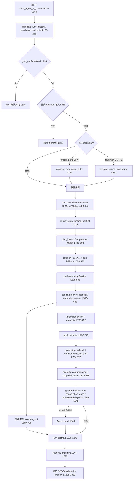

# HealthAgent Primary Routing Convergence — main 只读架构审计

审计基线：`main@41d91a3ae3fceeaa6f5401313f7471285b8cd86f`；日期：2026-11-03。

范围：`apps/api/main.py` 正式对话入口及直接可观察的调用关系；不涉及代码修改、分支创建或主链行为改变。

## 1. 当前决策调用图（精确到主入口调用点）

说明：这是源代码控制流概览，不代表每一条请求必经所有节点。多个节点被 `result is None`、开关、checkpoint、pending/clarification、注入测试策略等守卫跳过。Host 终结可在多处发生；图中统一并入 Turn 最终化。影子路径发生在 durable finalization 之后，不授权执行。

## 2. 旧调用逐项处置矩阵

| 调用点（main.py） | 当前性质 | Unified 目标处理 | 迁移条件 |
|---|---|---|---|
| 294–308 goal_confirmation | Host 显式确认 | 保留独立可信控制入口 | 版本与 pending 绑定，不能由模型伪造 |
| 311–326 admit_explicit_ordinary_calculation | 显式操作 Host 围栏 | 保留，纳入单次准入结果 | 拒绝后不得转入计划/AgentLoop |
| 339 propose_new_plan_route | 新计划语义提案 | 合并 Primary | 与已保存计划、普通请求共享相同枚举与证据合同 |
| 371 propose_saved_plan_route | 已保存计划语义提案 | 合并 Primary | 保留可信 preturn 捕获与引用校验 |
| 396 review_plan_cancellation | 独立取消意图模型 | Unified 退役 | CANCEL 从 Primary 得出，Host 仍校验取消权限 |
| 428 explicit_step_binding_conflict | 用户请求与步骤引用冲突 | 保留确定性约束检查 | 不承担意图分类 |
| 460 propose_first_route | 独立 FIRST 提案 | Unified 退役/合并 Primary | 不允许双重路由提案 |
| 481/495/789 review_plan_intent | 旧计划意图模型和回退 | Unified 零调用 | 提案无效时 fail closed/澄清，不回退第二分类器 |
| 515 review_plan_revision | 意图与参数混合模型 | 拆分：意图退役、绑定保留 | 参数解析不允许改写 Primary route_kind |
| 531 check_plan_edit_intent | 第二修改意图判断 | Unified 零调用 | 模糊修改请求澄清，不当作 ordinary 执行 |
| 575 UnderstandingService | 通用目标理解模型 | 与 Primary 合并语义所有权 | 不允许在 M5 提案后再独立裁决同一轮意图 |
| 600 classify_pending_reply | 独立澄清回复分类 | 并入 Primary | pending 原始请求绑定与有效期保留 |
| 621 review_pending_reference_lookup | 补参数场景意图模型 | Unified 退役独立分类 | Primary 指定工具目的，Host 校验已有 pending 来源 |
| 640 review_unsupported_capability | 不支持能力语义复核 | 从执行主路由移除 | 工具注册表确定性约束；模糊能力请求澄清 |
| 653 review_read_only_clarification | 另一轮 read-only 分类 | 并入 Primary | 不能以二次模型扩大工具权限 |
| 687–726 direct execute_tool | 澄清后直接工具执行 | 共享执行治理入口 | 明确审批、幂等、审计、失败与重放边界 |
| 738 decide_execution_policy_detail | 执行政策分类模型 | 改为基于提案+可信状态的 Host 策略 | 禁止改变意图种类或扩大权限 |
| 744 reconcile_execution_policy | 第二执行政策语义模型 | Unified 退役 | 政策冲突拒绝/澄清，不靠第二裁决者 |
| 804 review_plan_creation_reference | 计划创建引用模型 | 并入提案的证据字段 | Host 验证原始消息中的引用跨度 |
| 819 review_missing_plan_reference | 是否指向计划的语义模型 | 并入 Primary；Host 确定计划存在性 | 不能把普通读操作误判为缺失计划 |
| 825/898 resolve_plan_admission | 确定性计划准入 | 保留并整合 Host Admission | 单一审计记录与 deny reason |
| 884/969 review_plan_execution_authorization | 计划执行二次意图模型 | Unified 退役语义裁决 | Host 仅查来源、Scope、策略、状态 |
| 908 review_plan_execution_scope | 执行范围模型 | 提案一次给出，Host 验证/收窄 | scope 不明须拒绝或澄清 |
| 992 admit_guarded_plan_execution | Host 准入 | 必须保留 | CAS/claim/step 范围不变 |
| 1007 explicit_saved_plan_cancellation | 阻止取消误落入通用 Loop | 保留为纯拒绝围栏或吸纳准入 | 不得重新决定另一种意图 |
| 1021 explicit_deferred_plan_request | 计划延后执行防误入 | 保留只拒绝的确定性检查 | 不得改写 Primary |
| 1030–1045 unresolved dispatch guard | 恢复安全 | 必须保留 | 结果不明时禁止二次副作用 |
| 1048 AgentLoop | 真正工具执行 | 保留 | 必须接收唯一 Host Admission 结果 |
| 1269 evaluate_shadow | 事后诊断 | 保留可选 | trace-only、不能授权 |
| 1308 evaluate_admission_shadow | 事后诊断 | 保留可选 | trace-only、不能授权 |

## 3. 已证实与未证实

**代码直接证实**：Unified 在条件满足时先运行 M5 提案，但随后仍可能执行 `UnderstandingService`、修订模型、执行策略模型和部分授权/范围模型；未覆盖/回退路径可调用 `review_plan_intent`。因此“Unified 全部请求只有一个主语义裁决者”的目标尚不成立。

**代码直接证实**：旧模型分类器与安全性 Host 断言混杂；保留 Host 原子性/权限/绑定/拒绝是必要的。影子观察发生在 Turn 最终化后，不影响本轮。

**仍需运行验证**：每个真实请求的模型调用次数、哪些分类器被调用、不同类型的分布、耗时；静态调用点数量不能代替实际计数。本次没有执行模型或完整运行时探针。

## 4. 重要安全与实现提醒

- 不得把所有早返回理解为补丁；可信的取消确认、明确拒绝、引用冲突、崩溃恢复要求可直接终结。
- 主语义“唯一”不等于全回合只有一次模型 API 调用。结构化同一提案内部允许受限重试，AgentLoop 后续自主推理仍独立。
- 目标收敛须覆盖 ordinary、plan control、pending reply、respond、clarify 以及明确的未知/拒绝状态；模型无效不得重新触发旧分类器。
- `evals/s25_04_unified_physical.py` 的 10/10 证明若干业务场景通过，不证明所有 Unified 语义旧路径零调用。